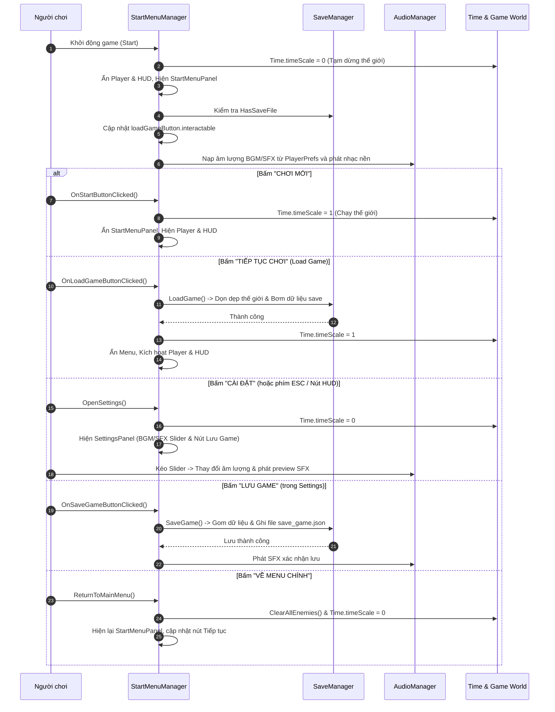
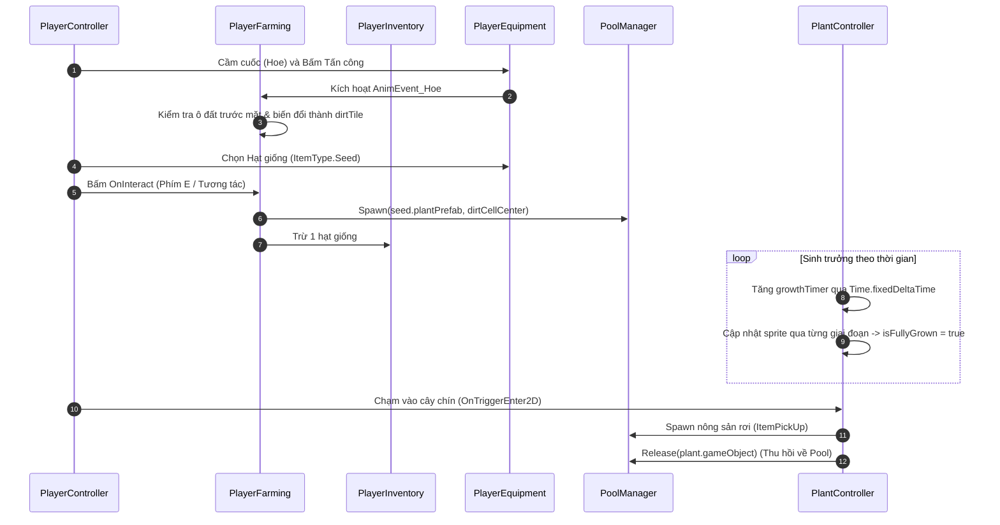
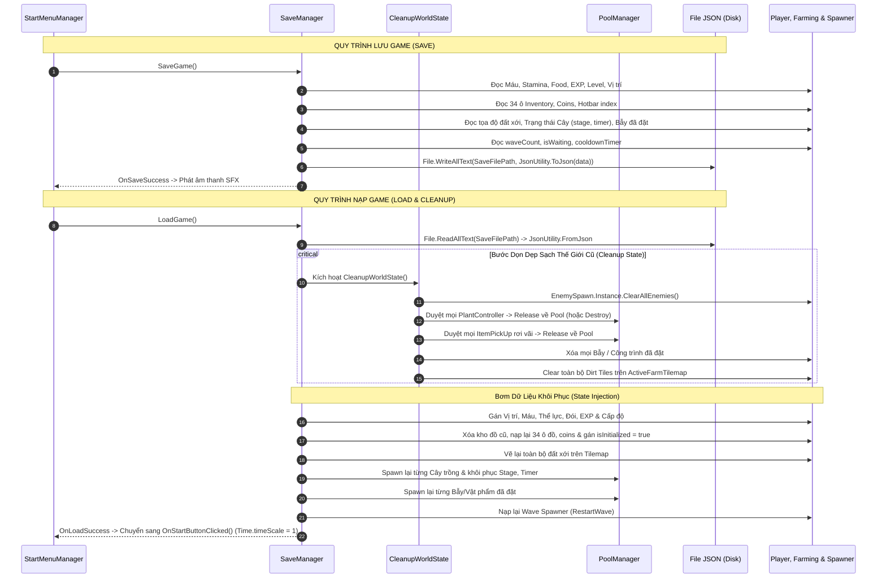

# FarmSurvive (Knight Game) - Complete Project Context & Architecture

Tài liệu này tổng hợp toàn diện kiến trúc, thiết kế kỹ thuật, cấu trúc phân hệ, các luồng hoạt động chính (workflows) và **toàn bộ source code cốt lõi** hiện có của dự án **FarmSurvive (Knight Game)** nhằm phục vụ AI assistant và lập trình viên nắm bắt toàn diện hệ thống mà không cần tốn thời gian rà soát từng file.

---

## 1. Thông tin tổng quan dự án

- **Tên dự án**: FarmSurvive (Tên nội bộ: Knight Game)
- **Thể loại**: Action RPG 2D kết hợp Farming (Nông nghiệp), Survival (Sinh tồn/Đói/Kinh nghiệm), Xây dựng/Đặt bẫy & Thủ thành trước đợt quái vô tận (Top-down 2D).
- **Engine**: Unity 6 (Universal Render Pipeline - URP 2D).
- **Hệ thống Input**: Unity New Input System (`com.unity.inputsystem`).
- **Thư mục script chính**: `Assets/Script/` (và các file Editor trong `Assets/Editor/`).
- **Mục tiêu & Tính năng cốt lõi**:
  - **Di chuyển & Thể lực**: Đi bộ, chạy nước rút tiêu hao thể lực (`PlayerStamina`), tự hồi phục khi dừng hoặc đi bộ, hỗ trợ lật sprite (`Flip`) và lưu hướng nhìn chuẩn hóa (`LastInputX`, `LastInputY`).
  - **Sinh tồn & Dinh dưỡng (`PlayerFood`)**: Quản lý thanh thức ăn (100 đơn vị). Tự động tụt đói theo chu kỳ thời gian thực (`decayInterval`), cơ chế ăn thức ăn hồi phục đói và máu khi đói kiệt sức.
  - **Cấp độ & Kinh nghiệm (`PlayerExperience`)**: Quản lý Level và EXP (`IExpReceivable`). Tự động nhân hệ số kinh nghiệm khi thăng cấp (`expGrowthMultiplier`), nhận kinh nghiệm khi diệt quái hoặc thu hoạch nông sản.
  - **Kinh tế & Tiền tệ (`Coins`)**: Tích hợp tiền vàng trực tiếp vào `PlayerInventory`. Hỗ trợ bán nông sản (`SellItemAtSlot`) tính giá bán linh hoạt, nhặt coin từ quái rụng.
  - **Kiến trúc Tách rời Giao diện (`PlayerHUD`)**: Độc lập lắng nghe sự kiện C# `Action<float, float>` (`OnHealthChanged`, `OnStaminaChanged`, `OnFoodChanged`, `OnExpChanged`, `OnLevelChanged`), tự động cập nhật thanh fill và text TextMeshPro mà không can thiệp vào logic thực thể.
  - **Hệ thống Nông nghiệp (`PlayerFarming` & `PlantController`)**:
    - Cuốc xới đất (`dirtTile`) trên khu vực cho phép (`FarmableArea.ActiveFarmTilemap`), đồng bộ với Animation Event `AnimEvent_Hoe`.
    - Khai thác tài nguyên & Đào đá (`ResourceNode` / `ResourceType.Rock`): Tích hợp trực tiếp Animation Event `AnimEvent_Mine`, nhận diện Cúp (`ItemData.isPickaxe`), quét hitbox theo hướng nhìn và gây sát thương phá hủy đá rụng khoáng sản qua `BaseDrop`, phản hồi âm thanh `mineRockClip`.
    - Gieo hạt giống (`ItemType.Seed` + `plantPrefab`) trực tiếp xuống ô đất tơi xốp qua phím tương tác `OnInteract`, sinh cây qua `PoolManager`.
    - Cây sinh trưởng qua nhiều giai đoạn theo thời gian (`PlanData.growthStageSprites`), chuyển đổi sprite tự động và tự reset trạng thái trong `OnEnable()`.
    - Thu hoạch (`IHaverstable`) rụng nông sản (`ItemPickUp`), hỗ trợ hiệu ứng nam châm hút về người chơi (`useMagnetEffect`) và hoàn trả về pool khi nhặt xong.
  - **Hệ thống Đặt vật phẩm / Bẫy (`PlayerPlacement`)**: Kiểm tra lưới Grid và vật cản (`IsPlacementBlocked`), cho phép đặt bẫy, đuốc, hàng rào từ túi đồ xuống map.
  - **Hệ thống Túi đồ & Phím tắt Hotbar (`PlayerInventory` & `PlayerHotbar`)**:
    - Kho đồ 34 ô, thuật toán cộng dồn (`maxStack`) và trừ đồ chuẩn xác, tự động dọn sạch ô khi số lượng về 0.
    - Thanh Hotbar 10 ô nhanh (Phím 1-0 hoặc lăn chuột Mouse Scroll) truy xuất các ô đồ từ index 30 đến 39 (`realInventoryIndex = hotbarIndex + 30`).
    - Kéo-thả hoán đổi vật phẩm (`InventorySlotUI`), đóng/mở túi đồ qua phím `Tab`.
  - **AI Kẻ địch Thuần 2D, Né Vật Cản & Đợt quái Vô tận (`EnemyController`, `EnemyVision` & `EnemySpawn`)**:
    - **Gỡ bỏ hoàn toàn NavMesh 3D**: Chuyển đổi toàn diện sang cơ chế **2D Context Steering (Whiskers đa hướng)**. `EnemyController` không còn phụ thuộc `NavMeshAgent` hay `UnityEngine.AI`, tránh triệt để xung đột trục Z và lỗi không nhận diện 2D Collider của Tilemap.
    - **Cảm biến né vật cản đa hướng 2D**: Dùng `Physics2D.CircleCast` bán kính $0.35m$ quét trước mặt $1m$. Khi gặp vật cản (Sông `Water`, Tường `wall`, Công trình `Building`), tự động xòe các góc cảm biến ($\pm 30^\circ, \pm 60^\circ, \pm 90^\circ, \pm 120^\circ, \pm 150^\circ$) tìm hướng lách qua và men theo bờ sông/vách đá mượt mà. Tích hợp cơ chế chống giật lắc (Anti-jitter/Hysteresis) và làm mượt chuyển hướng (`steeringSmoothSpeed`).
    - **Mục tiêu 3 cấp không bao giờ đứng im (`Triple-Target AI`)**: `EnemyVision` quét định kỳ mỗi 0.5s tìm kiếm theo thứ bậc ưu tiên:
      1. Cây trồng (`PlantController` còn sống và hợp lệ).
      2. Người chơi (`PlayerController` và `BaseHealth` còn sống).
      3. Tâm bản đồ (`[MapCenterTarget]` tại `Vector3.zero`). Khi cây bị phá hoặc mất dấu, lập tức chuyển mục tiêu ngay trong frame, không bao giờ để quái rơi vào trạng thái bơ vơ hay đứng im.
    - **Mục tiêu 3 cấp không bao giờ đứng im (`Triple-Target AI`) & Static Registry Pattern**: `EnemyVision` quét định kỳ mỗi 0.5s (cached `WaitForSeconds`, 0 GC Alloc) tìm kiếm theo thứ bậc ưu tiên:
      1. Cây trồng (`PlantController.ActivePlants` danh sách tĩnh Contiguous Memory $O(N)$ tính bằng `sqrMagnitude`).
      2. Người chơi (`PlayerController.Instance` Singleton $O(1)$ và `BaseHealth` còn sống).
      3. Tâm bản đồ (`[MapCenterTarget]` tại `Vector3.zero`). Khi cây bị phá hoặc mất dấu, lập tức chuyển mục tiêu ngay trong frame, không bao giờ để quái rơi vào trạng thái bơ vơ hay đứng im. Tuyệt đối không dùng `FindObjectsByType`.
    - **Đồng bộ 100% Rigidbody2D**: Quái di chuyển bằng `rb.linearVelocity`, phản ứng tự nhiên với các hiệu ứng đẩy lùi (`KnockbackReceiver`), làm chậm (`SlowReceiver`), đóng băng (`FreezeReceiver`).
    - **Đợt quái vô tận & Tăng tiến chỉ số (Wave Scaling)**: `EnemySpawn` điều phối sinh quái liên tục theo công thức tăng dần `baseEnemyCount + currentWaveCount`. Hỗ trợ thời gian ân xá đầu game `initialGracePeriod` (20s) và giãn cách giữa các quái `spawnDelay`. Tự động nhân hệ số Máu (`EnemyHealth`) và Sát thương (`EnemyAttackDamage`) theo từng Wave (`1 + wave * 0.15`), lưu chỉ số gốc lúc khởi tạo chống lỗi cộng dồn khi tái sử dụng Object Pool.
    - **Sinh quái an toàn thuần 2D**: `EnemySpawn` dùng `Physics2D.OverlapCircle` quét vị trí hợp lệ quanh người chơi, tuyệt đối không sinh quái rơi vào sông hoặc kẹt trong tường.
    - **Rơi tiền vàng khi tiêu diệt quái (Enemy Coin Loot)**: Mỗi quái vật khi chết kích hoạt `DropCoins()` trong `EnemyController`, mặc định rơi ngẫu nhiên **8 - 10 Coin/con** (Hạ sạch 5 con Wave 1 thu về **40 - 50 Coin**). Tiền rơi tự động tăng tiến nhẹ theo đợt (`+1 coin/wave`) để bù đắp lạm phát giá bẫy. Tích hợp nam châm hút coin hoặc cộng trực tiếp nếu chưa gán prefab.
  - **Hệ thống Cửa Hàng (Shop System)**: Kiến trúc tối giản liên kết chặt chẽ với cấu trúc Hierarchy 4 phân khu (Hạt giống, Nông sản, Bẫy, Vũ khí). Mỗi phân khu quản lý 1 `SectionGrid` riêng biệt (`seedGrid`, `cropGrid`, `trapGrid`, `weaponGrid`). Khởi tạo tự động dọn slot mẫu cũ và sinh số lượng slot giới hạn (Hạt giống <= 4, Nông sản <= 4, Bẫy <= 2, Vũ khí <= 4). Cơ chế lạm phát giá cho Bẫy tăng +10 Coin sau mỗi lần mua lưu qua `Dictionary<ItemData, int>` và gọi `RefreshPrice()`. Cơ chế vũ khí mua 1 lần tự động kiểm tra `PlayerInventory.Instance.HasItem(item)` để ẩn (`SetActive(false)`), khi bán vũ khí tự động đồng bộ hiện lại trong shop qua sự kiện `OnInventoryChanged` và `RefreshWeaponVisibility()`. Ô slot `ShopSlotUI.cs` độc lập quản lý icon, giá và tự tắt raycast graphic con chống cấn chuột. Gắn trực tiếp `CoinText` trên đỉnh Shop hiển thị tiền thời gian thực. Đã chuẩn hóa Auto Layout cho Content và GridLayoutGroup 2 cột (kích thước ô 94x94, icon 52x52).
  - **Cân Bằng Kinh Tế & Chiến Đấu Đầu Game (Early-Game Balance)**:
    - **Cây Giáo (Spear)**: Cấu hình `Base Damage = 34` trên Asset `WeaponData` (chuẩn 3 nhát chém hạ quái 100 HP, dọn 5 con trong 8-10s, chừa 20s cho người chơi farm).
    - **Gỗ (Wood)**: Giá bán chuẩn **2 Coin / khúc** (`ItemData.GetEffectiveSellPrice()`).
    - **Đá (Stone / Rock)**: Giá bán chuẩn **4 Coin / viên**.
  - **Hiệu ứng Trạng thái & Bẫy Môi trường Tách Rời (Decoupled Status Effects)**:
    - Bẫy (`BurnEffect`, `FreezeZoneEffect`, `SlowEffect`) chỉ tương tác thông qua Interfaces thuần túy (`IBurnable`, `IFreezable`, `ISlowable`).
    - Hiệu ứng Receivers (`BurnReceiver`, `FreezeReceiver`, `SlowReceiver`) chỉ gắn trên Quái vật (đổi màu đỏ khi cháy, đóng băng xanh, làm chậm).
    - Người chơi không gắn Receivers nên hoàn toàn miễn nhiễm với bẫy trong lối chơi sinh tồn thủ thành.
  - **Âm thanh Toàn diện (`AudioManager` & `AudioSliderController`)**:
    - Singleton quản lý BGM và SFX với âm lượng lưu trong `PlayerPrefs`.
    - Tích hợp phát SFX toàn diện: Cuốc đất (`tillSoilClip`), Gieo hạt thành công/thất bại (`plantSuccessClip`, `plantFailClip`), Đào đá (`mineRockClip`), Chặt cây (`chopWoodClip`), Nhặt vật phẩm/tiền vàng (`pickUpClip`, `coinPickUpClip`), Chết (`playerDeathClip`, `enemyDeathClip`), Mua/Bán Shop (`buyItemClip`, `sellItemClip`), Bước chân (`footstepClips`).
    - Thanh trượt UI điều chỉnh âm lượng mượt mà, hiển thị % và phát âm thanh thử nghiệm (preview).
  - **Giao diện Start Menu & Cài Đặt (`StartMenuManager`)**:
    - Điều khiển Start Menu, Menu Cài đặt, điều chỉnh âm lượng BGM/SFX, tạm dừng thời gian (`Time.timeScale = 0`), phím tắt `Escape`, nút Cài đặt nhanh trên HUD.
    - **Hàm `StartNewGame()` cho Ván Chơi Mới (Kiến trúc SRP & DRY)**:
      - Thiết kế theo nguyên tắc *Đơn nhiệm (Single Responsibility Principle)* và *Tái sử dụng (DRY)*: Hàm `StartNewGame()` đóng vai trò điều phối (orchestrator) ngắn gọn, gọi tuần tự các module logic độc lập:
        - `CleanupWorldEntities()`: Thu hồi hoặc phá hủy các thực thể trên Scene qua hàm generic gom nhóm `SafeReleaseAll<T>()` (`PlantController`, `ItemPickUp`), `ClearTraps()` và `ClearFarmTilemap()`.
        - `ResetPlayerStatus()`: Reset Máu (`ResetHealth`), Thể lực, Đói, Cấp độ & Exp (`ResetExperience`), tháo trang bị trên tay và khôi phục vị trí người chơi qua `ResetPlayerPosition()`. Logic vị trí ưu tiên: `customSpawnPoint` (Inspector) -> Tọa độ gốc ban đầu người chơi được đặt trong Scene (`initialPlayerPosition` lưu lúc Awake) -> GameObject `PlayerSpawnPoint` / `PlayerSpawn` -> Giữ nguyên vị trí hiện tại (Tuyệt đối không ép về `Vector3.zero` gây lỗi kẹt trong hồ/nước). Đặt vận tốc `rb.linearVelocity = Vector2.zero`.
        - `ResetEconomyAndInventory()`: Xóa sạch ô túi đồ, gán 0 Coin, cấp trang bị tân thủ qua `GiveStartingItems()`, reset lạm phát giá bẫy và đồng bộ vũ khí trong `ShopManager`.
        - `ResetEnemyWave()`: Kích hoạt `EnemySpawn.Instance.ResetToInitialState()` (tham số Inspector, không hardcode).
        - `EnterGameWorld()`: Khôi phục thời gian thực (`Time.timeScale = 1f`), ẩn các bảng menu, bật/tắt HUD qua hàm gom `SetHUDActive(bool)` và kích hoạt điều khiển nhân vật qua `SetPlayerActive(bool)`.
  - **Hệ thống Lưu & Tải Game (Save/Load System)**:
    - **Lớp DTO `GameSaveData.cs`**: Thiết kế chuẩn mực DTO tuần tự hóa bằng `JsonUtility`, không kế thừa MonoBehaviour, toàn bộ các lớp con đều gắn `[Serializable]`:
      - `Metadata`: `saveDate`, `gameVersion`.
      - `Player Stats`: Tọa độ (`posX`, `posY`, `posZ`), Máu (`currentHealth`, `maxHealth`), Thể lực (`currentStamina`, `maxStamina`), Đói & Timer (`currentFood`, `maxFood`, `foodDecayTimer`), Cấp độ & Exp (`currentLevel`, `currentExp`, `maxExp`).
    - **Cơ chế Bảo vệ Thức Ăn (Food Safe Recovery)**:
      - Trong `PlayerFood.SetFood(current, max)`: Chỉ cập nhật `maxFood` khi `max > 0`, tránh lỗi ép `maxFood = 1` khi đọc bản lưu cũ chưa có trường `maxFood`.
      - Trong `SaveManager.RestorePlayerData`: Tự động fallback `data.maxFood` về `food.MaxFood` (100) nếu giá trị <= 0.
      - `Inventory & Hotbar`: `coins`, `currentHotbarIndex`, danh sách `inventorySlots` (`SavedSlotData`).
      - `Farming & World State`: Ô đất xới `tilledTiles` (`SavedTilePos`), cây trồng `plants` (`SavedPlantData`), vật phẩm đặt `placedItems` (`SavedPlacedItemData`).
      - `Shop System`: Lịch sử mua bẫy `purchaseRecords` (`SavedPurchaseRecord`) tính lạm phát giá.
      - `Wave System`: `currentWaveCount`, `isWaitingForNextWave`, `waveCooldownTimer`.
    - **Lớp Quản lý `SaveManager.cs` (Centralized Architecture - SRP & DRY)**:
      - Quản lý Singleton tự động khởi tạo (Auto-Instantiating Singleton: tự động tạo GameObject `SaveManager` trong Scene nếu chưa có và đánh dấu `DontDestroyOnLoad`).
      - Hàm `GetSaveFilePath(int slotIndex)`: Trỏ vào `Application.persistentDataPath/SaveData/save_game_{slotIndex}.json` (tự động tạo thư mục nếu chưa có).
      - Hàm `SaveGame(int slotIndex)`: Đóng vai trò điều phối ngắn gọn (Orchestrator), gọi tuần tự các module đơn nhiệm: `CollectPlayerData`, `CollectInventoryData`, `CollectWorldData`, `CollectSystemData` -> Ghi file JSON formatted -> Kích hoạt `OnSaveSuccess` / `OnSaveFailed`.
      - Hàm `LoadGame(int slotIndex)`: Đóng vai trò điều phối ngắn gọn (Orchestrator): Tái sử dụng `StartMenuManager.Instance.CleanupWorldEntities()` để dọn sạch thế giới (DRY) -> Gọi tuần tự các module đơn nhiệm: `RestorePlayerData`, `RestoreInventoryData`, `RestoreWorldData`, `RestoreSystemData` -> Kích hoạt `OnLoadSuccess` / `OnLoadFailed`.
      - Hàm `HasSaveData(int slotIndex)` & `LoadSaveDataHeader(int slotIndex)` / `GetSlotMetadata(int slotIndex)`: Đọc nhanh thông tin bản lưu phục vụ UI hiển thị slot.
    - **Giao diện Chọn Slot `SaveSlotUIController.cs`**:
      - Quản lý chế độ `SaveLoadMode { Save, Load }`.
      - Hàm `Open(mode)`: Cập nhật tiêu đề bảng (`CHỌN VỊ TRÍ ĐỂ LƯU GAME` / `CHỌN BẢN LƯU ĐỂ TIẾP TỤC`) và làm mới 3 slot.
      - Hàm `RefreshSlotsUI()`: Duyệt 3 slot, đọc `SaveManager.Instance.GetSlotMetadata(slotIndex)`. Nếu có dữ liệu: hiển thị Level, Wave, ngày giờ lưu và bật nút. Nếu trống: hiển thị `[ TRỐNG ]`, cho phép bấm khi Save và khóa nút khi Load.
      - Tự động gán listener cho 3 nút Slot qua `RegisterSlotEvents()` và tự động tìm tham chiếu an toàn qua `AutoFindReferencesIfNull()`.
      - Tích hợp liên kết hai chiều với `StartMenuManager.OnSaveGameButtonClicked()` và `OnLoadGameButtonClicked()`.

---

## 2. Kiến trúc & Thiết kế kỹ thuật (Architecture & Design Patterns)

```mermaid
graph TD
    subgraph Input_and_Control
        A[New Input System] -->|Move, Sprint, Attack| B[PlayerController]
        A -->|OnInteract| C[PlayerFarming]
        A -->|OnInteract: Place| C2[PlayerPlacement]
        A -->|Digit 1-0, Scroll| D[PlayerHotbar]
        A -->|OnToggleInventory: Tab| E[InventoryUIManager]
        A -->|Escape Key| SM[StartMenuManager]
    end

    subgraph Object_Pooling_Architecture
        PM[PoolManager] -->|Spawn / Release Arrows| V[ProjectileDamage]
        PM -->|Spawn Arrows| V1[BowWeapon]
        PM -->|Spawn Plants| C
        PM -->|Spawn Drops| M[PlantController]
        PM -->|Release Collectibles| T[ItemPickUp]
        PM -->|Spawn Enemies| AC[EnemySpawn]
        PM -->|Release Dead Enemies| EH[EnemyHealth]
    end

    subgraph Player_Core_and_Decoupling
        B --> F[PlayerHealth]
        B --> G[PlayerStamina]
        B --> H[PlayerSpeed]
        B --> FD[PlayerFood]
        B --> EXP[PlayerExperience]
        B --> I[KnockbackReceiver]
        
        F -->|event OnHealthChanged| HUD[PlayerHUD]
        G -->|event OnStaminaChanged| HUD
        FD -->|event OnFoodChanged| HUD
        EXP -->|event OnExpChanged & OnLevelChanged| HUD
        
        D -->|Key 1-0 / Scroll| J[PlayerInventory]
        D -->|Equip Selected| K[PlayerEquipment]
        D -->|Highlight Slot| E
        
        K -->|Swap Controller| AN[Animator / OverrideController]
        AN -->|AnimEvent_Hoe| C
        AN -->|AnimEvent_Shoot| V1
        
        C -->|Check currentItem Seed| K
        C -->|Check dirt & till| L[FarmableArea]
        C -->|Consume seed| J
        C -->|Spawn via PoolManager| M
    end

    subgraph Audio_and_UI_System
        AM[AudioManager] -->|BGM & SFX Volume| SM
        ASC[AudioSliderController] -->|Adjust Volume| AM
        SM -->|TimeScale 0/1 & Toggle HUD| B
    end

    subgraph Enemy_AI_and_Pure_2D_Steering
        AC[EnemySpawn] -->|Wave Config| AD[ScriptableObject: WaveData]
        AC -->|2D Safe Spawn via PoolManager| Y[EnemyController]
        Y -->|2D Context Steering Whiskers| CS[2D Obstacle Avoidance: Water, Wall]
        Y -->|Damage Player| W[IDamageable]
        Y -->|Destroy Crop via PoolManager| M[PlantController]
        AA[EnemyVision] -->|1. Scan Closest Plant| M
        AA -->|2. Scan Closest Player| F[PlayerController]
        AA -->|3. Fallback MapCenter Vector3.zero| MC[Map Center]
        AA -->|Set TargetPosition & CurrentTarget| Y
    end
```



### 2.1. Hub Pattern & Event-Driven Decoupling
- `PlayerController`, `PlayerFarming`, `PlayerPlacement`, `PlayerHotbar`, `PlayerEquipment` và `PlayerInventory` cùng phối hợp trên thực thể Player thông qua các component chuyên biệt thay vì tạo một "God Object":
  - **Health**: `PlayerHealth`, `EnemyHealth` (kế thừa `BaseHealth`).
  - **Speed**: `PlayerSpeed`, `EnemySpeed` (kế thừa `BaseSpeed`).
  - **Damage**: `PlayerAttackDamage`, `EnemyAttackDamage` (kế thừa `BaseDamage`).
  - **Stamina**: `PlayerStamina` (kế thừa `BaseStamina`).
  - **Food & Hunger**: `PlayerFood` (quản lý mức no và tụt đói theo thời gian).
  - **Experience**: `PlayerExperience` (quản lý EXP và cấp độ, implement `IExpReceivable`).
  - **Event-Driven UI Decoupling (`PlayerHUD`)**: Hoàn toàn không chứa tham chiếu ngược lại logic. `PlayerHUD` chỉ đăng ký lắng nghe sự kiện C# (`OnHealthChanged`, `OnStaminaChanged`, `OnFoodChanged`, `OnExpChanged`, `OnLevelChanged`), cập nhật giao diện mượt mà và tự hủy đăng ký trong `OnDisable()`.

### 2.2. Object Pooling Pattern (`PoolManager`)
- Xây dựng `PoolManager` dạng Singleton sử dụng API chuẩn `UnityEngine.Pool.ObjectPool<GameObject>`.
- Mỗi prefab kích hoạt sẽ tự động gán component `PoolReturner` mang `prefabId` để phục vụ hoàn trả nhanh chóng.
- Toàn bộ các đối tượng có tần suất sinh/hủy cao (mũi tên, quái vật, nông sản rơi, cây trồng) đều qua `PoolManager.Instance.Spawn(...)` và `PoolManager.Instance.Release(...)`.

### 2.3. AI Kẻ địch Thuần 2D (Hybrid A* Pathfinding & Context Steering)
- **Gỡ bỏ NavMesh hoàn toàn**: Không sử dụng `NavMeshAgent` hay 3D physics để loại trừ tận gốc các lỗi đồng bộ trục Z và sự thiếu tương thích với 2D Tilemap Collider.
- **Hệ thống Tìm đường A* 2D Cốt lõi (`PathfindingGrid2D.cs`, `Pathfinding2D.cs`, `PathNode2D.cs`)**:
  - `PathfindingGrid2D`: Quản lý lưới tọa độ A* 2D, chia thế giới thành các node $1\text{m} \times 1\text{m}$ chuẩn Tilemap, quét vật cản (`Water`, `wall`, `Building`) qua `Physics2D.OverlapCircle`. Chống cắt xuyên góc tường (`Corner Cutting Protection`). Tách biệt logic căn chỉnh Bounds (`FitGridToSceneTilemaps`) chỉ chạy từ Editor Inspector/Setup tool, tối ưu hóa $0$ GC Alloc cho neighbor offsets và giảm 160 lần phép tính tọa độ trong `BuildGrid()`.
  - `Pathfinding2D`: Thuật toán A* Octile ($14 \times \min(dx, dy) + 10 \times |dx - dy|$), tự động tìm ô lân cận nếu đích rơi vào tường, và rút gọn lộ trình (`SimplifyPath`) chỉ giữ lại các mốc góc cua để quái di chuyển mượt mà.
- **Cơ chế Hybrid AI trên `EnemyController`**:
  - **Khi đường đi thông thoáng** (`Pathfinding2D.HasDirectLineOfSight == true`): Quái chạy thẳng về phía mục tiêu kết hợp bộ râu cảm biến đa hướng `CalculateSteeringDirection` (Local Avoidance) $\rightarrow$ siêu mượt, không tốn tài nguyên A*.
  - **Khi bị tường hoặc sông lớn ngăn cách** (`HasDirectLineOfSight == false`): Tự động kích hoạt A* tìm đường vòng qua khúc cua/cây cầu (`FollowAStarPath`), bám theo từng waypoint để tiếp cận mục tiêu.
- **`EnemyVision` (Mục tiêu 3 cấp liên tục & Static Registry)**: Tìm kiếm theo thứ bậc nghiêm ngặt:
  1. Cây trồng gần nhất (`PlantController.ActivePlants` danh sách tĩnh Contiguous Memory $O(N)$, tính khoảng cách bằng `sqrMagnitude` tránh căn bậc 2).
  2. Người chơi (`PlayerController.Instance` Singleton $O(1)$, kiểm tra `!player.IsDead`).
  3. Tâm bản đồ `[MapCenterTarget]` tại `Vector3.zero`.
  - Cơ chế tự phục hồi: Khi cây bị phá hoặc đối tượng bị vô hiệu hóa, `EnemyVision` gọi `FindClosestTarget()` ngay lập tức trong frame đó mà không chờ coroutine 0.5s, ngăn chặn triệt để hiện tượng quái bị đứng im mất mục tiêu.
  - Loại bỏ hoàn toàn `FindObjectsByType` và cache sẵn `WaitForSeconds`, triệt tiêu 100% GC Alloc khi quét toàn bản đồ (Global Vision).
- Khi tiếp cận mục tiêu trong tầm đánh (`attackRange`): Dừng di chuyển, hướng mặt về mục tiêu và tấn công (gây sát thương/đẩy lùi người chơi hoặc phá hủy cây trồng trả về `PoolManager`).

### 2.4. Data-Driven Design (ScriptableObjects)
- **`ItemData`**: Định nghĩa tên vật phẩm, icon, giá bán (`sellPrice`, `CanSell`), số lượng xếp chồng (`maxStack`), loại vật phẩm (`ItemType`), tham chiếu `WeaponData`, cờ `isHoe`, cờ `isPlaceable` và prefab đặt `placeablePrefab`, prefab cây trồng `plantPrefab`.
- **`WeaponData`**: Cấu hình tên vũ khí, sát thương cơ bản, lực đẩy lùi, animation override controller, và icon.
- **`PlanData`**: Cấu hình tên cây trồng, mảng sprite từng giai đoạn tăng trưởng (`growthStageSprites`), thời gian mỗi giai đoạn (`timePerStage`), prefab vật phẩm rơi (`dropItemPrefab`) và số lượng rơi (`dropAmount`).
- **`WaveData`**: Cấu hình chế độ đợt quái vô tận (`enemyPrefab`, `baseEnemyCount`, `spawnDelay`, `timeBetweenWaves`).

### 2.5. Centralized Save / Load & World State Cleanup Architecture
- **Centralized Pattern (Thu thập & Bơm dữ liệu tập trung)**:
  - Toàn bộ logic lưu và nạp tập trung duy nhất tại `SaveManager.cs` (Singleton với `DontDestroyOnLoad` và cơ chế Lazy Initialization).
  - Không sửa đổi lắt nhắt hoặc phân tán logic vào từng thực thể (`PlayerHealth`, `EnemySpawn`, `PlantController`,...); các thực thể chỉ cung cấp API trạng thái công khai.
- **Pure Serializable DTO (`GameSaveData.cs`)**:
  - Dữ liệu tuần tự hóa 100% bằng Unity `JsonUtility` sang file văn bản JSON tại đường dẫn chuẩn `Application.persistentDataPath/SaveData/save_game.json`.
  - Tách bạch các cấu trúc con: `SavedSlotData` (slotIndex, itemName, amount), `SavedTilePos` (x, y, z), `SavedPlantData` (plantName, position, growthStageIndex, growthTimer, isFullyGrown), `SavedPlacedItemData` (itemName, position).
- **Cơ chế Chống Nhân bản & Xung đột State (`CleanupWorldState`)**:
  - Khi người chơi nạp game (Load Game) nhiều lần giữa chừng, nếu không dọn dẹp sẽ gây ra lỗi nghiêm trọng: nhân bản cây trồng, rác vật phẩm rơi, tile đất xới đè nhau.
  - Hàm `CleanupWorldState()` trước khi khôi phục dữ liệu sẽ:
    1. Xóa quái vật cũ qua `EnemySpawn.Instance.ClearAllEnemies()`.
    2. Quét mọi cây trồng (`PlantController`) và vật phẩm rơi (`ItemPickUp`), ưu tiên giải phóng về Object Pool (`PoolManager.Instance.Release()`) thay vì `Destroy()`.
    3. Quét các bẫy / công trình đã đặt (`IPlaceable` hoặc tag `"Trap"`).
    4. Quét sạch các ô đất xới cũ trên `FarmableArea.ActiveFarmTilemap`.
- **Chống Đè Đồ Khởi Đầu (Starting Items Override Guard)**:
  - Khi nạp dữ liệu túi đồ, gán `PlayerInventory.isInitialized = true` để ngăn phương thức `Start()` của nhân vật tự ý nạp đè `startingItems` tân thủ lên túi đồ đã lưu.

---

## 3. Cấu trúc thư mục dự án

```text
Assets/
├── Animation/                       # Animation clips & Animator Controllers (Player, Enemy, Weapons, Hoe, Carry)
├── Data/                            # ScriptableObject assets lưu cấu hình dữ liệu
├── Editor/                          # Editor Scripts
│   └── AStarPathfindingSetup.cs     # Công cụ 1-click thiết lập hệ thống tìm đường A* 2D
├── Prefabs/                         # Prefabs quái, đạn tên, bẫy, UI, nông sản, Map blocks
├── Scenes/                          # Unity Scenes (CoreScence, CreateMap1, Test)
├── Script/                          # Mã nguồn C# chính của dự án
│   ├── BaseAttribute/               # Các lớp cơ sở chỉ số nhân vật (Damage, Health, Speed, Stamina)
│   ├── Data/                        # ScriptableObject definitions & Data DTO
│   │   ├── GameSaveData.cs          # DTO thuần túy tuần tự hóa lưu trữ thông tin game
│   │   ├── ItemData.cs
│   │   ├── PlantData.cs
│   │   ├── WaveData.cs
│   │   └── WeaponData.cs
│   ├── EffectReceiver/              # Các component nhận & xử lý hiệu ứng (Burn, Freeze, Knockback, Slow)
│   ├── Entity/
│   │   ├── Enemy/                   # Thực thể Kẻ địch, AI & NavMesh (EnemyController, EnemySpawn, EnemyVision,...)
│   │   ├── Plant/                   # Thực thể Cây trồng & Nông nghiệp (PlantController, ItemPickUp)
│   │   ├── Player/                  # Thực thể Người chơi (Action, Equip, Inventory, Specifications)
│   │   ├── Trap/                    # Bẫy môi trường (BurnEffect, FreezeZoneEffect, SlowEffect)
│   │   └── Weapon/                  # Vũ khí & Đạn (BowWeapon, ProjectileDamage, Weapon)
│   ├── Interface/                   # 9 Gameplay Interfaces (IDamageable, IExpReceivable,...)
│   ├── Manager/                     # Quản lý game, menu, HUD, âm thanh, pool, save
│   │   ├── AudioManager.cs          # Quản lý BGM & SFX
│   │   ├── GameManager.cs           # Trạng thái chung
│   │   ├── PlayerHUD.cs             # Đồng bộ thanh máu/thể lực/đói/exp
│   │   ├── PoolManager.cs           # Object Pooling
│   │   ├── SaveManager.cs           # Hệ thống Save/Load JSON tập trung, chống trùng lặp state
│   │   └── StartMenuManager.cs      # Quản lý Start Menu, Settings, Save/Load Button listeners
│   ├── Map/                         # FarmableArea, MapManager, TileMapManager
│   └── UI/                          # UI Controllers
│       ├── AudioSliderController.cs # Quản lý thanh trượt âm lượng thời gian thực
│       └── SaveSlotUIController.cs  # Quản lý giao diện chọn Slot Lưu / Tải (3 Slot)
└── TextMesh Pro/                    # Resources TMP
```

---

## 4. Bảng phân tích chi tiết từng phân hệ

### 4.1. Phân hệ Giao tiếp (Interfaces)
- `IDamageable`: Nhận sát thương (`TakeDamage`).
- `IKnockbackable`: Nhận lực đẩy lùi theo hướng (`ApplyKnockback`).
- `IBurnable`: Chịu sát thương thiêu đốt qua thời gian (`ApplyBurn`).
- `ISlowable`: Làm chậm theo kỹ năng hoặc theo vùng (`ApplySlow`, `SetZoneSlow`).
- `IFreezable`: Đóng băng hoàn toàn (stun) kết hợp suy giảm tốc độ và sát thương băng.
- `IStunable`: Gây choáng nhân vật (`ApplyStun`).
- `IExhaustible`: Kiểm tra và tiêu hao thể lực (`UseStamina`, `HasEnoughStamina`).
- `IHaverstable`: Thực hiện hành động thu hoạch tài nguyên/cây trồng (`Harvest`).
- `IExpReceivable`: Tiếp nhận kinh nghiệm (`AddExp`).

### 4.2. Phân hệ Người chơi (Player)
- `PlayerController`: Orchestrator quản lý người chơi tuân thủ SRP: `HandleInput` (New Input System), `HandleMovement` (tính tốc độ, gán `linearVelocity`), `HandleStamina` (trừ/hồi thể lực khi Sprint), `HandleAnimation` (lật sprite, cập nhật Animator `LastInputX`/`LastInputY`). Hỗ trợ `IsKnockedBack` tự động bỏ qua `HandleMovement` cho Rigidbody tự trôi mượt mà. Cung cấp static `Instance` Singleton $O(1)$ và property `IsDead`.
- `PlayerFarming`: Xử lý cuốc đất qua Animation Event `AnimEvent_Hoe`, gieo hạt giống `PlantSeed` xuống ô đất tơi xốp, thu hoạch cây chín khi đứng gần.
- `PlayerPlacement`: Cho phép đặt các vật phẩm có cờ `IsPlaceable` (bẫy, đuốc, tường) xuống ô lưới bản đồ.
- `PlayerEquipment`: Quản lý socket cầm tay, tự động hoán đổi `AnimatorOverrideController` theo loại vũ khí và truyền Animation Events.
- `PlayerInventory`: Quản lý 34 ô đồ, tiền vàng `Coins`, tính năng bán đồ `SellItemAtSlot`.
- `PlayerHotbar`: Quản lý 10 ô phím nóng nhanh (0-9 hoặc lăn chuột).
- `PlayerHealth`, `PlayerStamina`, `PlayerFood`, `PlayerExperience`: Bộ 4 chỉ số sinh tồn cốt lõi, phát sự kiện trực tiếp tới `PlayerHUD`.

### 4.3. Phân hệ Nông nghiệp & Cây trồng
- `PlanData`: ScriptableObject lưu sprite các giai đoạn lớn, thời gian mỗi giai đoạn, prefab nông sản rơi.
- `PlantController`: Đếm thời gian sinh trưởng, cập nhật sprite, cho phép thu hoạch khi chín (`Harvest`) rụng vật phẩm qua `PoolManager`.
- `ItemPickUp`: Vật phẩm rụng có hiệu ứng nam châm hút về phía Player.
- `FarmableArea`: Đánh dấu Tilemap cho phép cuốc đất canh tác (`ActiveFarmTilemap`).

### 4.4. Phân hệ Kẻ địch & NavMesh AI
- `EnemyVision`: Quét tìm mục tiêu kép gần nhất (Player hoặc Cây trồng) mỗi 0.5s.
- `EnemyController`: Điều khiển di chuyển bám mục tiêu bằng `NavMeshAgent` 2D và `Rigidbody2D`, gây sát thương lên người hoặc phá hủy mùa màng. Khi hết máu, kích hoạt rơi 8 - 10 Coin vàng (`DropCoins()`), hỗ trợ hút nam châm hoặc cộng thẳng vào túi đồ.
- `EnemySpawn`: Điều phối đợt quái vô tận (`InfiniteWaveRoutine`), spawn quái ngay tức thì khi bắt đầu game, tự động kiểm tra NavMesh, scale máu/dame quái và scale tiền rơi nhẹ theo đợt (`+1 coin/wave`).

### 4.5. Phân hệ Âm thanh & Giao diện Menu
- `AudioManager`: Singleton quản lý AudioSource BGM và SFX, tự động nạp/lưu âm lượng qua `PlayerPrefs`.
- `AudioSliderController`: Điều khiển slider âm lượng thời gian thực, hiển thị text %, phát âm thanh thử nghiệm.
- `StartMenuManager`: Điều khiển Start Menu, Menu Cài đặt, tạm dừng `Time.timeScale`, mở Cài đặt bằng phím `Escape`, điều hướng mở bảng Multi-Slot Save/Load (`SaveLoadPanel`), quản lý trạng thái tương tác của nút Load game.
- `SaveSlotUIController`: Điều khiển giao diện chọn Slot (3 Slot). Đọc nhanh metadata (`GetSlotMetadata`) để hiển thị cấp độ, đợt quái, ngày lưu hoặc trạng thái ô trống; tự động vô hiệu hóa nút nạp nếu ô trống; xử lý gọi Save/Load theo slot được chọn.

### 4.6. Phân hệ Lưu Trữ & Nạp Dữ Liệu Đa Bản Lưu (Multi-Slot Save / Load System)
- `GameSaveData`: DTO thuần túy mang thuộc tính `[Serializable]`, chứa toàn bộ thông tin về Người chơi, Túi đồ 34 ô, Nông nghiệp (tọa độ đất xới, trạng thái tăng trưởng cây), Bẫy/Công trình đã đặt, và tiến trình Đợt quái.
- `SaveManager`: Singleton tập trung (`DontDestroyOnLoad`), hỗ trợ 3 Slot lưu độc lập (`save_game_1.json`, `save_game_2.json`, `save_game_3.json`). Cung cấp API `GetSaveFilePath(slotIndex)`, `HasSaveFile(slotIndex)`, `HasAnySaveFile()`, `GetSlotMetadata(slotIndex)` (đọc nhanh không tải thực sự), `SaveGame(slotIndex)`, `LoadGame(slotIndex)` với quy trình dọn dẹp sạch sẽ (`CleanupWorldState`) chống lỗi nhân bản state.

### 4.7. Phân hệ Bẫy & Hiệu Ứng Trạng Thái Tách Rời (Status Effects & Traps)
- `BurnEffect`, `FreezeZoneEffect`, `SlowEffect`: Gắn trên bẫy môi trường hoặc bẫy do người chơi đặt, chỉ tương tác với các đối tượng kế thừa interfaces `IBurnable`, `IFreezable`, `ISlowable`.
- `BurnReceiver`, `FreezeReceiver`, `SlowReceiver`: Chỉ gắn trên quái vật (`EnemyController`). Quản lý trạng thái hiệu ứng, đổi màu SpriteRenderer khi bị đốt cháy (đỏ nhấp nháy), đóng băng (xanh lam) và giảm tốc độ NavMeshAgent. Không can thiệp hoặc gắn lên Player, giúp bẫy hoàn toàn an toàn cho người chơi.

### 4.8. Phân hệ Cửa Hàng (Shop System)
- *Hệ thống Cửa Hàng cũ (`ShopManager`, `ShopSlotUI`, `ShopScrollViewBuilder`, `EditShopHeadersWindow`) đã được dọn dẹp và tách hoàn toàn khỏi `SaveManager` và `GameSaveData`. Sẵn sàng cho việc thiết kế kiến trúc shop mới.*

---

## 5. Mã nguồn các Script Quản lý & Cốt lõi được cập nhật mới nhất

### 5.1. `Assets/Script/Manager/StartMenuManager.cs`
```csharp
using UnityEngine;
using UnityEngine.UI;
using UnityEngine.InputSystem;
using UnityEngine.Tilemaps;
using TMPro;
using Object = UnityEngine.Object;

/// <summary>
/// Quản lý giao diện Menu Chính (Start Menu), Bảng Cài đặt âm thanh, Bảng Lưu/Tải và điều hướng trạng thái game.
/// Áp dụng Menu State Machine để xử lý chuyển đổi giao diện mượt mà và chống kẹt phím ESC.
/// </summary>
public class StartMenuManager : MonoBehaviour
{
    #region Enum & State Machine Definitions
    public enum MenuState
    {
        MainMenu,
        InGame,
        Settings,
        SaveLoad
    }
    #endregion

    #region Singleton & Serialized Fields
    public static StartMenuManager Instance { get; private set; }

    [Header("Trạng Thái Giao Diện")]
    [SerializeField] private MenuState currentMenuState = MenuState.MainMenu;
    private MenuState previousMenuState = MenuState.MainMenu;

    [Header("Các Panel Giao Diện")]
    [SerializeField] private GameObject startMenuPanel;
    [SerializeField] private GameObject settingsPanel;
    [SerializeField] private GameObject menuBlurVolume;

    [Header("Cài Đặt Âm Thanh (BGM & SFX)")]
    [SerializeField] private Slider bgmSlider;
    [SerializeField] private Slider sfxSlider;
    [SerializeField] private TextMeshProUGUI bgmValueText;
    [SerializeField] private TextMeshProUGUI sfxValueText;

    [Header("Các Thanh HUD Khi Chơi")]
    [SerializeField] private GameObject healthBar;
    [SerializeField] private GameObject staminaBar;
    [SerializeField] private GameObject expBar;
    [SerializeField] private GameObject foodBar;
    [SerializeField] private GameObject toolbar;
    [SerializeField] private GameObject hudSettingsButton;

    [Header("Nút Lưu & Tải Game")]
    [SerializeField] private Button loadGameButton;

    [Header("Bảng Chọn Bản Lưu (Multi-Slot Save/Load)")]
    [SerializeField] private SaveSlotUIController saveSlotUIController;
    [SerializeField] private GameObject saveLoadPanel;

    [Header("Tham Chiếu Người Chơi")]
    [SerializeField] private PlayerEquipment playerEquipment;
    [SerializeField] private GameObject player;
    [Tooltip("Tùy chọn: Kéo Transform điểm xuất phát vào đây nếu muốn. Nếu để trống, game tự động dùng tọa độ mặc định của Player trong Scene.")]
    [SerializeField] private Transform customSpawnPoint;

    private Vector3 initialPlayerPosition;
    private bool hasSavedInitialPosition = false;
    private float lastSFXPreviewTime = 0f;
    #endregion

    #region Properties
    public bool IsInGame => currentMenuState == MenuState.InGame;
    public MenuState CurrentMenuState => currentMenuState;
    #endregion

    #region Unity Lifecycles
    private void Awake()
    {
        if (Instance == null) Instance = this;
        FindReferencesIfNull();
    }

    private void Start()
    {
        InitAudioSliders();
        ShowStartMenu();
        UpdateSaveLoadUI();
    }

    private void Update()
    {
        if (IsEscapePressed())
        {
            HandleEscapeInput();
        }
    }
    #endregion

    #region UI Auto-Binding & References (Tối ưu hóa tránh Hardcode)
    /// <summary>
    /// Tự động tìm và liên kết các thành phần UI/Entity nếu chưa được gán trong Inspector
    /// </summary>
    public void FindReferencesIfNull()
    {
        Canvas canvas = Object.FindFirstObjectByType<Canvas>(FindObjectsInactive.Include);

        BindPanelReferences(canvas);
        BindHUDReferences(canvas);
        BindSaveLoadReferences(canvas);
        BindAudioReferences();
        BindPlayerReferences();
    }

    private void BindPanelReferences(Canvas canvas)
    {
        if (canvas != null)
        {
            if (startMenuPanel == null) startMenuPanel = FindChild(canvas.transform, "StartMenuPanel");
            if (settingsPanel == null) settingsPanel = FindChild(canvas.transform, "SettingsPanel");
        }

        if (startMenuPanel == null) startMenuPanel = GameObject.Find("StartMenuPanel");
        if (settingsPanel == null) settingsPanel = GameObject.Find("SettingsPanel");
    }

    private void BindHUDReferences(Canvas canvas)
    {
        if (hudSettingsButton == null)
        {
            hudSettingsButton = (canvas != null ? FindChild(canvas.transform, "Btn_HUD_Settings") : null) 
                                ?? GameObject.Find("Btn_HUD_Settings");
        }

        if (hudSettingsButton != null)
        {
            TextMeshProUGUI tmp = hudSettingsButton.GetComponentInChildren<TextMeshProUGUI>(true);
            if (tmp != null && tmp.text.Contains("\u2699"))
            {
                tmp.text = "CÀI ĐẶT";
            }
        }

        if (toolbar == null)
        {
            toolbar = (canvas != null ? FindChild(canvas.transform, "BarGrid", "Hotbar", "Toolbar") : null)
                      ?? FindInScene("BarGrid", "Hotbar", "Toolbar");
        }

        if (healthBar == null) healthBar = FindInScene("HealthBar");
        if (staminaBar == null) staminaBar = FindInScene("StaminaBar");
        if (expBar == null) expBar = FindInScene("ExpBar", "Exp", "ExperienceBar");
        if (foodBar == null) foodBar = FindInScene("FoodBar", "Food", "HungerBar");
    }

    private void BindSaveLoadReferences(Canvas canvas)
    {
        if (saveSlotUIController == null)
        {
            saveSlotUIController = Object.FindFirstObjectByType<SaveSlotUIController>(FindObjectsInactive.Include);
        }

        if (saveLoadPanel == null && saveSlotUIController != null)
        {
            saveLoadPanel = saveSlotUIController.gameObject;
        }

        if (saveLoadPanel == null && canvas != null)
        {
            GameObject p = FindChild(canvas.transform, "SaveLoadPanel");
            if (p != null)
            {
                saveLoadPanel = p;
                if (saveSlotUIController == null) saveSlotUIController = p.GetComponent<SaveSlotUIController>();
            }
        }

        if (loadGameButton == null && startMenuPanel != null)
        {
            GameObject btn = FindChild(startMenuPanel.transform, "ButtonGroup/Btn_Continue", "ButtonGroup/Btn_LoadGame", "Btn_Continue", "Btn_LoadGame");
            if (btn != null) loadGameButton = btn.GetComponent<Button>();
        }
    }

    private void BindAudioReferences()
    {
        if (settingsPanel == null) return;

        if (bgmSlider == null || sfxSlider == null)
        {
            Slider[] sliders = settingsPanel.GetComponentsInChildren<Slider>(true);
            foreach (var s in sliders)
            {
                if (bgmSlider == null && IsMatchingName(s.gameObject, "BGM")) bgmSlider = s;
                else if (sfxSlider == null && IsMatchingName(s.gameObject, "SFX")) sfxSlider = s;
            }
        }

        if (bgmValueText == null || sfxValueText == null)
        {
            TextMeshProUGUI[] texts = settingsPanel.GetComponentsInChildren<TextMeshProUGUI>(true);
            foreach (var t in texts)
            {
                if (t.name != "PercentText") continue;
                if (bgmValueText == null && IsMatchingName(t.gameObject, "BGM")) bgmValueText = t;
                else if (sfxValueText == null && IsMatchingName(t.gameObject, "SFX")) sfxValueText = t;
            }
        }
    }

    private void BindPlayerReferences()
    {
        if (player == null)
        {
            PlayerController pc = Object.FindFirstObjectByType<PlayerController>(FindObjectsInactive.Include);
            if (pc != null) player = pc.gameObject;
            else
            {
                PlayerInventory inv = Object.FindFirstObjectByType<PlayerInventory>(FindObjectsInactive.Include);
                if (inv != null) player = inv.gameObject;
                else player = GameObject.FindWithTag("Player");
            }
        }

        if (player != null && playerEquipment == null)
        {
            playerEquipment = player.GetComponent<PlayerEquipment>();
        }

        if (player != null && !hasSavedInitialPosition)
        {
            initialPlayerPosition = player.transform.position;
            hasSavedInitialPosition = true;
        }
    }

    private GameObject FindChild(Transform parent, params string[] relativePaths)
    {
        if (parent == null) return null;
        foreach (var path in relativePaths)
        {
            Transform t = parent.Find(path);
            if (t != null) return t.gameObject;
        }
        return null;
    }

    private GameObject FindInScene(params string[] objectNames)
    {
        foreach (var name in objectNames)
        {
            GameObject obj = GameObject.Find(name);
            if (obj != null) return obj;
        }
        return null;
    }

    private bool IsMatchingName(GameObject go, string keyword)
    {
        if (go.name.IndexOf(keyword, System.StringComparison.OrdinalIgnoreCase) >= 0) return true;
        if (go.transform.parent != null && go.transform.parent.name.IndexOf(keyword, System.StringComparison.OrdinalIgnoreCase) >= 0) return true;
        return false;
    }
    #endregion

    #region Menu State Machine & Input Handling
    /// <summary>
    /// Kiểm tra người chơi có nhấn phím ESC trong frame hiện tại không
    /// </summary>
    private bool IsEscapePressed()
    {
        return Keyboard.current != null && Keyboard.current.escapeKey.wasPressedThisFrame;
    }

    /// <summary>
    /// Xử lý phím ESC dựa theo trạng thái State Machine hiện tại
    /// </summary>
    private void HandleEscapeInput()
    {
        switch (currentMenuState)
        {
            case MenuState.Settings:
                CloseSettings();
                break;

            case MenuState.SaveLoad:
                CloseSaveLoadPanel();
                break;

            case MenuState.InGame:
                OpenSettings();
                break;

            case MenuState.MainMenu:
                // Ở Menu chính, bỏ qua hoặc không làm gì
                break;
        }
    }
    #endregion

    #region Menu Navigation & Visibility (ToggleHUD / ToggleMenu)
    /// <summary>
    /// Bật/Tắt toàn bộ thanh trạng thái HUD và nút cài đặt in-game
    /// </summary>
    public void ToggleHUD(bool isActive)
    {
        if (healthBar != null) healthBar.SetActive(isActive);
        if (staminaBar != null) staminaBar.SetActive(isActive);
        if (expBar != null) expBar.SetActive(isActive);
        if (foodBar != null) foodBar.SetActive(isActive);
        if (toolbar != null) toolbar.SetActive(isActive);
        if (hudSettingsButton != null) hudSettingsButton.SetActive(isActive);
    }

    /// <summary>
    /// Bật/Tắt Panel Menu Chính và hiệu ứng làm mờ nền
    /// </summary>
    public void ToggleMenu(bool isActive)
    {
        if (startMenuPanel != null)
        {
            startMenuPanel.SetActive(isActive);
            if (isActive)
            {
                startMenuPanel.transform.SetAsLastSibling();
            }
        }

        if (menuBlurVolume != null)
        {
            menuBlurVolume.SetActive(isActive);
        }
    }

    /// <summary>
    /// Bật/Tắt điều khiển và hiển thị Người Chơi
    /// </summary>
    private void TogglePlayer(bool active)
    {
        if (player != null)
        {
            player.SetActive(active);
            PlayerInput pInput = player.GetComponent<PlayerInput>();
            if (pInput != null) pInput.enabled = active;
            PlayerController pCtrl = player.GetComponent<PlayerController>();
            if (pCtrl != null) pCtrl.enabled = active;
        }
        if (playerEquipment != null) playerEquipment.enabled = active;
    }

    public void SetHUDActive(bool active) => ToggleHUD(active);
    public void SetPlayerActive(bool active) => TogglePlayer(active);

    /// <summary>
    /// Hiển thị Menu Khởi đầu (Main Menu)
    /// </summary>
    public void ShowStartMenu()
    {
        FindReferencesIfNull();

        Time.timeScale = 0f;
        currentMenuState = MenuState.MainMenu;

        Cursor.visible = true;
        Cursor.lockState = CursorLockMode.None;

        UpdateSaveLoadUI();

        ToggleMenu(true);
        if (settingsPanel != null) settingsPanel.SetActive(false);
        if (saveLoadPanel != null) saveLoadPanel.SetActive(false);

        ToggleHUD(false);
        TogglePlayer(false);
    }

    /// <summary>
    /// Điều phối luồng Bắt đầu Ván Chơi Mới: Dọn dẹp thế giới, reset nhân vật, kinh tế và wave quái
    /// </summary>
    public void StartNewGame()
    {
        FindReferencesIfNull();

        CleanupWorldEntities();
        ResetPlayerStatus();
        ResetEconomyAndInventory();
        ResetEnemyWave();
        EnterGameWorld();

        Debug.Log("<color=#70E880>[StartMenuManager] Bắt đầu Ván Chơi Mới thành công! Đã dọn dẹp thế giới và reset các chỉ số.</color>");
    }

    /// <summary>
    /// Vào thế giới game sau khi đã Tải Game (Load) thành công từ bản lưu
    /// </summary>
    public void ResumeGameAfterLoad()
    {
        FindReferencesIfNull();
        EnterGameWorld();
    }

    /// <summary>
    /// Kích hoạt chuyển trạng thái vào ván chơi thực tế
    /// </summary>
    private void EnterGameWorld()
    {
        Time.timeScale = 1f;
        currentMenuState = MenuState.InGame;

        ToggleMenu(false);
        if (settingsPanel != null) settingsPanel.SetActive(false);
        if (saveLoadPanel != null) saveLoadPanel.SetActive(false);
        if (menuBlurVolume != null) menuBlurVolume.SetActive(false);

        ToggleHUD(true);
        TogglePlayer(true);
    }

    /// <summary>
    /// Mở Bảng Cài Đặt (Settings)
    /// </summary>
    public void OpenSettings()
    {
        previousMenuState = currentMenuState;
        currentMenuState = MenuState.Settings;

        Time.timeScale = 0f;
        InitAudioSliders();

        if (settingsPanel != null) settingsPanel.SetActive(true);
        if (startMenuPanel != null && startMenuPanel.activeSelf) startMenuPanel.SetActive(false);
        if (menuBlurVolume != null) menuBlurVolume.SetActive(true);
    }

    /// <summary>
    /// Đóng Bảng Cài Đặt và quay về trạng thái giao diện trước đó
    /// </summary>
    public void CloseSettings()
    {
        if (settingsPanel != null) settingsPanel.SetActive(false);

        if (previousMenuState == MenuState.InGame)
        {
            currentMenuState = MenuState.InGame;
            Time.timeScale = 1f;
            if (menuBlurVolume != null) menuBlurVolume.SetActive(false);
        }
        else
        {
            currentMenuState = MenuState.MainMenu;
            ToggleMenu(true);
        }
    }

    /// <summary>
    /// Quay về Menu Chính từ trong trận đấu
    /// </summary>
    public void ReturnToMainMenu()
    {
        if (EnemySpawn.Instance != null)
        {
            EnemySpawn.Instance.ClearAllEnemies();
        }

        ShowStartMenu();
    }

    /// <summary>
    /// Thoát hoàn toàn khỏi trò chơi
    /// </summary>
    public void OnExitButtonClicked()
    {
#if UNITY_EDITOR
        UnityEditor.EditorApplication.isPlaying = false;
#else
        Application.Quit();
#endif
    }
    #endregion

    #region World Entities Cleanup & Reset Mechanics
    private void SafeReleaseOrDestroy(GameObject obj)
    {
        if (obj == null) return;
        if (PoolManager.Instance != null)
            PoolManager.Instance.Release(obj);
        else
            Destroy(obj);
    }

    private void SafeReleaseAll<T>() where T : Component
    {
        T[] items = Object.FindObjectsByType<T>(FindObjectsInactive.Include, FindObjectsSortMode.None);
        foreach (var item in items)
        {
            if (item != null)
            {
                SafeReleaseOrDestroy(item.gameObject);
            }
        }
    }

    /// <summary>
    /// Dọn sạch toàn bộ thực thể trong thế giới (Quái, Cây, Vật phẩm rơi, Bẫy, Tilemap ruộng)
    /// </summary>
    public void CleanupWorldEntities()
    {
        if (EnemySpawn.Instance != null)
        {
            EnemySpawn.Instance.ClearAllEnemies();
        }

        SafeReleaseAll<PlantController>();
        SafeReleaseAll<ItemPickUp>();
        ClearTraps();
        ClearFarmTilemap();
    }

    private void ClearTraps()
    {
        try
        {
            GameObject[] traps = GameObject.FindGameObjectsWithTag("Trap");
            foreach (var trap in traps)
            {
                SafeReleaseOrDestroy(trap);
            }
        }
        catch (System.Exception ex)
        {
            Debug.LogWarning($"[StartMenuManager] Lưu ý khi quét tag Trap: {ex.Message}");
        }

        foreach (var mb in Object.FindObjectsByType<MonoBehaviour>(FindObjectsInactive.Include, FindObjectsSortMode.None))
        {
            if (mb is IPlaceable && !(mb is PlantController))
            {
                SafeReleaseOrDestroy(mb.gameObject);
            }
        }
    }

    private void ClearFarmTilemap()
    {
        Tilemap farmTilemap = FarmableArea.ActiveFarmTilemap;
        if (farmTilemap == null)
        {
            FarmableArea fa = Object.FindFirstObjectByType<FarmableArea>(FindObjectsInactive.Include);
            if (fa != null) farmTilemap = fa.GetComponent<Tilemap>();
        }
        if (farmTilemap != null)
        {
            farmTilemap.ClearAllTiles();
        }
    }

    private void ResetPlayerStatus()
    {
        if (player == null) player = GameObject.FindWithTag("Player");
        if (player == null) return;

        BaseHealth health = player.GetComponent<BaseHealth>();
        if (health != null) health.ResetHealth();

        PlayerStamina stamina = player.GetComponent<PlayerStamina>();
        if (stamina != null) stamina.SetStamina(stamina.MaxStamina, stamina.MaxStamina);

        PlayerFood food = player.GetComponent<PlayerFood>();
        if (food != null) food.SetFood(food.MaxFood, food.MaxFood);

        PlayerExperience exp = player.GetComponent<PlayerExperience>();
        if (exp != null) exp.ResetExperience();

        ResetPlayerPosition();

        if (playerEquipment != null) playerEquipment.EquipItem(null);
    }

    private void ResetPlayerPosition()
    {
        if (player == null) player = GameObject.FindWithTag("Player");
        if (player == null) return;

        Vector3 spawnPos;
        if (customSpawnPoint != null)
        {
            spawnPos = customSpawnPoint.position;
        }
        else if (hasSavedInitialPosition)
        {
            spawnPos = initialPlayerPosition;
        }
        else
        {
            GameObject spawnObj = GameObject.Find("PlayerSpawnPoint") ?? GameObject.Find("PlayerSpawn");
            spawnPos = spawnObj != null ? spawnObj.transform.position : player.transform.position;
        }

        spawnPos.z = 0f;
        player.transform.position = spawnPos;

        if (player.TryGetComponent(out Rigidbody2D rb))
        {
            rb.linearVelocity = Vector2.zero;
        }
    }

    private void ResetEconomyAndInventory()
    {
        if (PlayerInventory.Instance != null)
        {
            PlayerInventory.Instance.ClearInventory();
            PlayerInventory.Instance.SetCoins(0);
            PlayerInventory.Instance.GiveStartingItems();
        }

        if (ShopManager.Instance != null)
        {
            ShopManager.Instance.ResetPurchaseCounts();
            ShopManager.Instance.RefreshWeaponVisibility();
            ShopManager.Instance.UpdateCoinUI();
        }
    }

    private void ResetEnemyWave()
    {
        if (EnemySpawn.Instance != null)
        {
            EnemySpawn.Instance.ResetToInitialState();
        }
    }
    #endregion

    #region Audio Settings (BGM & SFX)
    /// <summary>
    /// Khởi tạo các thanh trượt âm lượng và đồng bộ với AudioManager / PlayerPrefs
    /// </summary>
    public void InitAudioSliders()
    {
        FindReferencesIfNull();

        float currentBGM = 0.4f;
        float currentSFX = 0.8f;

        if (AudioManager.Instance != null)
        {
            currentBGM = AudioManager.Instance.BGMVolume;
            currentSFX = AudioManager.Instance.SFXVolume;
        }
        else
        {
            currentBGM = PlayerPrefs.GetFloat("BGM_Volume", 0.4f);
            currentSFX = PlayerPrefs.GetFloat("SFX_Volume", 0.8f);
        }

        if (bgmSlider != null)
        {
            bgmSlider.onValueChanged.RemoveListener(OnBGMVolumeChanged);
            bgmSlider.minValue = 0f;
            bgmSlider.maxValue = 1f;
            bgmSlider.SetValueWithoutNotify(currentBGM);
            bgmSlider.onValueChanged.AddListener(OnBGMVolumeChanged);
        }
        UpdateVolumeText(bgmValueText, currentBGM);

        if (sfxSlider != null)
        {
            sfxSlider.onValueChanged.RemoveListener(OnSFXVolumeChanged);
            sfxSlider.minValue = 0f;
            sfxSlider.maxValue = 1f;
            sfxSlider.SetValueWithoutNotify(currentSFX);
            sfxSlider.onValueChanged.AddListener(OnSFXVolumeChanged);
        }
        UpdateVolumeText(sfxValueText, currentSFX);
    }

    public void OnBGMVolumeChanged(float val)
    {
        val = Mathf.Clamp01(val);
        if (AudioManager.Instance != null)
        {
            AudioManager.Instance.SetBGMVolume(val);
        }
        else
        {
            PlayerPrefs.SetFloat("BGM_Volume", val);
            PlayerPrefs.Save();
        }
        UpdateVolumeText(bgmValueText, val);
    }

    public void OnSFXVolumeChanged(float val)
    {
        val = Mathf.Clamp01(val);
        if (AudioManager.Instance != null)
        {
            AudioManager.Instance.SetSFXVolume(val);

            if (Time.unscaledTime - lastSFXPreviewTime > 0.15f)
            {
                lastSFXPreviewTime = Time.unscaledTime;
                AudioClip previewClip = AudioManager.Instance.pickUpClip ?? AudioManager.Instance.coinPickUpClip ?? AudioManager.Instance.attackClip;
                if (previewClip != null)
                {
                    AudioManager.Instance.PlaySFX(previewClip);
                }
            }
        }
        else
        {
            PlayerPrefs.SetFloat("SFX_Volume", val);
            PlayerPrefs.Save();
        }
        UpdateVolumeText(sfxValueText, val);
    }

    private void UpdateVolumeText(TextMeshProUGUI label, float val)
    {
        if (label != null)
        {
            label.text = $"{Mathf.RoundToInt(val * 100f)}%";
        }
    }
    #endregion

    #region Save / Load Integration (Multi-Slot)
    public void OnSaveGameButtonClicked()
    {
        OpenSaveLoadPanel(SaveSlotUIController.SaveLoadMode.Save);
    }

    public void OnLoadGameButtonClicked()
    {
        OpenSaveLoadPanel(SaveSlotUIController.SaveLoadMode.Load);
    }

    public void OpenSaveLoadPanel(SaveSlotUIController.SaveLoadMode mode)
    {
        FindReferencesIfNull();
        if (saveSlotUIController != null)
        {
            previousMenuState = currentMenuState;
            currentMenuState = MenuState.SaveLoad;
            saveSlotUIController.Open(mode);
        }
        else
        {
            Debug.LogWarning("[StartMenuManager] saveSlotUIController chưa được gán!");
        }
    }

    public void CloseSaveLoadPanel()
    {
        if (saveSlotUIController != null)
        {
            saveSlotUIController.Close();
        }
        if (saveLoadPanel != null)
        {
            saveLoadPanel.SetActive(false);
        }

        if (previousMenuState == MenuState.InGame)
        {
            currentMenuState = MenuState.InGame;
            Time.timeScale = 1f;
            if (menuBlurVolume != null) menuBlurVolume.SetActive(false);
        }
        else
        {
            currentMenuState = MenuState.MainMenu;
            ToggleMenu(true);
        }
    }

    public void UpdateSaveLoadUI()
    {
        if (loadGameButton != null)
        {
            bool hasAnySave = false;
            if (SaveManager.Instance != null)
            {
                hasAnySave = SaveManager.Instance.HasSaveData(1) 
                          || SaveManager.Instance.HasSaveData(2) 
                          || SaveManager.Instance.HasSaveData(3);
            }
            loadGameButton.interactable = hasAnySave;
        }
    }
    #endregion
}
```

---

### 5.2. `Assets/Editor/AStarPathfindingSetup.cs`
```csharp
#if UNITY_EDITOR
using UnityEditor;
using UnityEngine;

/// <summary>
/// Công cụ Editor hỗ trợ thiết lập hệ thống Tìm đường A* 2D chỉ trong 1 Click chuột.
/// </summary>
public static class AStarPathfindingSetup
{
    [MenuItem("Tools/FarmSurvive/Cấu Hình Hệ Thống Tìm Đường A* 2D (Setup AStar Pathfinding)", false, 30)]
    public static void SetupAStarPathfinding()
    {
        PathfindingGrid2D existingGrid = Object.FindFirstObjectByType<PathfindingGrid2D>(FindObjectsInactive.Include);
        Pathfinding2D existingPathfinding = Object.FindFirstObjectByType<Pathfinding2D>(FindObjectsInactive.Include);

        GameObject aStarObj = null;

        if (existingGrid != null)
        {
            aStarObj = existingGrid.gameObject;
        }
        else if (existingPathfinding != null)
        {
            aStarObj = existingPathfinding.gameObject;
        }
        else
        {
            aStarObj = new GameObject("[AStar_Pathfinding]");
            Undo.RegisterCreatedObjectUndo(aStarObj, "Create [AStar_Pathfinding]");
        }

        PathfindingGrid2D gridComp = aStarObj.GetComponent<PathfindingGrid2D>();
        if (gridComp == null)
        {
            gridComp = Undo.AddComponent<PathfindingGrid2D>(aStarObj);
        }

        gridComp.FitGridToSceneTilemaps();
        gridComp.BuildGrid();

        Pathfinding2D pathComp = aStarObj.GetComponent<Pathfinding2D>();
        if (pathComp == null)
        {
            pathComp = Undo.AddComponent<Pathfinding2D>(aStarObj);
        }

        EditorUtility.SetDirty(aStarObj);
        Selection.activeGameObject = aStarObj;

        Debug.Log($"<color=#55FF55><b>[AStar Pathfinding]</b> Đã thiết lập thành công hệ thống Tìm Đường A* 2D trên GameObject '{aStarObj.name}'!</color>\n" +
                  $"Kích thước lưới: {gridComp.GridWorldSize}, Tâm lưới: {gridComp.GridCenter}, Số ô: {gridComp.GridSizeX}x{gridComp.GridSizeY}.");
    }
}
#endif
```

---

### 5.3. `Assets/Script/Entity/Enemy/EnemySpawn.cs`
```csharp
using System.Collections;
using UnityEngine;

/// <summary>
/// Quản lý việc sinh quái vật theo các Wave vô tận, tự động tăng độ khó (Scaling)
/// và điều phối vị trí spawn với cơ chế fallback 3 cấp độ (Dynamic -> Cave -> Random Fallback).
/// Tuân thủ nguyên tắc Đơn nhiệm (SRP) và mô hình Orchestrator Pattern.
/// </summary>
public class EnemySpawn : MonoBehaviour
{
    #region Inspector Configuration & Fields
    [Header("Wave Settings")]
    [Tooltip("Wave bắt đầu khi chơi mới (mặc định: 0)")]
    [SerializeField] private int startingWave = 0;
    [Tooltip("Thời gian chờ ân xá trước khi bắt đầu Wave đầu tiên (giây)")]
    [SerializeField] private float initialGracePeriod = 20f;
    [SerializeField] private WaveData infiniteWaveData;
    [SerializeField] private bool startSpawning = true;
    [Tooltip("Hệ số tăng máu và sát thương quái vật mỗi Wave (0.15 = +15%/wave)")]
    [SerializeField] private float statIncreasePerWave = 0.15f;

    [Header("Dynamic Spawning Settings")]
    [SerializeField] private bool useDynamicSpawning = true;
    [SerializeField] private Transform playerTransform;
    [SerializeField] private float minSpawnDistance = 8f;
    [SerializeField] private float maxSpawnDistance = 15f;
    [SerializeField] private int maxSampleAttempts = 30;

    [Header("Set up chánh vật cản")]
    [SerializeField] private LayerMask obstacleLayers;
    [SerializeField] private float obstacleCheckRadius = 0.5f;

    [Header("Cave Spawning")]
    [SerializeField] private bool enableCaveSpawn = false;
    [SerializeField] private Transform[] caveSpawnPoints;

    [Header("NavMesh Fallback Option")]
    [SerializeField] private bool spawnEvenWithoutNavMesh = true;

    [Header("Wave State Tracking")]
    [SerializeField] private int currentWaveCount = 0;
    [SerializeField] private float waveCooldownTimer = 0f;
    [SerializeField] private bool isWaitingForNextWave = false;
    [SerializeField] private int spawnedInCurrentWave = 0;
    #endregion

    #region Singleton & Properties
    public static EnemySpawn Instance { get; private set; }

    public int CurrentWaveCount
    {
        get => currentWaveCount;
        set => currentWaveCount = value;
    }

    public float WaveCooldownTimer
    {
        get => waveCooldownTimer;
        set => waveCooldownTimer = value;
    }

    public bool IsWaitingForNextWave
    {
        get => isWaitingForNextWave;
        set => isWaitingForNextWave = value;
    }

    public int SpawnedInCurrentWave
    {
        get => spawnedInCurrentWave;
        set => spawnedInCurrentWave = value;
    }

    public GameObject EnemyPrefab => (infiniteWaveData != null) ? infiniteWaveData.enemyPrefab : null;

    private Coroutine waveCoroutine;
    #endregion

    #region Unity Lifecycles
    private void Awake()
    {
        if (Instance == null)
        {
            Instance = this;
        }
    }

    private void Start()
    {
        FindPlayerIfNull();

        if (startSpawning)
        {
            StartSpawning();
        }
    }
    #endregion

    #region Public Management API
    /// <summary>
    /// Thiết lập chỉ số Wave hiện tại
    /// </summary>
    public void SetWave(int wave)
    {
        currentWaveCount = Mathf.Max(0, wave);
    }

    /// <summary>
    /// Thu hồi hoặc tiêu diệt toàn bộ quái vật hiện hữu trong thế giới
    /// </summary>
    public void ClearAllEnemies()
    {
        EnemyController[] enemies = Object.FindObjectsByType<EnemyController>(FindObjectsInactive.Include, FindObjectsSortMode.None);
        foreach (var e in enemies)
        {
            if (e == null) continue;

            if (PoolManager.Instance != null)
            {
                PoolManager.Instance.Release(e.gameObject);
            }
            else
            {
                Destroy(e.gameObject);
            }
        }
    }

    /// <summary>
    /// Khởi động lại Wave từ một trạng thái chỉ định (dùng khi nạp game hoặc đổi đợt)
    /// </summary>
    public void RestartWave(int wave, bool isWaiting = false, float cooldownTimer = 0f)
    {
        currentWaveCount = Mathf.Max(0, wave);
        isWaitingForNextWave = isWaiting;
        waveCooldownTimer = cooldownTimer;
        spawnedInCurrentWave = 0;
        ClearAllEnemies();
        StartSpawning();
    }

    /// <summary>
    /// Đưa đợt quái về trạng thái khởi đầu của ván mới dựa trên cấu hình Inspector (không hardcode)
    /// </summary>
    public void ResetToInitialState()
    {
        RestartWave(startingWave, true, initialGracePeriod);
    }

    /// <summary>
    /// Bắt đầu chạy vòng lặp sinh quái vô tận
    /// </summary>
    public void StartSpawning()
    {
        if (waveCoroutine != null)
        {
            StopCoroutine(waveCoroutine);
        }

        if (!IsWaveDataValid())
        {
            return;
        }

        waveCoroutine = StartCoroutine(InfiniteWaveRoutine());
    }

    /// <summary>
    /// Bật/Tắt tính năng sinh quái từ hang động
    /// </summary>
    public void SetCaveSpawnActive(bool active) => enableCaveSpawn = active;

    /// <summary>
    /// Điều chỉnh khoảng cách tối thiểu và tối đa sinh quái quanh Player
    /// </summary>
    public void SetSpawnDistance(float min, float max)
    {
        minSpawnDistance = min;
        maxSpawnDistance = max;
    }

    /// <summary>
    /// Cập nhật danh sách điểm spawn hang động
    /// </summary>
    public void UpdateSpawnPoints(Transform[] newPoints) => caveSpawnPoints = newPoints;
    #endregion

    #region Wave Lifecycle Orchestrator
    /// <summary>
    /// Điều phối luồng sinh quái vô tận cấp cao: Ân xá đầu game -> Chờ hồi chiêu -> Sinh quái -> Bắt đầu hồi chiêu
    /// </summary>
    private IEnumerator InfiniteWaveRoutine()
    {
        yield return ProcessInitialGracePeriod();

        while (true)
        {
            while (Time.timeScale <= 0f) yield return null;

            FindPlayerIfNull();

            if (!IsWaveDataValid())
            {
                yield return new WaitForSeconds(1f);
                continue;
            }

            yield return WaitProcessCooldown();

            yield return SpawnCurrentWaveEnemies();

            CompleteWaveAndStartCooldown();

            yield return null;
        }
    }

    /// <summary>
    /// Kiểm tra tính hợp lệ của tài nguyên cấu hình WaveData và EnemyPrefab
    /// </summary>
    private bool IsWaveDataValid()
    {
        return infiniteWaveData != null && infiniteWaveData.enemyPrefab != null;
    }

    /// <summary>
    /// Xử lý thời gian ân xá đầu game trước khi bắt đầu Wave 1
    /// </summary>
    private IEnumerator ProcessInitialGracePeriod()
    {
        if (currentWaveCount != 0 || isWaitingForNextWave || initialGracePeriod <= 0f) yield break;

        float graceTimer = initialGracePeriod;
        while (graceTimer > 0f)
        {
            while (Time.timeScale <= 0f) yield return null;

            float dt = Time.deltaTime > 0f ? Time.deltaTime : 0.02f;
            graceTimer -= dt;
            yield return null;
        }
    }

    /// <summary>
    /// Chờ thời gian hồi chiêu giữa các Wave, xử lý tạm dừng khi TimeScale = 0 và kích hoạt Wave tiếp theo
    /// </summary>
    private IEnumerator WaitProcessCooldown()
    {
        if (!isWaitingForNextWave) yield break;

        float safetyTimeout = 120f; // Timeout an toàn 2 phút chống kẹt
        while (waveCooldownTimer > 0f && safetyTimeout > 0f)
        {
            while (Time.timeScale <= 0f) yield return null;

            float dt = Time.deltaTime > 0f ? Time.deltaTime : 0.02f;
            waveCooldownTimer -= dt;
            safetyTimeout -= dt;
            yield return null;
        }

        AdvanceToNextWave();
    }

    /// <summary>
    /// Chuyển trạng thái sang Wave tiếp theo và đặt lại các bộ đếm
    /// </summary>
    private void AdvanceToNextWave()
    {
        isWaitingForNextWave = false;
        waveCooldownTimer = 0f;
        currentWaveCount++;
        spawnedInCurrentWave = 0;
    }

    /// <summary>
    /// Điều phối sinh lần lượt từng quái vật của Wave hiện tại
    /// </summary>
    private IEnumerator SpawnCurrentWaveEnemies()
    {
        int enemiesToSpawn = CalculateEnemiesToSpawn();
        int failedSpawnAttempts = 0;

        while (spawnedInCurrentWave < enemiesToSpawn)
        {
            while (Time.timeScale <= 0f) yield return null;

            if (TryGetValidSpawnPosition(out Vector3 spawnPos))
            {
                SpawnAndScaleEnemy(infiniteWaveData.enemyPrefab, spawnPos);
                spawnedInCurrentWave++;
                failedSpawnAttempts = 0;
            }
            else
            {
                failedSpawnAttempts++;
                if (failedSpawnAttempts >= 5)
                {
                    yield return new WaitForSeconds(0.5f);
                    failedSpawnAttempts = 0;
                }
            }

            yield return WaitForSpawnDelay();
        }
    }

    /// <summary>
    /// Tính toán tổng số lượng quái vật cần sinh trong Wave hiện tại
    /// </summary>
    private int CalculateEnemiesToSpawn()
    {
        if (infiniteWaveData == null) return 1;
        return Mathf.Max(1, infiniteWaveData.baseEnemyCount + currentWaveCount);
    }

    /// <summary>
    /// Kết thúc đợt sinh quái hiện tại và kích hoạt bộ đếm thời gian hồi chiêu
    /// </summary>
    private void CompleteWaveAndStartCooldown()
    {
        isWaitingForNextWave = true;
        waveCooldownTimer = Mathf.Max(1f, infiniteWaveData.timeBetweenWaves);
    }

    /// <summary>
    /// Trì hoãn một nhịp giữa các lần sinh quái theo cấu hình spawnDelay
    /// </summary>
    private IEnumerator WaitForSpawnDelay()
    {
        float delay = infiniteWaveData != null ? infiniteWaveData.spawnDelay : 0f;
        if (delay > 0.02f)
        {
            yield return new WaitForSeconds(delay);
        }
        else
        {
            yield return null;
        }
    }
    #endregion

    #region Spawn Position Calculation (3-Level Fallback)
    /// <summary>
    /// Tìm vị trí sinh quái vật hợp lệ với cơ chế fallback 3 cấp (Dynamic -> Cave -> Random Fallback)
    /// </summary>
    private bool TryGetValidSpawnPosition(out Vector3 spawnPos)
    {
        spawnPos = Vector3.zero;

        // 1. Thử vị trí Dynamic quanh người chơi
        if (useDynamicSpawning && TryGetDynamicSpawnPosition(out spawnPos))
        {
            return true;
        }

        // 2. Thử vị trí từ các điểm spawn trong hang động (Cave)
        if (enableCaveSpawn && TryGetCaveSpawnPosition(out spawnPos))
        {
            return true;
        }

        // 3. Fallback ngẫu nhiên quanh người chơi nếu không dùng NavMesh
        if (spawnEvenWithoutNavMesh && TryGetFallbackRandomPosition(out spawnPos))
        {
            return true;
        }

        return false;
    }

    /// <summary>
    /// Tìm vị trí ngẫu nhiên quanh Người Chơi theo bán kính và kiểm tra vật cản
    /// </summary>
    private bool TryGetDynamicSpawnPosition(out Vector3 spawnPosition)
    {
        spawnPosition = Vector3.zero;

        if (playerTransform == null)
        {
            FindPlayerIfNull();
            if (playerTransform == null) return false;
        }

        for (int i = 0; i < maxSampleAttempts; i++)
        {
            Vector2 randomDirection = Random.insideUnitCircle.normalized;
            if (randomDirection == Vector2.zero) randomDirection = Vector2.up;

            float randomDistance = Random.Range(minSpawnDistance, maxSpawnDistance);
            Vector3 candidatePos = playerTransform.position + (Vector3)(randomDirection * randomDistance);
            candidatePos.z = 0f;

            if (IsPositionBlocked(candidatePos))
            {
                continue;
            }

            spawnPosition = candidatePos;
            return true;
        }

        return false;
    }

    /// <summary>
    /// Lấy ngẫu nhiên một vị trí điểm spawn trong hang động không bị chặn
    /// </summary>
    private bool TryGetCaveSpawnPosition(out Vector3 spawnPos)
    {
        spawnPos = Vector3.zero;
        if (caveSpawnPoints == null || caveSpawnPoints.Length == 0) return false;

        Transform spawnPoint = caveSpawnPoints[Random.Range(0, caveSpawnPoints.Length)];
        if (spawnPoint == null || IsPositionBlocked(spawnPoint.position)) return false;

        spawnPos = spawnPoint.position;
        spawnPos.z = 0f;
        return true;
    }

    /// <summary>
    /// Fallback dự phòng tìm tọa độ không vướng cản quanh người chơi (tối đa 15 lần thử)
    /// </summary>
    private bool TryGetFallbackRandomPosition(out Vector3 spawnPos)
    {
        spawnPos = Vector3.zero;
        if (playerTransform == null) return false;

        for (int attempt = 0; attempt < 15; attempt++)
        {
            Vector2 randomDir = Random.insideUnitCircle.normalized;
            if (randomDir == Vector2.zero) randomDir = Vector2.up;

            float randomDist = Random.Range(minSpawnDistance, maxSpawnDistance);
            Vector3 testPos = playerTransform.position + (Vector3)(randomDir * randomDist);
            testPos.z = 0f;

            if (!IsPositionBlocked(testPos))
            {
                spawnPos = testPos;
                return true;
            }
        }

        return false;
    }

    /// <summary>
    /// Kiểm tra bằng OverlapCircle xem vị trí tọa độ có bị vướng collider vật cản không
    /// </summary>
    private bool IsPositionBlocked(Vector3 position)
    {
        if (obstacleLayers.value == 0) return false;

        Collider2D hit = Physics2D.OverlapCircle(position, obstacleCheckRadius, obstacleLayers);
        return hit != null && !hit.isTrigger;
    }

    /// <summary>
    /// Tự động dò tìm đối tượng Người Chơi trong Scene nếu biến tham chiếu đang rỗng
    /// </summary>
    private void FindPlayerIfNull()
    {
        if (playerTransform == null)
        {
            PlayerController player = Object.FindFirstObjectByType<PlayerController>(FindObjectsInactive.Include);
            if (player != null)
            {
                playerTransform = player.transform;
            }
        }
    }
    #endregion

    #region Enemy Instantiation & Stat Scaling
    /// <summary>
    /// Khởi tạo quái vật từ PoolManager và scale chỉ số (Máu, Dame, Coin) theo cấp độ Wave
    /// </summary>
    private void SpawnAndScaleEnemy(GameObject prefab, Vector3 pos)
    {
        if (prefab == null || PoolManager.Instance == null) return;

        pos.z = 0f;
        if (IsPositionBlocked(pos)) return;

        GameObject enemy = PoolManager.Instance.Spawn(prefab, pos, Quaternion.identity);
        if (enemy == null) return;

        ApplyWaveScaling(enemy);
        enemy.transform.position = pos;
    }

    /// <summary>
    /// Áp dụng hệ số nhân cấp số nhân theo Wave cho Máu, Sát thương và Phần thưởng vàng (chống bug dồn pool)
    /// </summary>
    private void ApplyWaveScaling(GameObject enemy)
    {
        float waveMultiplier = 1f + (currentWaveCount * statIncreasePerWave);

        if (enemy.TryGetComponent(out EnemyHealth enemyHealth))
        {
            enemyHealth.ApplyWaveMultiplier(waveMultiplier);
        }

        if (enemy.TryGetComponent(out EnemyAttackDamage enemyDamage))
        {
            enemyDamage.ApplyDamageMultiplier(waveMultiplier);
        }

        if (enemy.TryGetComponent(out EnemyController enemyController))
        {
            int waveBonus = Mathf.Max(0, currentWaveCount - 1);
            enemyController.SetCoinDropRange(8 + waveBonus, 10 + waveBonus);
        }
    }
    #endregion
}
```

---

### 5.4. `Assets/Script/Manager/AudioManager.cs`
```csharp
using UnityEngine;

public class AudioManager : MonoBehaviour
{
    private static AudioManager instance;
    public static AudioManager Instance
    {
        get
        {
            if (instance == null)
            {
                instance = Object.FindFirstObjectByType<AudioManager>();
                if (instance == null)
                {
                    GameObject go = new GameObject("AudioManager");
                    instance = go.AddComponent<AudioManager>();
                }
            }
            return instance;
        }
        private set => instance = value;
    }

    [Header("Audio Sources")]
    [SerializeField] private AudioSource bgmSource;
    [SerializeField] private AudioSource sfxSource;

    [Header("BGM Config")]
    [SerializeField] private AudioClip defaultBGM;
    [SerializeField] private bool playBGMOnStart = true;
    [Range(0f, 1f)] [SerializeField] private float bgmVolume = 0.4f;

    [Header("SFX Config")]
    [Range(0f, 1f)] [SerializeField] private float sfxVolume = 0.8f;

    [Header("Common Sound Clips")]
    public AudioClip tillSoilClip;
    public AudioClip plantSuccessClip;
    public AudioClip plantFailClip;
    public AudioClip chopWoodClip;
    public AudioClip mineRockClip;
    public AudioClip attackClip;
    public AudioClip pickUpClip;
    public AudioClip coinPickUpClip;
    public AudioClip playerDeathClip;
    public AudioClip enemyDeathClip;
    public AudioClip arrowShootClip;
    public AudioClip buyItemClip;
    public AudioClip sellItemClip;

    [Header("Footstep Sound Clips")]
    public AudioClip[] footstepClips;
    private int lastFootstepIndex = -1;

    private void Awake()
    {
        if (instance == null)
        {
            instance = this;
            if (transform.parent != null) transform.SetParent(null);
            DontDestroyOnLoad(gameObject);
            InitAudioSources();
        }
        else if (instance != this)
        {
            Destroy(gameObject);
        }
    }

    private void Start()
    {
        if (playBGMOnStart && defaultBGM != null)
        {
            PlayBGM(defaultBGM);
        }
    }

    private void InitAudioSources()
    {
        if (bgmSource == null)
        {
            GameObject bgmObj = new GameObject("BGM_Source");
            bgmObj.transform.SetParent(transform);
            bgmSource = bgmObj.AddComponent<AudioSource>();
            bgmSource.loop = true;
            bgmSource.playOnAwake = false;
            bgmSource.spatialBlend = 0f;
        }

        if (sfxSource == null)
        {
            GameObject sfxObj = new GameObject("SFX_Source");
            sfxObj.transform.SetParent(transform);
            sfxSource = sfxObj.AddComponent<AudioSource>();
            sfxSource.loop = false;
            sfxSource.playOnAwake = false;
            sfxSource.spatialBlend = 0f;
        }

        bgmVolume = PlayerPrefs.GetFloat("BGM_Volume", bgmVolume);
        sfxVolume = PlayerPrefs.GetFloat("SFX_Volume", sfxVolume);

        bgmSource.volume = bgmVolume;
        sfxSource.volume = sfxVolume;
    }

    public float BGMVolume => bgmVolume;
    public float SFXVolume => sfxVolume;

    public void PlayBGM(AudioClip clip, bool loop = true)
    {
        if (clip == null || bgmSource == null) return;
        if (bgmSource.clip == clip && bgmSource.isPlaying) return;

        bgmSource.clip = clip;
        bgmSource.loop = loop;
        bgmSource.volume = bgmVolume;
        bgmSource.Play();
    }

    public void StopBGM() { if (bgmSource != null) bgmSource.Stop(); }

    public void SetBGMVolume(float volume)
    {
        bgmVolume = Mathf.Clamp01(volume);
        if (bgmSource != null) bgmSource.volume = bgmVolume;
        PlayerPrefs.SetFloat("BGM_Volume", bgmVolume);
        PlayerPrefs.Save();
    }

    public void PlaySFX(AudioClip clip, float volumeScale = 1f)
    {
        if (clip == null || sfxSource == null) return;
        sfxSource.PlayOneShot(clip, sfxVolume * Mathf.Clamp01(volumeScale));
    }

    public void SetSFXVolume(float volume)
    {
        sfxVolume = Mathf.Clamp01(volume);
        if (sfxSource != null) sfxSource.volume = sfxVolume;
        PlayerPrefs.SetFloat("SFX_Volume", sfxVolume);
        PlayerPrefs.Save();
    }
}
```

---

### 5.5. `Assets/Script/UI/AudioSliderController.cs`
```csharp
using UnityEngine;
using UnityEngine.UI;
using TMPro;

public class AudioSliderController : MonoBehaviour
{
    public enum AudioType { BGM, SFX }

    [SerializeField] private AudioType audioType = AudioType.BGM;
    [SerializeField] private Slider slider;
    [SerializeField] private TextMeshProUGUI percentText;
    private float lastSFXPreviewTime = 0f;

    private void Awake() { FindComponentsIfNull(); }

    private void OnEnable()
    {
        FindComponentsIfNull();
        SyncSliderWithCurrentVolume();

        if (slider != null)
        {
            slider.onValueChanged.RemoveListener(OnSliderValueChanged);
            slider.onValueChanged.AddListener(OnSliderValueChanged);
        }
    }

    private void OnDisable()
    {
        if (slider != null) slider.onValueChanged.RemoveListener(OnSliderValueChanged);
    }

    private void FindComponentsIfNull()
    {
        if (slider == null) slider = GetComponentInChildren<Slider>();
        if (percentText == null) percentText = GetComponentInChildren<TextMeshProUGUI>();
    }

    public void Setup(AudioType type, Slider customSlider, TextMeshProUGUI customText)
    {
        audioType = type;
        slider = customSlider;
        percentText = customText;
        SyncSliderWithCurrentVolume();
    }

    private void SyncSliderWithCurrentVolume()
    {
        float currentVol = 0.5f;
        if (AudioManager.Instance != null)
        {
            currentVol = (audioType == AudioType.BGM) ? AudioManager.Instance.BGMVolume : AudioManager.Instance.SFXVolume;
        }
        else
        {
            currentVol = PlayerPrefs.GetFloat(audioType == AudioType.BGM ? "BGM_Volume" : "SFX_Volume", 0.5f);
        }

        if (slider != null)
        {
            slider.SetValueWithoutNotify(currentVol);
        }
        UpdatePercentText(currentVol);
    }

    private void OnSliderValueChanged(float val)
    {
        UpdatePercentText(val);

        if (AudioManager.Instance != null)
        {
            if (audioType == AudioType.BGM) AudioManager.Instance.SetBGMVolume(val);
            else
            {
                AudioManager.Instance.SetSFXVolume(val);
                if (Time.unscaledTime - lastSFXPreviewTime > 0.15f)
                {
                    lastSFXPreviewTime = Time.unscaledTime;
                    AudioClip preview = AudioManager.Instance.pickUpClip ?? AudioManager.Instance.attackClip;
                    if (preview != null) AudioManager.Instance.PlaySFX(preview);
                }
            }
        }
    }

    private void UpdatePercentText(float val)
    {
        if (percentText != null) percentText.text = $"{Mathf.RoundToInt(val * 100f)}%";
    }
}
```

---

### 5.6. `Assets/Script/Entity/Player/Action/PlayerPlacement.cs`
```csharp
using UnityEngine;
using UnityEngine.InputSystem;
using UnityEngine.Tilemaps;

/// <summary>
/// Quản lý cơ chế đặt bẫy, rào chắn và công trình xây dựng của người chơi (Player).
/// Tối ưu hóa kiểm tra vật cản bằng LayerMask/Tag và tự động căn chỉnh vị trí theo Grid Snapping 2D.
/// </summary>
public class PlayerPlacement : MonoBehaviour
{
    #region Inspector Fields & Settings
    [Header("Placement Settings (Cài đặt đặt vật phẩm/bẫy)")]
    [Tooltip("Bán kính vùng kiểm tra vật cản quanh ô đặt")]
    [SerializeField] private float placementCheckRadius = 0.4f;
    #endregion

    #region Private Components & Cached State
    private PlayerEquipment equipment;
    private PlayerInventory inventory;
    private PlayerFarming farming;
    private Animator animator;

    private static int cachedObstacleLayerMask = -1;
    private static int ObstacleLayerMask
    {
        get
        {
            if (cachedObstacleLayerMask == -1)
            {
                cachedObstacleLayerMask = LayerMask.GetMask("wall", "Water", "Building");
                if (cachedObstacleLayerMask == 0) cachedObstacleLayerMask = (1 << 4) | (1 << 7);
            }
            return cachedObstacleLayerMask;
        }
    }
    #endregion

    #region Unity Lifecycles
    private void Awake()
    {
        equipment = GetComponent<PlayerEquipment>();
        inventory = GetComponent<PlayerInventory>();
        farming = GetComponent<PlayerFarming>();
        animator = GetComponent<Animator>();
    }
    #endregion

    #region Input Handling
    /// <summary>
    /// Nhận tín hiệu tương tác phím từ New Input System
    /// </summary>
    private void OnInteract(InputValue inputValue)
    {
        if (!inputValue.isPressed) return;

        if (equipment != null && equipment.currentItem != null)
        {
            ItemData currentItem = equipment.currentItem;

            // Chỉ xử lý các vật phẩm đặt được (không phải hạt giống vì hạt giống thuộc về PlayerFarming)
            if (currentItem.itemType != ItemType.Seed && currentItem.IsPlaceable && currentItem.placeablePrefab != null)
            {
                PlaceItem(currentItem);
            }
        }
    }
    #endregion

    #region Placement Orchestration (SRP)
    /// <summary>
    /// Điều phối quy trình đặt vật phẩm: Tính toán vị trí -> Sinh prefab qua PoolManager -> Trừ đồ trong túi
    /// </summary>
    public void PlaceItem(ItemData itemToPlace)
    {
        if (itemToPlace == null || itemToPlace.placeablePrefab == null) return;

        Vector3 spawnPos = CalculateBestPlacementPosition();
        if (float.IsPositiveInfinity(spawnPos.x)) return;

        SpawnPlaceablePrefab(itemToPlace.placeablePrefab, spawnPos);
        ConsumePlacedItem(itemToPlace);
    }

    /// <summary>
    /// Sinh đối tượng công trình/bẫy vào thế giới ưu tiên qua PoolManager
    /// </summary>
    private void SpawnPlaceablePrefab(GameObject prefab, Vector3 spawnPos)
    {
        if (PoolManager.Instance != null)
        {
            PoolManager.Instance.Spawn(prefab, spawnPos, Quaternion.identity);
        }
        else
        {
            Instantiate(prefab, spawnPos, Quaternion.identity);
        }

        Physics2D.SyncTransforms();
    }

    /// <summary>
    /// Trừ vật phẩm trong túi đồ của người chơi và hủy trang bị nếu hết số lượng
    /// </summary>
    private void ConsumePlacedItem(ItemData itemToPlace)
    {
        if (inventory == null) return;

        inventory.RemoveItem(itemToPlace, 1);
        if (inventory.GetItemAmount(itemToPlace) <= 0 && equipment != null)
        {
            equipment.EquipItem(null);
        }
    }
    #endregion

    #region Grid Snapping & Position Calculation
    /// <summary>
    /// Tính toán vị trí đặt vật phẩm tối ưu dựa trên hướng nhìn và căn chỉnh theo ô lưới (Grid Snapping)
    /// </summary>
    public Vector3 CalculateBestPlacementPosition()
    {
        Vector3 basePos = GetPlayerFeetPosition();
        Vector2 cardinalLookDir = GetPlayerCardinalDirection();

        Vector3 frontTargetPos = basePos + (Vector3)(cardinalLookDir * 0.8f);

        Vector3 frontSnappedPos = GetGridCellCenter(frontTargetPos);
        Vector3 feetSnappedPos = GetGridCellCenter(basePos);

        // 1. Ưu tiên ô phía trước mặt
        if (!IsPlacementBlocked(frontSnappedPos))
        {
            return frontSnappedPos;
        }

        // 2. Thử ô ngay dưới chân người chơi
        if (!IsPlacementBlocked(feetSnappedPos))
        {
            return feetSnappedPos;
        }

        // Không tìm được vị trí hợp lệ
        return Vector3.positiveInfinity;
    }

    /// <summary>
    /// Lấy tọa độ chân của người chơi để định vị chính xác trên mặt đất
    /// </summary>
    private Vector3 GetPlayerFeetPosition()
    {
        if (farming != null && farming.FeetPos != null)
        {
            return farming.FeetPos.position;
        }
        return transform.position;
    }

    /// <summary>
    /// Lấy 4 hướng chính (Lên, Xuống, Trái, Phải) dựa trên hướng nhìn cuối của Animator
    /// </summary>
    private Vector2 GetPlayerCardinalDirection()
    {
        if (animator == null) return Vector2.down;

        float lookX = animator.GetFloat("LastInputX");
        float lookY = animator.GetFloat("LastInputY");
        Vector2 lookDir = new Vector2(lookX, lookY);

        if (lookDir == Vector2.zero) return Vector2.down;

        if (Mathf.Abs(lookDir.y) > Mathf.Abs(lookDir.x))
        {
            return lookDir.y > 0 ? Vector2.up : Vector2.down;
        }

        return lookDir.x >= 0 ? Vector2.right : Vector2.left;
    }

    /// <summary>
    /// Chuyển đổi tọa độ thế giới về tâm của ô lưới Tilemap hoặc Grid gần nhất
    /// </summary>
    public Vector3 GetGridCellCenter(Vector3 worldPos)
    {
        Tilemap farmTilemap = FarmableArea.ActiveFarmTilemap;
        if (farmTilemap != null)
        {
            Vector3Int cellPos = farmTilemap.WorldToCell(worldPos);
            return farmTilemap.GetCellCenterWorld(cellPos);
        }

        Grid grid = Object.FindFirstObjectByType<Grid>();
        if (grid != null)
        {
            Vector3Int cellPos = grid.WorldToCell(worldPos);
            return grid.GetCellCenterWorld(cellPos);
        }

        return new Vector3(Mathf.Floor(worldPos.x) + 0.5f, Mathf.Floor(worldPos.y) + 0.5f, 0f);
    }
    #endregion

    #region Physics & Obstacle Collision Checks (Tag/Layer Optimized)
    /// <summary>
    /// Kiểm tra xem tại vị trí ô chỉ định có bị cản trở bởi vật thể khác hay không
    /// </summary>
    public bool IsPlacementBlocked(Vector3 centerPos)
    {
        Physics2D.SyncTransforms();
        Vector2 checkSize = new Vector2(placementCheckRadius * 1.5f, placementCheckRadius * 1.5f);
        Collider2D[] colliders = Physics2D.OverlapBoxAll(centerPos, checkSize, 0f);

        if (colliders == null || colliders.Length == 0) return false;

        for (int i = 0; i < colliders.Length; i++)
        {
            Collider2D col = colliders[i];
            if (!IsColliderValidForPlacement(col, centerPos))
            {
                return true;
            }
        }

        return false;
    }

    /// <summary>
    /// Kiểm tra xem một Collider có hợp lệ (không gây cản trở) cho việc đặt vật phẩm hay không.
    /// Ưu tiên lọc nhanh bằng Tag/Layer trước khi truy vấn GetComponent.
    /// </summary>
    public bool IsColliderValidForPlacement(Collider2D col, Vector3 centerPos)
    {
        // 1. Bỏ qua chính người chơi và các child colliders
        if (col == null || col.gameObject == gameObject || col.transform.root == transform.root)
        {
            return true;
        }

        // 2. Bỏ qua các thực thể sống (Người chơi, Quái vật)
        if (col.CompareTag("Player") || col.CompareTag("Enemy"))
        {
            return true;
        }

        // 3. Lọc nhanh bằng Tag và Layer cản (không tốn chi phí GetComponent)
        if (col.CompareTag("Trap") || col.CompareTag("Wall"))
        {
            return false;
        }

        if (!col.isTrigger && IsObstacleLayer(col.gameObject.layer))
        {
            return false;
        }

        // 4. Kiểm tra Cây trồng (Plant): Chỉ chặn nếu tâm cây nằm trong ô (< 0.5f)
        if (TryGetPlant(col, out PlantController plant))
        {
            return Vector2.Distance(plant.transform.position, centerPos) >= 0.5f;
        }

        // 5. Kiểm tra các công trình đặt được hoặc tài nguyên tự nhiên
        if (IsStructuralOrResourceObstacle(col))
        {
            return false;
        }

        return true;
    }

    private bool IsObstacleLayer(int layer)
    {
        return ((1 << layer) & ObstacleLayerMask) != 0;
    }

    private bool TryGetPlant(Collider2D col, out PlantController plant)
    {
        if (col.TryGetComponent(out plant)) return true;
        plant = col.GetComponentInParent<PlantController>();
        return plant != null;
    }

    private bool IsStructuralOrResourceObstacle(Collider2D col)
    {
        if (col.TryGetComponent(out ResourceNode _) || col.GetComponentInParent<ResourceNode>() != null)
        {
            return true;
        }

        if (col.TryGetComponent(out IPlaceable _) || col.GetComponentInParent<IPlaceable>() != null)
        {
            return true;
        }

        if (col.TryGetComponent(out BurnEffect _) || col.GetComponentInParent<BurnEffect>() != null ||
            col.TryGetComponent(out FreezeZoneEffect _) || col.GetComponentInParent<FreezeZoneEffect>() != null ||
            col.TryGetComponent(out SlowEffect _) || col.GetComponentInParent<SlowEffect>() != null)
        {
            return true;
        }

        return false;
    }
    #endregion
}
```

---

### 5.7. `Assets/Script/Entity/Player/Specifications/PlayerFood.cs`
```csharp
using System;
using UnityEngine;
using UnityEngine.InputSystem;

public class PlayerFood : MonoBehaviour
{
    public static PlayerFood Instance { get; private set; }

    [Header("Cấu hình Thức Ăn (Food / Hunger)")]
    [SerializeField] private float maxFood = 100f;
    private float currentFood;

    public float CurrentFood => currentFood;
    public float MaxFood => maxFood;
    public bool IsStarving => currentFood <= 0f;

    public event Action<float, float> OnFoodChanged;
    public event Action<GameObject> OnStarving;

    [Header("Cơ chế Tiêu Hao Tự Nhiên")]
    [SerializeField] private float decayAmount = 4f;
    [SerializeField] private float decayInterval = 60f;
    private float decayTimer = 0f;

    public float DecayTimer
    {
        get => decayTimer;
        set => decayTimer = value;
    }

    private BaseHealth playerHealth;
    private PlayerEquipment equipment;
    private PlayerInventory inventory;
    private PlayerHotbar hotbar;

    private void Awake()
    {
        if (Instance == null) Instance = this;
        else if (Instance != this) { Destroy(this); return; }

        currentFood = maxFood;
        playerHealth = GetComponent<BaseHealth>();
        equipment = GetComponent<PlayerEquipment>();
        inventory = GetComponent<PlayerInventory>();
        hotbar = GetComponent<PlayerHotbar>();
    }

    private void Start()
    {
        NotifyFoodChanged();
    }

    private void Update()
    {
        HandlePassiveDecay();
    }

    private void HandlePassiveDecay()
    {
        if (Time.timeScale <= 0f) return;

        decayTimer += Time.deltaTime;
        if (decayTimer >= decayInterval)
        {
            decayTimer = 0f;
            ConsumeFood(decayAmount);
        }
    }

    public void ConsumeFood(float amount)
    {
        if (amount <= 0f) return;
        currentFood = Mathf.Max(0f, currentFood - amount);
        NotifyFoodChanged();

        if (currentFood <= 0f)
        {
            OnStarving?.Invoke(gameObject);
        }
    }

    public void RestoreFood(float amount)
    {
        if (amount <= 0f) return;
        currentFood = Mathf.Min(maxFood, currentFood + amount);
        NotifyFoodChanged();
    }

    public void SetFood(float current, float max)
    {
        maxFood = Mathf.Max(1f, max);
        currentFood = Mathf.Clamp(current, 0f, maxFood);
        NotifyFoodChanged();
    }

    public void NotifyFoodChanged()
    {
        OnFoodChanged?.Invoke(currentFood, maxFood);
    }
}
```

---

### 5.8. `Assets/Script/Entity/Player/Specifications/PlayerExperience.cs`
```csharp
using System;
using UnityEngine;

public class PlayerExperience : MonoBehaviour, IExpReceivable
{
    public static PlayerExperience Instance { get; private set; }

    [Header("Cấu hình Cấp Độ & EXP")]
    [SerializeField] private int currentLevel = 1;
    [SerializeField] private float currentExp = 0f;
    [SerializeField] private float maxExp = 100f;
    [SerializeField] private float expGrowthMultiplier = 1.25f;

    public int CurrentLevel => currentLevel;
    public float CurrentExp => currentExp;
    public float MaxExp => maxExp;

    public event Action<float, float> OnExpChanged;
    public event Action<int> OnLevelChanged;

    private void Awake()
    {
        if (Instance == null) Instance = this;
        else if (Instance != this) { Destroy(this); return; }
    }

    private void Start()
    {
        if (maxExp <= 0f) maxExp = 100f;
        if (expGrowthMultiplier <= 1f) expGrowthMultiplier = 1.25f;

        NotifyExpChanged();
        NotifyLevelChanged();
    }

    public void AddExp(float amount)
    {
        if (amount <= 0) return;

        if (maxExp <= 0f) maxExp = 100f;
        if (expGrowthMultiplier <= 1f) expGrowthMultiplier = 1.25f;

        int oldLevel = currentLevel;
        currentExp += amount;

        int safetyIterationLimit = 500;
        while (currentExp >= maxExp && safetyIterationLimit-- > 0)
        {
            currentExp -= maxExp;
            currentLevel++;
            maxExp = Mathf.Max(10f, Mathf.Round(maxExp * expGrowthMultiplier));
            NotifyLevelChanged();
        }

        NotifyExpChanged();
    }

    public void SetExpAndLevel(int level, float exp, float max)
    {
        currentLevel = Mathf.Max(1, level);
        maxExp = Mathf.Max(10f, max);
        currentExp = Mathf.Clamp(exp, 0f, maxExp);

        NotifyLevelChanged();
        NotifyExpChanged();
    }

    public void NotifyExpChanged()
    {
        OnExpChanged?.Invoke(currentExp, maxExp);
    }

    public void NotifyLevelChanged()
    {
        OnLevelChanged?.Invoke(currentLevel);
    }
}
```

---

### 5.9. `Assets/Script/Data/GameSaveData.cs`
```csharp
using System;
using System.Collections.Generic;
using UnityEngine;

/// <summary>
/// DTO (Data Transfer Object) lưu trữ toàn bộ dữ liệu thuần túy của trò chơi FarmSurvive.
/// Đảm bảo tính độc lập và khả năng tuần tự hóa 100% với JsonUtility.
/// </summary>
[Serializable]
public class GameSaveData
{
    [Header("Metadata")]
    public string saveDate;
    public string gameVersion = "1.0";

    [Header("Chỉ Số Người Chơi (Player Stats)")]
    public float posX;
    public float posY;
    public float posZ;
    public float currentHealth;
    public float maxHealth;
    public float currentStamina;
    public float maxStamina;
    public float currentFood;
    public float foodDecayTimer;
    public int currentLevel;
    public float currentExp;
    public float maxExp;

    [Header("Túi Đồ & Trang Bị (Inventory & Hotbar)")]
    public int coins;
    public int currentHotbarIndex;
    public List<SavedSlotData> inventorySlots = new List<SavedSlotData>();

    [Header("Nông Nghiệp & Canh Tác (Farming)")]
    public List<SavedTilePos> tilledTiles = new List<SavedTilePos>();
    public List<SavedPlantData> plants = new List<SavedPlantData>();

    [Header("Bẫy & Công Trình Đã Đặt (Placed Items / Traps)")]
    public List<SavedPlacedItemData> placedItems = new List<SavedPlacedItemData>();

    [Header("Đợt Quái Vật & Spawner (Wave System)")]
    public int currentWaveCount;
    public bool isWaitingForNextWave;
    public float waveCooldownTimer;

    [Header("Lịch Sử Mua Hàng & Lạm Phát Giá Shop")]
    public List<SavedPurchaseRecord> purchaseRecords = new List<SavedPurchaseRecord>();
}

[Serializable]
public class SavedSlotData
{
    public int slotIndex;
    public string itemName;
    public int amount;
}

[Serializable]
public class SavedTilePos
{
    public int x;
    public int y;
    public int z;
}

[Serializable]
public class SavedPlantData
{
    public string plantName;
    public float posX;
    public float posY;
    public float posZ;
    public int growthStageIndex;
    public float growthTimer;
    public bool isFullyGrown;
}

[Serializable]
public class SavedPlacedItemData
{
    public string itemName;
    public float posX;
    public float posY;
    public float posZ;
}

[Serializable]
public class SavedPurchaseRecord
{
    public string itemName;
    public int purchaseCount;
}
```

---

### 5.10. `Assets/Script/Manager/SaveManager.cs`
```csharp
using System;
using System.IO;
using System.Collections.Generic;
using UnityEngine;
using UnityEngine.Tilemaps;
using Object = UnityEngine.Object;

public class SaveManager : MonoBehaviour
{
    #region Singleton & Sự Kiện
    private static SaveManager instance;
    public static SaveManager Instance
    {
        get
        {
            if (instance == null)
            {
                instance = Object.FindFirstObjectByType<SaveManager>(FindObjectsInactive.Include);
                if (instance == null)
                {
                    GameObject go = new GameObject("SaveManager");
                    instance = go.AddComponent<SaveManager>();
                    DontDestroyOnLoad(go);
                }
            }
            return instance;
        }
    }

    public event Action<GameSaveData> OnSaveSuccess;
    public event Action<string> OnSaveFailed;
    public event Action<GameSaveData> OnLoadSuccess;
    public event Action<string> OnLoadFailed;

    [Header("Item Database (Tùy chọn gán từ Inspector hoặc tự lấy qua ShopManager)")]
    [SerializeField] private List<ItemData> itemDatabase = new List<ItemData>();
    private readonly Dictionary<string, ItemData> itemCache = new Dictionary<string, ItemData>(StringComparer.OrdinalIgnoreCase);

    private void Awake()
    {
        if (instance == null)
        {
            instance = this;
            DontDestroyOnLoad(gameObject);
        }
        else if (instance != this)
        {
            Destroy(gameObject);
        }
    }
    #endregion

    #region Đường Dẫn & Quản Lý File Lưu
    public string GetSaveFilePath(int slotIndex)
    {
        string saveDir = Path.Combine(Application.persistentDataPath, "SaveData");
        if (!Directory.Exists(saveDir)) Directory.CreateDirectory(saveDir);
        return Path.Combine(saveDir, $"save_game_{slotIndex}.json");
    }

    public bool HasSaveData(int slotIndex)
    {
        return File.Exists(GetSaveFilePath(slotIndex));
    }

    public GameSaveData LoadSaveDataHeader(int slotIndex)
    {
        string path = GetSaveFilePath(slotIndex);
        if (!File.Exists(path)) return null;

        try
        {
            return JsonUtility.FromJson<GameSaveData>(File.ReadAllText(path));
        }
        catch
        {
            return null;
        }
    }

    public GameSaveData GetSlotMetadata(int slotIndex) => LoadSaveDataHeader(slotIndex);

    private GameSaveData CreateInitialSaveData()
    {
        return new GameSaveData
        {
            saveDate = DateTime.Now.ToString("dd/MM/yyyy HH:mm"),
            gameVersion = Application.version
        };
    }

    private void WriteSaveFile(int slotIndex, GameSaveData data)
    {
        string filePath = GetSaveFilePath(slotIndex);
        string json = JsonUtility.ToJson(data, true);
        File.WriteAllText(filePath, json);
    }

    private GameSaveData ReadSaveFile(string filePath)
    {
        string json = File.ReadAllText(filePath);
        return JsonUtility.FromJson<GameSaveData>(json);
    }
    #endregion

    #region Điều Phối Lưu Game (SaveGame - Orchestrator)
    public bool SaveGame(int slotIndex)
    {
        try
        {
            GameSaveData data = CreateInitialSaveData();

            if (!CollectPlayerData(data)) return false;
            CollectInventoryData(data);
            CollectFarmingData(data);
            CollectWaveData(data);

            WriteSaveFile(slotIndex, data);

            Debug.Log($"<color=#70E880>[SaveManager] Lưu game thành công vào Slot {slotIndex}!</color>");
            OnSaveSuccess?.Invoke(data);
            return true;
        }
        catch (Exception ex)
        {
            Debug.LogError($"[SaveManager] Lỗi khi lưu Slot {slotIndex}: {ex.Message}");
            OnSaveFailed?.Invoke(ex.Message);
            return false;
        }
    }
    //Thu thập dữ liệu người chơi
    private bool CollectPlayerData(GameSaveData data)
    {
        GameObject player = GetPlayerObject();
        if (player == null)
        {
            OnSaveFailed?.Invoke("Không tìm thấy Player!");
            return false;
        }

        CollectPlayerTransform(player, data);
        CollectPlayerStats(player, data);
        return true;
    }

    //tìm kiếm player gameobjetc
    private GameObject GetPlayerObject()
    {
        GameObject player = GameObject.FindWithTag("Player");
        if (player == null)
        {
            PlayerController pc = Object.FindFirstObjectByType<PlayerController>(FindObjectsInactive.Include);
            if (pc != null) player = pc.gameObject;
        }
        return player;
    }
    //Lấy tọa độ player
    private void CollectPlayerTransform(GameObject player, GameSaveData data)
    {
        Vector3 pos = player.transform.position;
        data.posX = pos.x;
        data.posY = pos.y;
        data.posZ = pos.z;
    }

    // trạng thái player
    private void CollectPlayerStats(GameObject player, GameSaveData data)
    {
        BaseHealth health = player.GetComponent<BaseHealth>();
        if (health != null)
        {
            data.currentHealth = health.CurrentHealth;
            data.maxHealth = health.MaxHealth;
        }

        PlayerStamina stamina = player.GetComponent<PlayerStamina>();
        if (stamina != null)
        {
            data.currentStamina = stamina.CurrentStamina;
            data.maxStamina = stamina.MaxStamina;
        }

        PlayerFood food = player.GetComponent<PlayerFood>();
        if (food != null)
        {
            data.currentFood = food.CurrentFood;
            data.maxFood = food.MaxFood;
            data.foodDecayTimer = food.DecayTimer;
        }

        PlayerExperience exp = player.GetComponent<PlayerExperience>();
        if (exp != null)
        {
            data.currentLevel = exp.CurrentLevel;
            data.currentExp = exp.CurrentExp;
            data.maxExp = exp.MaxExp;
        }
    }

    // Vật phẩm sở hữu
    private void CollectInventoryData(GameSaveData data)
    {
        if (PlayerInventory.Instance != null)
        {
            data.coins = PlayerInventory.Instance.Coins;
            CollectInventorySlots(data);
        }

        PlayerHotbar hotbar = Object.FindFirstObjectByType<PlayerHotbar>(FindObjectsInactive.Include);
        if (hotbar != null)
        {
            data.currentHotbarIndex = hotbar.currentHotbarIndex;
        }
    }

    //Kiểm tra slot đồ
    private void CollectInventorySlots(GameSaveData data)
    {
        if (PlayerInventory.Instance.slots == null) return;

        for (int i = 0; i < PlayerInventory.Instance.slots.Length; i++)
        {
            var slot = PlayerInventory.Instance.slots[i];
            if (slot != null && slot.itemData != null && slot.amount > 0)
            {
                data.inventorySlots.Add(new SavedSlotData(i, slot.itemData.name, slot.amount));
            }
        }
    }

    //Trạn thái map
    private void CollectFarmingData(GameSaveData data)
    {
        CollectTilledTiles(data);
        CollectPlants(data);
        CollectPlacedItems(data);
    }

    private void CollectTilledTiles(GameSaveData data)
    {
        Tilemap farmTilemap = GetFarmTilemap();
        if (farmTilemap == null) return;

        BoundsInt bounds = farmTilemap.cellBounds;
        foreach (Vector3Int cell in bounds.allPositionsWithin)
        {
            if (farmTilemap.HasTile(cell))
            {
                data.tilledTiles.Add(new SavedTilePos(cell.x, cell.y, cell.z));
            }
        }
    }

    private void CollectPlants(GameSaveData data)
    {
        PlantController[] plants = Object.FindObjectsByType<PlantController>(FindObjectsInactive.Include, FindObjectsSortMode.None);
        foreach (var p in plants)
        {
            if (p == null) continue;
            string pName = p.PlantData != null ? p.PlantData.name : p.gameObject.name.Replace("(Clone)", "").Trim();
            Vector3 pos = p.transform.position;
            data.plants.Add(new SavedPlantData(pName, pos.x, pos.y, pos.z, p.CurrentStage, p.GrowthTimer, p.IsFullyGrown));
        }
    }

    private void CollectPlacedItems(GameSaveData data)
    {
        HashSet<GameObject> placedSet = new HashSet<GameObject>();
        try
        {
            GameObject[] traps = GameObject.FindGameObjectsWithTag("Trap");
            foreach (var t in traps) if (t != null) placedSet.Add(t);
        }
        catch { }

        foreach (var mb in Object.FindObjectsByType<MonoBehaviour>(FindObjectsInactive.Include, FindObjectsSortMode.None))
        {
            if (mb is IPlaceable && !(mb is PlantController)) placedSet.Add(mb.gameObject);
        }

        foreach (var go in placedSet)
        {
            if (go == null) continue;
            Vector3 pos = go.transform.position;
            SavedPlacedItemData placedData = new SavedPlacedItemData
            {
                itemName = go.name.Replace("(Clone)", "").Trim(),
                posX = pos.x,
                posY = pos.y,
                posZ = pos.z
            };
            data.placedItems.Add(placedData);
        }
    }

    private void CollectWaveData(GameSaveData data)
    {
        if (EnemySpawn.Instance != null)
        {
            data.currentWaveCount = EnemySpawn.Instance.CurrentWaveCount;
            data.isWaitingForNextWave = EnemySpawn.Instance.IsWaitingForNextWave;
            data.waveCooldownTimer = EnemySpawn.Instance.WaveCooldownTimer;
        }

        CollectShopData(data);
    }

    private void CollectShopData(GameSaveData data)
    {
        if (ShopManager.Instance != null && ShopManager.Instance.itemPurchaseCounts != null)
        {
            foreach (var pair in ShopManager.Instance.itemPurchaseCounts)
            {
                data.purchaseRecords.Add(new SavedPurchaseRecord(pair.Key, pair.Value));
            }
        }
    }
    #endregion

    #region Điều Phối Nạp Game (LoadGame - Orchestrator)
    public bool LoadGame(int slotIndex)
    {
        string filePath = GetSaveFilePath(slotIndex);
        if (!File.Exists(filePath))
        {
            OnLoadFailed?.Invoke($"Không tìm thấy file lưu Slot {slotIndex}!");
            return false;
        }

        try
        {
            GameSaveData data = ReadSaveFile(filePath);
            if (data == null)
            {
                OnLoadFailed?.Invoke("Dữ liệu bản lưu bị lỗi!");
                return false;
            }

            CleanupWorldState();

            RestorePlayerData(data);
            RestoreInventoryData(data);
            RestoreFarmingData(data);
            RestoreWaveData(data);

            Debug.Log($"<color=#70E880>[SaveManager] Nạp game thành công từ Slot {slotIndex} ({data.saveDate})!</color>");
            OnLoadSuccess?.Invoke(data);
            return true;
        }
        catch (Exception ex)
        {
            Debug.LogError($"[SaveManager] Lỗi khi nạp Slot {slotIndex}: {ex.Message}");
            OnLoadFailed?.Invoke(ex.Message);
            return false;
        }
    }

    private void RestorePlayerData(GameSaveData data)
    {
        GameObject player = GetPlayerObject();
        if (player == null) return;

        RestorePlayerTransform(player, data);
        RestorePlayerStats(player, data);
    }

    private void RestorePlayerTransform(GameObject player, GameSaveData data)
    {
        player.transform.position = new Vector3(data.posX, data.posY, data.posZ);
        if (player.TryGetComponent(out Rigidbody2D rb))
        {
            rb.linearVelocity = Vector2.zero;
        }
    }

    private void RestorePlayerStats(GameObject player, GameSaveData data)
    {
        BaseHealth health = player.GetComponent<BaseHealth>();
        if (health != null)
        {
            float maxH = data.maxHealth > 0f ? data.maxHealth : health.MaxHealth;
            float curH = data.currentHealth > 0f ? data.currentHealth : maxH;
            health.SetHealth(curH, maxH);
        }

        PlayerStamina stamina = player.GetComponent<PlayerStamina>();
        if (stamina != null)
        {
            float maxS = data.maxStamina > 0f ? data.maxStamina : stamina.MaxStamina;
            float curS = data.currentStamina > 0f ? data.currentStamina : maxS;
            stamina.SetStamina(curS, maxS);
        }

        PlayerFood food = player.GetComponent<PlayerFood>();
        if (food != null)
        {
            float maxF = data.maxFood > 0f ? data.maxFood : (food.MaxFood > 0f ? food.MaxFood : 100f);
            float curF = data.currentFood > 0f ? data.currentFood : maxF;
            food.SetFood(curF, maxF);
            food.DecayTimer = data.foodDecayTimer;
        }

        PlayerExperience exp = player.GetComponent<PlayerExperience>();
        if (exp != null)
        {
            int lvl = data.currentLevel > 0 ? data.currentLevel : 1;
            float maxE = data.maxExp > 0f ? data.maxExp : 100f;
            exp.SetExpAndLevel(lvl, data.currentExp, maxE);
        }
    }

    private void RestoreInventoryData(GameSaveData data)
    {
        if (PlayerInventory.Instance != null)
        {
            PlayerInventory.Instance.isInitialized = true;
            PlayerInventory.Instance.InitSlotsIfEmpty();
            PlayerInventory.Instance.ClearInventory();
            PlayerInventory.Instance.SetCoins(data.coins);

            PopulateInventorySlots(data.inventorySlots);
            PlayerInventory.Instance.RefreshInventoryUI();
        }

        PlayerHotbar hotbar = Object.FindFirstObjectByType<PlayerHotbar>(FindObjectsInactive.Include);
        if (hotbar != null)
        {
            hotbar.SelectSlot(data.currentHotbarIndex);
        }
    }

    private void PopulateInventorySlots(List<SavedSlotData> savedSlots)
    {
        if (savedSlots == null || PlayerInventory.Instance == null || PlayerInventory.Instance.slots == null) return;

        foreach (var savedSlot in savedSlots)
        {
            if (savedSlot == null || savedSlot.slotIndex < 0 || savedSlot.slotIndex >= PlayerInventory.Instance.slots.Length) continue;

            ItemData item = FindItemData(savedSlot.itemName);
            if (item != null)
            {
                PlayerInventory.Instance.slots[savedSlot.slotIndex].itemData = item;
                PlayerInventory.Instance.slots[savedSlot.slotIndex].amount = savedSlot.amount;
            }
        }
    }

    private void RestoreFarmingData(GameSaveData data)
    {
        RestoreTilledTiles(data.tilledTiles);
        RestorePlants(data.plants);
        RestorePlacedItems(data.placedItems);
    }

    private void RestoreTilledTiles(List<SavedTilePos> tilledTiles)
    {
        if (tilledTiles == null) return;

        Tilemap farmTilemap = GetFarmTilemap();
        if (farmTilemap == null) return;

        TileBase dirtTile = null;
        PlayerFarming pf = Object.FindFirstObjectByType<PlayerFarming>(FindObjectsInactive.Include);
        if (pf != null) dirtTile = pf.DirtTile;

        if (dirtTile == null) return;

        foreach (var t in tilledTiles)
        {
            farmTilemap.SetTile(new Vector3Int(t.x, t.y, t.z), dirtTile);
        }
    }

    private void RestorePlants(List<SavedPlantData> plants)
    {
        if (plants == null) return;

        foreach (var p in plants)
        {
            if (p == null) continue;
            ItemData seed = FindItemData(p.plantName) ?? FindItemData($"{p.plantName}Seed");
            GameObject prefab = (seed != null && seed.plantPrefab != null) ? seed.plantPrefab : Resources.Load<GameObject>(p.plantName);

            if (prefab == null) continue;

            Vector3 pos = new Vector3(p.posX, p.posY, p.posZ);
            GameObject plantObj = (PoolManager.Instance != null)
                ? PoolManager.Instance.Spawn(prefab, pos, Quaternion.identity)
                : Instantiate(prefab, pos, Quaternion.identity);

            if (plantObj != null && plantObj.TryGetComponent(out PlantController pc))
            {
                pc.SetPlantState(p.growthStageIndex, p.growthTimer, p.isFullyGrown);
            }
        }
    }

    private void RestorePlacedItems(List<SavedPlacedItemData> placedItems)
    {
        if (placedItems == null) return;

        List<ItemData> allItems = GetAllAvailableItems();

        foreach (var pi in placedItems)
        {
            if (pi == null || string.IsNullOrEmpty(pi.itemName)) continue;

            GameObject prefabToSpawn = ResolvePlacedItemPrefab(pi.itemName, allItems);

            if (prefabToSpawn != null)
            {
                Vector3 spawnPos = new Vector3(pi.posX, pi.posY, pi.posZ);
                if (PoolManager.Instance != null)
                {
                    PoolManager.Instance.Spawn(prefabToSpawn, spawnPos, Quaternion.identity);
                }
                else
                {
                    Instantiate(prefabToSpawn, spawnPos, Quaternion.identity);
                }
            }
            else
            {
                Debug.LogWarning($"[SaveManager] Không thể tìm thấy Prefab để khôi phục bẫy: '{pi.itemName}'!");
            }
        }
    }

    private GameObject ResolvePlacedItemPrefab(string itemName, List<ItemData> allItems)
    {
        ItemData item = FindItemData(itemName);
        if (item != null && item.placeablePrefab != null)
        {
            return item.placeablePrefab;
        }

        if (allItems != null)
        {
            foreach (var dbItem in allItems)
            {
                if (dbItem != null && dbItem.placeablePrefab != null)
                {
                    string prefabName = dbItem.placeablePrefab.name.Trim();
                    if (prefabName.Equals(itemName, StringComparison.OrdinalIgnoreCase) ||
                        prefabName.IndexOf(itemName, StringComparison.OrdinalIgnoreCase) >= 0 ||
                        itemName.IndexOf(prefabName, StringComparison.OrdinalIgnoreCase) >= 0)
                    {
                        return dbItem.placeablePrefab;
                    }
                }
            }
        }

        return Resources.Load<GameObject>(itemName);
    }

    private void RestoreWaveData(GameSaveData data)
    {
        if (EnemySpawn.Instance != null)
        {
            EnemySpawn.Instance.RestartWave(data.currentWaveCount, data.isWaitingForNextWave, data.waveCooldownTimer);
        }

        RestoreShopData(data.purchaseRecords);
    }

    private void RestoreShopData(List<SavedPurchaseRecord> purchaseRecords)
    {
        if (ShopManager.Instance == null) return;

        ShopManager.Instance.LoadPurchaseRecords(purchaseRecords);
        ShopManager.Instance.RefreshWeaponVisibility();
        ShopManager.Instance.UpdateCoinUI();
    }
    #endregion

    #region Điều Phối Dọn Dẹp Thế Giới (CleanupWorldState - Orchestrator)
    public void CleanupWorldState()
    {
        ClearEnemies();
        ClearPlants();
        ClearDrops();
        ClearTraps();
        ClearTiles();
    }

    private void ClearEnemies()
    {
        if (EnemySpawn.Instance != null)
        {
            EnemySpawn.Instance.ClearAllEnemies();
        }
        else
        {
            SafeReleaseAll<EnemyController>();
        }
    }

    private void ClearPlants()
    {
        SafeReleaseAll<PlantController>();
    }

    private void ClearDrops()
    {
        SafeReleaseAll<ItemPickUp>();
    }

    private void ClearTraps()
    {
        try
        {
            GameObject[] traps = GameObject.FindGameObjectsWithTag("Trap");
            foreach (var trap in traps)
            {
                SafeReleaseOrDestroy(trap);
            }
        }
        catch (Exception ex)
        {
            Debug.LogWarning($"[SaveManager] Lưu ý khi quét tag Trap: {ex.Message}");
        }

        foreach (var mb in Object.FindObjectsByType<MonoBehaviour>(FindObjectsInactive.Include, FindObjectsSortMode.None))
        {
            if (mb is IPlaceable && !(mb is PlantController))
            {
                SafeReleaseOrDestroy(mb.gameObject);
            }
        }
    }

    private void ClearTiles()
    {
        Tilemap farmTilemap = GetFarmTilemap();
        if (farmTilemap != null)
        {
            farmTilemap.ClearAllTiles();
        }
    }
    #endregion

    #region Pool & Memory Management Helpers
    private void SafeReleaseAll<T>() where T : Component
    {
        T[] objects = Object.FindObjectsByType<T>(FindObjectsInactive.Include, FindObjectsSortMode.None);
        foreach (var obj in objects)
        {
            if (obj != null)
            {
                SafeReleaseOrDestroy(obj.gameObject);
            }
        }
    }

    private void SafeReleaseOrDestroy(GameObject target)
    {
        if (target == null) return;

        if (PoolManager.Instance != null && target.GetComponent<PoolReturner>() != null)
        {
            PoolManager.Instance.Release(target);
        }
        else
        {
            Destroy(target);
        }
    }

    private Tilemap GetFarmTilemap()
    {
        Tilemap farmTilemap = FarmableArea.ActiveFarmTilemap;
        if (farmTilemap == null)
        {
            FarmableArea fa = Object.FindFirstObjectByType<FarmableArea>(FindObjectsInactive.Include);
            if (fa != null) farmTilemap = fa.GetComponent<Tilemap>();
        }
        return farmTilemap;
    }
    #endregion

    #region Helper Tra Cứu ItemData & Prefab
    public List<ItemData> GetAllAvailableItems()
    {
        List<ItemData> list = new List<ItemData>();
        if (itemDatabase != null && itemDatabase.Count > 0)
        {
            list.AddRange(itemDatabase);
        }

        if (ShopManager.Instance != null && ShopManager.Instance.AllProducts != null)
        {
            foreach (var prod in ShopManager.Instance.AllProducts)
            {
                if (prod != null && !list.Contains(prod))
                {
                    list.Add(prod);
                }
            }
        }

        ItemData[] resItems = Resources.LoadAll<ItemData>("");
        if (resItems != null)
        {
            foreach (var rItem in resItems)
            {
                if (rItem != null && !list.Contains(rItem))
                {
                    list.Add(rItem);
                }
            }
        }

        return list;
    }
    
    public ItemData FindItemData(string itemName)
    {
        if (string.IsNullOrEmpty(itemName)) return null;

        if (itemCache.TryGetValue(itemName, out ItemData cached) && cached != null)
        {
            return cached;
        }

        if (itemDatabase != null)
        {
            foreach (var it in itemDatabase)
            {
                if (it != null && (it.name.Equals(itemName, StringComparison.OrdinalIgnoreCase) ||
                                   (!string.IsNullOrEmpty(it.itemName) && it.itemName.Equals(itemName, StringComparison.OrdinalIgnoreCase))))
                {
                    itemCache[itemName] = it;
                    return it;
                }
            }
        }

        ItemData item = Resources.Load<ItemData>(itemName);
        if (item == null && ShopManager.Instance != null) item = ShopManager.Instance.FindProductByName(itemName);

        if (item != null) itemCache[itemName] = item;
        return item;
    }
    #endregion
}
```

---

### 5.11. `Assets/Script/UI/SaveSlotUIController.cs`
```csharp
using UnityEngine;
using UnityEngine.UI;
using TMPro;

public class SaveSlotUIController : MonoBehaviour
{
    public enum SaveLoadMode
    {
        Save,
        Load
    }

    [Header("Chế Độ Hiện Tại")]
    [SerializeField] private SaveLoadMode currentMode = SaveLoadMode.Save;

    [Header("Tiêu Đề Panel")]
    [SerializeField] private TextMeshProUGUI titleText;

    [Header("3 Nút Slot (Slot 1, 2, 3)")]
    [SerializeField] private Button[] slotButtons = new Button[3];
    [SerializeField] private TextMeshProUGUI[] slotInfoTexts = new TextMeshProUGUI[3];

    [Header("Nút Đóng")]
    [SerializeField] private Button closeButton;

    [Header("Tham Chiếu StartMenuManager")]
    [SerializeField] private StartMenuManager startMenuManager;

    public SaveLoadMode CurrentMode => currentMode;

    private void Awake()
    {
        FindReferencesIfNull();
    }

    private void Start()
    {
        SetupButtonListeners();
    }

    private void FindReferencesIfNull()
    {
        if (titleText == null)
        {
            Transform t = transform.Find("Title") ?? transform.Find("Panel/Title");
            if (t != null) titleText = t.GetComponent<TextMeshProUGUI>();
        }

        if (closeButton == null)
        {
            Transform b = transform.Find("Btn_Close") ?? transform.Find("Panel/Btn_Close") ?? transform.Find("CloseButton");
            if (b != null) closeButton = b.GetComponent<Button>();
        }

        if (startMenuManager == null)
        {
            startMenuManager = Object.FindFirstObjectByType<StartMenuManager>(FindObjectsInactive.Include);
        }

        for (int i = 0; i < 3; i++)
        {
            int slotNum = i + 1;
            if (slotButtons[i] == null)
            {
                Transform btnTransform = transform.Find($"SlotGroup/Btn_Slot_{slotNum}")
                                      ?? transform.Find($"Panel/SlotGroup/Btn_Slot_{slotNum}")
                                      ?? transform.Find($"Btn_Slot_{slotNum}");
                if (btnTransform != null) slotButtons[i] = btnTransform.GetComponent<Button>();
            }

            if (slotInfoTexts[i] == null && slotButtons[i] != null)
            {
                slotInfoTexts[i] = slotButtons[i].GetComponentInChildren<TextMeshProUGUI>(true);
            }
        }
    }

    private void SetupButtonListeners()
    {
        if (closeButton != null)
        {
            closeButton.onClick.RemoveListener(Close);
            closeButton.onClick.AddListener(Close);
        }

        for (int i = 0; i < slotButtons.Length; i++)
        {
            int slotIndex = i + 1;
            if (slotButtons[i] != null)
            {
                slotButtons[i].onClick.RemoveAllListeners();
                slotButtons[i].onClick.AddListener(() => OnSlotButtonClicked(slotIndex));
            }
        }
    }

    public void Open(SaveLoadMode mode)
    {
        FindReferencesIfNull();
        SetupButtonListeners();

        currentMode = mode;
        gameObject.SetActive(true);
        transform.SetAsLastSibling();

        UpdatePanelHeader();
        RefreshSlotsUI();
    }

    public void Close()
    {
        gameObject.SetActive(false);
    }

    private void UpdatePanelHeader()
    {
        if (titleText != null)
        {
            if (currentMode == SaveLoadMode.Save)
            {
                titleText.text = "CHỌN VỊ TRÍ ĐỂ LƯU GAME";
            }
            else
            {
                titleText.text = "CHỌN BẢN LƯU ĐỂ TIẾP TỤC";
            }
        }
    }

    public void RefreshSlotsUI()
    {
        if (SaveManager.Instance == null) return;

        for (int i = 0; i < 3; i++)
        {
            int slotIndex = i + 1;
            GameSaveData meta = SaveManager.Instance.GetSlotMetadata(slotIndex);

            Button btn = (i < slotButtons.Length) ? slotButtons[i] : null;
            TextMeshProUGUI txt = (i < slotInfoTexts.Length) ? slotInfoTexts[i] : null;

            if (meta != null)
            {
                if (txt != null)
                {
                    txt.text = $"<b>SLOT {slotIndex}</b>\nCấp {meta.currentLevel} - Đợt quái {meta.currentWaveCount}\n<size=75%><color=#90CAF9>{meta.saveDate}</color></size>";
                }
                if (btn != null)
                {
                    btn.interactable = true;
                }
            }
            else
            {
                if (txt != null)
                {
                    txt.text = $"<b>SLOT {slotIndex}</b>\n<color=#888888>[ Trống ]</color>";
                }
                if (btn != null)
                {
                    btn.interactable = (currentMode == SaveLoadMode.Save);
                }
            }
        }
    }

    public void OnSlotButtonClicked(int slotIndex)
    {
        if (SaveManager.Instance == null) return;

        if (currentMode == SaveLoadMode.Save)
        {
            bool success = SaveManager.Instance.SaveGame(slotIndex);
            if (success)
            {
                if (AudioManager.Instance != null && AudioManager.Instance.buyItemClip != null)
                {
                    AudioManager.Instance.PlaySFX(AudioManager.Instance.buyItemClip);
                }

                RefreshSlotsUI();
                Close();

                if (startMenuManager != null)
                {
                    startMenuManager.UpdateSaveLoadUI();
                }
            }
        }
        else // Load Mode
        {
            if (!SaveManager.Instance.HasSaveFile(slotIndex)) return;

            bool success = SaveManager.Instance.LoadGame(slotIndex);
            if (success)
            {
                if (AudioManager.Instance != null && AudioManager.Instance.pickUpClip != null)
                {
                    AudioManager.Instance.PlaySFX(AudioManager.Instance.pickUpClip);
                }

                Close();

                if (startMenuManager != null)
                {
                    startMenuManager.OnStartButtonClicked();
                }
            }
        }
    }
}
```

---

### 5.12. `Assets/Script/Entity/Player/Inventory/ShopManager.cs`
```csharp
using System;
using System.Collections.Generic;
using UnityEngine;
using UnityEngine.UI;
using TMPro;

/// <summary>
/// Quản lý danh mục hàng hóa, tính toán giá lạm phát, điều phối giao dịch mua sắm
/// và đồng bộ hiển thị giao diện Cửa Hàng (Shop).
/// Tuân thủ nguyên tắc Đơn nhiệm (SRP) và mô hình Orchestrator Pattern.
/// </summary>
public class ShopManager : MonoBehaviour
{
    #region Singleton & Events
    public static ShopManager Instance { get; private set; }

    /// <summary>
    /// Sự kiện phát ra khi một vật phẩm được mua thành công
    /// </summary>
    public event Action<ItemData> OnItemPurchased;
    #endregion

    #region Serialized Fields & Shop Catalog
    [Header("UI GRID")]
    [SerializeField] private Transform seedGrid;
    [SerializeField] private Transform cropGrid;
    [SerializeField] private Transform trapGrid;
    [SerializeField] private Transform weaponGrid;

    [Header("Coin Text & Slot Prefab")]
    [SerializeField] private GameObject shopSlotPrefab;
    [SerializeField] private TextMeshProUGUI playerCoinText;

    [Header("Shop Item Catalogs")]
    [SerializeField] private List<ItemData> seedProducts = new List<ItemData>();
    [SerializeField] private List<ItemData> foodProducts = new List<ItemData>();
    [SerializeField] private List<ItemData> trapProducts = new List<ItemData>();
    [SerializeField] private List<ItemData> weaponProducts = new List<ItemData>();

    private readonly List<ShopSlotUI> weaponSlotUIs = new List<ShopSlotUI>();
    private readonly Dictionary<ItemData, int> trapPurchaseCounts = new Dictionary<ItemData, int>();
    #endregion

    #region Unity Lifecycles & Event Subscriptions
    private void Awake()
    {
        if (Instance == null)
        {
            Instance = this;
        }
        else if (Instance != this)
        {
            Destroy(this);
            return;
        }
    }

    private void Start()
    {
        InitShopUI();
    }

    private void OnEnable()
    {
        RefreshWeaponVisibility();
        UpdateCoinUI();

        if (PlayerInventory.Instance != null)
        {
            PlayerInventory.Instance.OnCoinChanged += OnPlayerCoinChanged;
            PlayerInventory.Instance.OnInventoryChanged += RefreshWeaponVisibility;
        }
    }

    private void OnDisable()
    {
        if (PlayerInventory.Instance != null)
        {
            PlayerInventory.Instance.OnCoinChanged -= OnPlayerCoinChanged;
            PlayerInventory.Instance.OnInventoryChanged -= RefreshWeaponVisibility;
        }
    }
    #endregion

    #region Shop UI Initialization & Grid Generation
    /// <summary>
    /// Khởi tạo và sinh các ô slot hiển thị cho 4 phân khu hàng hóa trong Cửa Hàng
    /// </summary>
    public void InitShopUI()
    {
        ClearGrid(seedGrid);
        ClearGrid(cropGrid);
        ClearGrid(trapGrid);
        ClearGrid(weaponGrid);

        weaponSlotUIs.Clear();

        if (shopSlotPrefab == null)
        {
            Debug.LogError("[ShopManager] Chưa gán shopSlotPrefab trong Inspector của ShopPanel!");
            return;
        }

        SpawnSlotsForGrid(seedGrid, seedProducts, 4, false);
        SpawnSlotsForGrid(cropGrid, foodProducts, 4, false);
        SpawnSlotsForGrid(trapGrid, trapProducts, 2, false);
        SpawnSlotsForGrid(weaponGrid, weaponProducts, 4, true);

        RefreshWeaponVisibility();
        UpdateCoinUI();
    }

    private Transform GetActualGridTransform(Transform target)
    {
        if (target == null) return null;

        GridLayoutGroup childGrid = target.GetComponentInChildren<GridLayoutGroup>(true);
        if (childGrid != null)
        {
            childGrid.cellSize = new Vector2(94f, 94f);
            childGrid.spacing = new Vector2(8f, 8f);
            return childGrid.transform;
        }

        GridLayoutGroup myGrid = target.GetComponent<GridLayoutGroup>();
        if (myGrid != null)
        {
            myGrid.cellSize = new Vector2(94f, 94f);
            myGrid.spacing = new Vector2(8f, 8f);
            return target;
        }

        VerticalLayoutGroup vlg = target.GetComponent<VerticalLayoutGroup>();
        if (vlg != null)
        {
            Destroy(vlg);
        }

        myGrid = target.gameObject.AddComponent<GridLayoutGroup>();
        myGrid.cellSize = new Vector2(94f, 94f);
        myGrid.spacing = new Vector2(8f, 8f);
        myGrid.constraint = GridLayoutGroup.Constraint.FixedColumnCount;
        myGrid.constraintCount = 2;
        myGrid.childAlignment = TextAnchor.UpperCenter;

        ContentSizeFitter csf = target.GetComponent<ContentSizeFitter>();
        if (csf == null) csf = target.gameObject.AddComponent<ContentSizeFitter>();
        csf.horizontalFit = ContentSizeFitter.FitMode.Unconstrained;
        csf.verticalFit = ContentSizeFitter.FitMode.PreferredSize;

        return target;
    }

    private void ClearGrid(Transform gridTransform)
    {
        if (gridTransform == null) return;
        Transform actualGrid = GetActualGridTransform(gridTransform);
        if (actualGrid == null) return;

        for (int i = actualGrid.childCount - 1; i >= 0; i--)
        {
            Transform child = actualGrid.GetChild(i);
            if (child.name.Contains("Title") || child.GetComponent<TextMeshProUGUI>() != null)
            {
                continue;
            }
            Destroy(child.gameObject);
        }
    }

    private void SpawnSlotsForGrid(Transform gridTransform, List<ItemData> items, int maxCount, bool isWeaponCategory)
    {
        if (gridTransform == null || items == null) return;
        Transform actualGrid = GetActualGridTransform(gridTransform);
        if (actualGrid == null) return;

        int count = Mathf.Min(items.Count, maxCount);
        for (int i = 0; i < count; i++)
        {
            ItemData item = items[i];
            if (item == null) continue;

            GameObject slotObj = Instantiate(shopSlotPrefab, actualGrid);
            ShopSlotUI slotUI = slotObj.GetComponent<ShopSlotUI>();
            if (slotUI != null)
            {
                slotUI.Setup(item, this);

                if (isWeaponCategory)
                {
                    weaponSlotUIs.Add(slotUI);
                }
            }
        }
    }
    #endregion

    #region Price & Inflation Calculation
    /// <summary>
    /// Lấy giá mua hiện hành của vật phẩm (tính cả lạm phát cộng dồn đối với Bẫy)
    /// </summary>
    public int GetCurrentPrice(ItemData item)
    {
        if (item == null) return 0;

        if (IsTrap(item))
        {
            int purchasedTimes = 0;
            trapPurchaseCounts.TryGetValue(item, out purchasedTimes);
            return item.buyPrice + (purchasedTimes * 10);
        }

        return item.buyPrice;
    }
    #endregion

    #region Purchase & Transaction Orchestration (SRP)
    /// <summary>
    /// Điều phối chính quy trình mua vật phẩm: Kiểm tra -> Thực hiện giao dịch -> Ghi nhận lịch sử -> Cập nhật UI
    /// </summary>
    public bool BuyItem(ItemData item, ShopSlotUI clickedSlot = null)
    {
        if (item == null) return false;

        if (PlayerInventory.Instance == null)
        {
            Debug.LogWarning("[ShopManager] Không tìm thấy PlayerInventory.Instance!");
            return false;
        }

        int currentPrice = GetCurrentPrice(item);

        // 1. Kiểm tra điều kiện đủ tiền
        if (!CanAffordItem(currentPrice))
        {
            HandleInsufficientFunds(item, currentPrice);
            return false;
        }

        // 2. Thực hiện giao dịch tài chính & túi đồ (SRP)
        ProcessTransaction(item, currentPrice);

        // 3. Ghi nhận lịch sử mua hàng & lạm phát giá (SRP)
        RecordPurchaseHistory(item);

        // 4. Phát âm thanh mua hàng
        PlayPurchaseAudio();

        // 5. Cập nhật giao diện Cửa Hàng (SRP)
        UpdateShopUI(item, clickedSlot);

        // 6. Phát Event C# thông báo mua hàng thành công
        OnItemPurchased?.Invoke(item);

        Debug.Log($"<color=#70E880>[Shop] Mua thành công {item.itemName} với giá {currentPrice} Coin!</color>");
        return true;
    }

    /// <summary>
    /// Kiểm tra người chơi có đủ tiền mua món đồ hay không
    /// </summary>
    private bool CanAffordItem(int price)
    {
        return PlayerInventory.Instance != null && PlayerInventory.Instance.Coins >= price;
    }

    /// <summary>
    /// Thực hiện giao dịch tài chính: trừ tiền và thêm vật phẩm vào túi đồ
    /// </summary>
    public void ProcessTransaction(ItemData item, int price)
    {
        PlayerInventory.Instance.RemoveCoin(price);
        PlayerInventory.Instance.AddItem(item);
    }

    /// <summary>
    /// Ghi nhận lịch sử mua sắm để phục vụ cơ chế lạm phát giá bẫy và tuần tự hóa lưu trữ
    /// </summary>
    public void RecordPurchaseHistory(ItemData item)
    {
        if (!IsTrap(item)) return;

        if (trapPurchaseCounts.ContainsKey(item))
        {
            trapPurchaseCounts[item]++;
        }
        else
        {
            trapPurchaseCounts[item] = 1;
        }
    }

    /// <summary>
    /// Xử lý thông báo và phát âm thanh lỗi khi người chơi không đủ tiền
    /// </summary>
    private void HandleInsufficientFunds(ItemData item, int price)
    {
        Debug.Log($"<color=yellow>[Shop] Không đủ tiền mua {item.itemName}! Cần {price} Coin, hiện có {PlayerInventory.Instance.Coins} Coin.</color>");

        if (AudioManager.Instance != null && AudioManager.Instance.plantFailClip != null)
        {
            AudioManager.Instance.PlaySFX(AudioManager.Instance.plantFailClip);
        }
    }

    /// <summary>
    /// Phát âm thanh hiệu ứng mua hàng thành công
    /// </summary>
    private void PlayPurchaseAudio()
    {
        if (AudioManager.Instance != null && AudioManager.Instance.buyItemClip != null)
        {
            AudioManager.Instance.PlaySFX(AudioManager.Instance.buyItemClip);
        }
    }
    #endregion

    #region Shop UI Updates & Presentation
    /// <summary>
    /// Đồng bộ lại toàn bộ giao diện Cửa Hàng sau khi giao dịch hoàn tất
    /// </summary>
    public void UpdateShopUI(ItemData purchasedItem = null, ShopSlotUI clickedSlot = null)
    {
        // 1. Cập nhật lại giá hiển thị trên ô slot vừa click (nếu có lạm phát)
        if (clickedSlot != null)
        {
            clickedSlot.RefreshPrice();
        }

        // 2. Nếu là vũ khí/công cụ: cập nhật ẩn ô slot (Sold Out)
        if (purchasedItem != null && IsWeapon(purchasedItem))
        {
            RefreshWeaponVisibility();
        }

        // 3. Cập nhật lại số dư Coin trên đầu bảng Shop
        UpdateCoinUI();
    }

    /// <summary>
    /// Quét và ẩn các ô slot vũ khí mà người chơi đã sở hữu trong túi đồ
    /// </summary>
    public void RefreshWeaponVisibility()
    {
        if (PlayerInventory.Instance == null) return;

        bool hasChanged = false;
        foreach (ShopSlotUI slotUI in weaponSlotUIs)
        {
            if (slotUI != null && slotUI.ItemData != null)
            {
                bool playerHasItem = PlayerInventory.Instance.HasItem(slotUI.ItemData);
                bool shouldBeActive = !playerHasItem;
                if (slotUI.gameObject.activeSelf != shouldBeActive)
                {
                    slotUI.gameObject.SetActive(shouldBeActive);
                    hasChanged = true;
                }
            }
        }

        if (hasChanged && weaponGrid != null)
        {
            RectTransform wGridRect = weaponGrid.GetComponent<RectTransform>();
            if (wGridRect != null)
            {
                LayoutRebuilder.ForceRebuildLayoutImmediate(wGridRect);
            }
        }
    }

    /// <summary>
    /// Cập nhật nhãn văn bản hiển thị số dư coin hiện tại
    /// </summary>
    public void UpdateCoinUI()
    {
        if (playerCoinText != null)
        {
            int currentCoins = PlayerInventory.Instance != null ? PlayerInventory.Instance.Coins : 0;
            playerCoinText.text = currentCoins.ToString();
        }
    }

    private void OnPlayerCoinChanged(int newCoinAmount)
    {
        if (playerCoinText != null)
        {
            playerCoinText.text = newCoinAmount.ToString();
        }

        // Tự động kiểm tra và hiện lại slot vũ khí nếu người chơi vừa bán đồ
        RefreshWeaponVisibility();
    }
    #endregion

    #region Product Catalog Queries & Helpers
    private bool IsTrap(ItemData item)
    {
        return item != null && (item.itemType == ItemType.Trap || trapProducts.Contains(item));
    }

    private bool IsWeapon(ItemData item)
    {
        return item != null && (item.itemType == ItemType.Weapon || item.itemType == ItemType.Tool || weaponProducts.Contains(item));
    }

    /// <summary>
    /// Đặt lại toàn bộ lịch sử mua sắm khi bắt đầu ván mới
    /// </summary>
    public void ResetPurchaseCounts()
    {
        trapPurchaseCounts.Clear();
    }

    /// <summary>
    /// Tìm nạp ItemData từ 4 danh mục theo tên định danh
    /// </summary>
    public ItemData FindProductByName(string itemName)
    {
        if (string.IsNullOrEmpty(itemName)) return null;
        foreach (var it in seedProducts) if (it != null && it.name.Equals(itemName, StringComparison.OrdinalIgnoreCase)) return it;
        foreach (var it in foodProducts) if (it != null && it.name.Equals(itemName, StringComparison.OrdinalIgnoreCase)) return it;
        foreach (var it in trapProducts) if (it != null && it.name.Equals(itemName, StringComparison.OrdinalIgnoreCase)) return it;
        foreach (var it in weaponProducts) if (it != null && it.name.Equals(itemName, StringComparison.OrdinalIgnoreCase)) return it;
        return null;
    }

    public List<ItemData> TrapProducts => trapProducts;

    public List<ItemData> AllProducts
    {
        get
        {
            List<ItemData> list = new List<ItemData>();
            if (seedProducts != null) list.AddRange(seedProducts);
            if (foodProducts != null) list.AddRange(foodProducts);
            if (trapProducts != null) list.AddRange(trapProducts);
            if (weaponProducts != null) list.AddRange(weaponProducts);
            return list;
        }
    }

    public Dictionary<ItemData, int> TrapPurchaseCounts => trapPurchaseCounts;

    public Dictionary<string, int> itemPurchaseCounts
    {
        get
        {
            Dictionary<string, int> records = new Dictionary<string, int>();
            foreach (var pair in trapPurchaseCounts)
            {
                if (pair.Key != null)
                {
                    records[pair.Key.name] = pair.Value;
                }
            }
            return records;
        }
    }
    #endregion

    #region Save / Load Persistence Integration
    /// <summary>
    /// Nạp dữ liệu lịch sử mua hàng từ bản lưu SaveGame
    /// </summary>
    public void LoadPurchaseRecords(List<SavedPurchaseRecord> records)
    {
        trapPurchaseCounts.Clear();
        if (records == null) return;
        foreach (var rec in records)
        {
            if (string.IsNullOrEmpty(rec.itemName)) continue;
            ItemData item = Resources.Load<ItemData>(rec.itemName);
            if (item != null)
            {
                trapPurchaseCounts[item] = rec.purchaseCount;
            }
        }
    }
    #endregion

    #region Editor Utilities
#if UNITY_EDITOR
    [ContextMenu("Tự Động Nạp Item Vào 4 Phân Khu Từ Project")]
    public void AutoPopulateItemsFromProject()
    {
        string[] guids = UnityEditor.AssetDatabase.FindAssets("t:ItemData");
        seedProducts.Clear();
        foodProducts.Clear();
        trapProducts.Clear();
        weaponProducts.Clear();

        foreach (string guid in guids)
        {
            string path = UnityEditor.AssetDatabase.GUIDToAssetPath(guid);
            ItemData item = UnityEditor.AssetDatabase.LoadAssetAtPath<ItemData>(path);
            if (item == null || item.buyPrice <= 0) continue;

            if (item.IsSeed || item.itemType == ItemType.Seed)
            {
                if (!seedProducts.Contains(item)) seedProducts.Add(item);
            }
            else if (item.IsFood || item.itemType == ItemType.Food)
            {
                if (!foodProducts.Contains(item)) foodProducts.Add(item);
            }
            else if (item.itemType == ItemType.Trap)
            {
                if (!trapProducts.Contains(item)) trapProducts.Add(item);
            }
            else if (item.itemType == ItemType.Weapon || item.itemType == ItemType.Tool)
            {
                if (!weaponProducts.Contains(item)) weaponProducts.Add(item);
            }
        }

        UnityEditor.EditorUtility.SetDirty(this);
        Debug.Log($"<color=#70E880>[ShopManager] Đã nạp: {seedProducts.Count} Hạt giống, {foodProducts.Count} Nông sản/Đồ ăn, {trapProducts.Count} Bẫy, {weaponProducts.Count} Vũ khí/Công cụ!</color>");
    }
#endif
    #endregion
}
```

---

### 5.13. `Assets/Script/Entity/Player/Inventory/ShopSlotUI.cs`
```csharp
using UnityEngine;
using UnityEngine.UI;
using UnityEngine.EventSystems;
using TMPro;

public class ShopSlotUI : MonoBehaviour, IPointerClickHandler, IPointerDownHandler, IPointerUpHandler, IPointerEnterHandler, IPointerExitHandler
{
    public ItemData itemData;
    public int amountPerBuy = 1;
    [SerializeField] private Image itemIcon;
    [SerializeField] private TextMeshProUGUI priceText;
    [SerializeField] private Button buyButton;

    private void OnValidate()
    {
        // Chặn không chạy logic SetActive(false) trong Edit Mode gây lỗi SerializedObjectNotCreatableException
        if (!Application.isPlaying) return;
        UpdateDisplay();
    }

    public void EnsureSlotClickable()
    {
        Image bgImage = GetComponent<Image>();
        if (bgImage == null)
        {
#if UNITY_EDITOR
            if (!Application.isPlaying) bgImage = UnityEditor.Undo.AddComponent<Image>(gameObject);
            else bgImage = gameObject.AddComponent<Image>();
#else
            bgImage = gameObject.AddComponent<Image>();
#endif
            bgImage.color = new Color(0f, 0f, 0f, 0.005f);
        }
        if (bgImage != null) bgImage.raycastTarget = true;

        Button selfButton = GetComponent<Button>();
        if (selfButton == null)
        {
#if UNITY_EDITOR
            if (!Application.isPlaying) selfButton = UnityEditor.Undo.AddComponent<Button>(gameObject);
            else selfButton = gameObject.AddComponent<Button>();
#else
            selfButton = gameObject.AddComponent<Button>();
#endif
        }

        Graphic[] allGraphics = GetComponentsInChildren<Graphic>(true);
        foreach (var g in allGraphics)
        {
            if (g != null && g.gameObject != gameObject)
            {
                g.raycastTarget = (buyButton != null && (g.gameObject == buyButton.gameObject || g.transform.IsChildOf(buyButton.transform)));
            }
        }
    }

    public void UpdateDisplay()
    {
        ShopManager shop = ShopManager.Instance ?? Object.FindFirstObjectByType<ShopManager>(FindObjectsInactive.Include);
        if (itemData != null)
        {
            if (Application.isPlaying && shop != null && shop.IsItemSoldOut(itemData))
            {
                gameObject.SetActive(false);
                return;
            }
            if (itemIcon != null) itemIcon.sprite = itemData.icon;
            if (priceText != null) priceText.text = ((shop != null) ? shop.GetCurrentBuyPrice(itemData) : itemData.buyPrice).ToString();
        }
    }

    public void OnPointerDown(PointerEventData eventData) => transform.localScale = Vector3.one * 0.94f;
    public void OnPointerUp(PointerEventData eventData) => transform.localScale = Vector3.one;
}
```

---

### 5.14. `Assets/Script/Entity/Enemy/EnemyVision.cs`
```csharp
using System.Collections;
using System.Collections.Generic;
using UnityEngine;
using System.Collections;

/// <summary>
/// Quản lý tầm nhìn toàn bản đồ (Global Vision) cho quái vật.
/// Sử dụng Static Registry Pattern để định vị Người chơi và Cây trồng tức thì với chi phí O(N) và 0 GC Alloc.
/// </summary>
public class EnemyVision : MonoBehaviour
{
    #region Properties & Settings
    public Transform CurrentTarget { get; private set; }
    public bool HasTarget { get; private set; }

    /// <summary>
    /// Vị trí mục tiêu hiện tại (hoặc Vector3.zero nếu hướng về tâm bản đồ)
    /// </summary>
    public Vector3 TargetPosition => CurrentTarget != null ? CurrentTarget.position : Vector3.zero;

    [Header("Vision Settings")]
    [SerializeField] private float scanInterval = 0.5f;

    private static Transform mapCenterTarget;
    private WaitForSeconds scanWait;
    private Coroutine scanRoutine;
    #endregion

    #region Unity Lifecycle
    private void Awake()
    {
        EnsureMapCenterTarget();
        scanWait = new WaitForSeconds(scanInterval);
    }

    private void Start()
    {
        FindClosestTarget();
        StartCoroutine(FindTargetsRoutine());
    }

    private void OnEnable()
    {
        FindClosestTarget();
        if (scanRoutine != null) StopCoroutine(scanRoutine);
        scanRoutine = StartCoroutine(FindTargetsRoutine());
    }

    private void OnDisable()
    {
        if (scanRoutine != null)
        {
            StopCoroutine(scanRoutine);
            scanRoutine = null;
        }
    }

    private void FixedUpdate()
    {
        if (CurrentTarget != null && IsTargetValid(CurrentTarget))
        {
            HasTarget = true;
            return;
        }
        else

        // Khi mục tiêu bị phá hủy hoặc chết, lập tức tìm mục tiêu mới thay vì đứng im chờ coroutine
        FindClosestTarget();
    }
    #endregion

    #region Target Management (Orchestrator)
    /// <summary>
    /// Tìm mục tiêu gần nhất theo Triple-Target AI:
    /// Ưu tiên 1: Cây trồng gần nhất -> Ưu tiên 2: Người chơi -> Ưu tiên 3: Tâm bản đồ.
    /// </summary>
    public void FindClosestTarget()
    {
        // 1. Quét tìm cây trồng gần nhất (Ưu tiên số 1)
        if (TryFindClosestPlant(out Transform closestPlant))
        {
            // Ngay khi cây bị phá hoặc mất dấu, lập tức tìm mục tiêu mới thay vì đứng im chờ coroutine
            FindClosestTarget();
            SetTarget(closestPlant);
            return;
        }

        // 2. Quét người chơi (Ưu tiên số 2)
        if (TryGetPlayerTarget(out Transform playerTarget))
        {
            SetTarget(playerTarget);
            return;
        }

        // 3. Fallback: Tâm bản đồ (Ưu tiên số 3)
        SetTarget(EnsureMapCenterTarget());
    }

    public void ClearTarget()
    {
        CurrentTarget = null;
        HasTarget = false;
        SetTarget(null);
        FindClosestTarget();
    }

    private static Transform EnsureMapCenterTarget()
    {
        if (mapCenterTarget == null)
        {
            GameObject obj = GameObject.Find("[MapCenterTarget]");
            if (obj == null)
            {
                obj = new GameObject("[MapCenterTarget]");
                obj.transform.position = Vector3.zero;
            }
            mapCenterTarget = obj.transform;
        }
        return mapCenterTarget;
    }

    public bool IsTargetValid(Transform target)
    {
        if (target == null || !target.gameObject.activeInHierarchy) return false;

        // Điểm tâm bản đồ luôn hợp lệ
        if (mapCenterTarget != null && target == mapCenterTarget) return true;

        if (target.TryGetComponent(out BaseHealth health))
        // Kiểm tra máu nếu có BaseHealth
        if (target.TryGetComponent(out BaseHealth health) && health.IsDead)
        {
            if (health.IsDead) return false;
            return false;
        }

        PlantController plant = target.GetComponent<PlantController>() ?? target.GetComponentInParent<PlantController>();
        // Kiểm tra hợp lệ nếu là cây trồng
        PlantController plant = target.GetComponent<PlantController>();
        if (plant == null)
        {
            plant = target.GetComponentInParent<PlantController>();
        }

        if (plant != null)
        {
            if (!plant.gameObject.activeInHierarchy || !plant.enabled || plant.PlantData == null)
            {
                return false;
            }
        }

        return true;
    }
    #endregion

    private IEnumerator FindTargetsRoutine()
    #region Sub-methods & Detection
    /// <summary>
    /// Duyệt danh sách tĩnh PlantController.ActivePlants để tìm cây gần nhất bằng sqrMagnitude (0 Alloc).
    /// </summary>
    private bool TryFindClosestPlant(out Transform closestPlant)
    {
        while (true)
        {
            FindClosestTarget();
            yield return new WaitForSeconds(0.5f); // 0.5s quét 1 lần định kỳ
        }
    }
        closestPlant = null;
        List<PlantController> activePlants = PlantController.ActivePlants;
        if (activePlants == null || activePlants.Count == 0) return false;

    public void FindClosestTarget()
    {
        // 1. Quét tìm cây trồng gần nhất (Ưu tiên số 1)
        PlantController[] plants = Object.FindObjectsByType<PlantController>(FindObjectsInactive.Exclude, FindObjectsSortMode.None);
        float closestPlantDist = Mathf.Infinity;
        Transform closestPlant = null;
        float closestSqrDist = Mathf.Infinity;
        Vector3 currentPos = transform.position;

        foreach (PlantController plant in plants)
        for (int i = 0; i < activePlants.Count; i++)
        {
            if (plant != null && plant.gameObject.activeInHierarchy && plant.enabled && plant.PlantData != null)
            PlantController plant = activePlants[i];
            if (plant == null || !plant.gameObject.activeInHierarchy || !plant.enabled || plant.PlantData == null)
            {
                float dist = Vector2.Distance(transform.position, plant.transform.position);
                if (dist < closestPlantDist)
                {
                    closestPlantDist = dist;
                    closestPlant = plant.transform;
                }
                continue;
            }

            float sqrDist = (currentPos - plant.transform.position).sqrMagnitude;
            if (sqrDist < closestSqrDist)
            {
                closestSqrDist = sqrDist;
                closestPlant = plant.transform;
            }
        }

        // Nếu có cây trồng hợp lệ -> Nhắm vào cây trồng
        if (closestPlant != null)
        return closestPlant != null;
    }

    /// <summary>
    /// Truy xuất người chơi qua Singleton Instance O(1), không quét hierarchy.
    /// </summary>
    private bool TryGetPlayerTarget(out Transform playerTarget)
    {
        playerTarget = null;
        PlayerController player = PlayerController.Instance;
        if (player == null || !player.gameObject.activeInHierarchy || player.IsDead)
        {
            CurrentTarget = closestPlant;
            HasTarget = true;
            return;
            return false;
        }

        // 2. Nếu closestPlant null -> Ưu tiên gán mục tiêu là Player
        PlayerController[] players = Object.FindObjectsByType<PlayerController>(FindObjectsInactive.Exclude, FindObjectsSortMode.None);
        float closestPlayerDist = Mathf.Infinity;
        Transform closestPlayer = null;
        playerTarget = player.transform;
        return true;
    }

        foreach (PlayerController player in players)
    private void SetTarget(Transform target)
    {
        CurrentTarget = target;
        HasTarget = target != null;
    }

    private static Transform EnsureMapCenterTarget()
    {
        if (mapCenterTarget == null)
        {
            if (player != null && player.gameObject.activeInHierarchy)
            GameObject obj = GameObject.Find("[MapCenterTarget]");
            if (obj == null)
            {
                if (player.TryGetComponent(out BaseHealth health) && !health.IsDead)
                {
                    float dist = Vector2.Distance(transform.position, player.transform.position);
                    if (dist < closestPlayerDist)
                    {
                        closestPlayerDist = dist;
                        closestPlayer = player.transform;
                    }
                }
                obj = new GameObject("[MapCenterTarget]");
                obj.transform.position = Vector3.zero;
            }
            mapCenterTarget = obj.transform;
        }
        return mapCenterTarget;
    }

        // Nếu Player còn sống và hợp lệ -> Nhắm vào Player
        if (closestPlayer != null)
    private IEnumerator FindTargetsRoutine()
    {
        while (true)
        {
            CurrentTarget = closestPlayer;
            HasTarget = true;
            return;
            FindClosestTarget();
            yield return scanWait;
        }

        // 3. Nếu Player cũng null (hoặc đã chết) -> Bắt buộc gán tọa độ mục tiêu về tâm bản đồ (Vector3.zero)
        CurrentTarget = EnsureMapCenterTarget();
        HasTarget = true;
    }
    #endregion
}
```

---

### 5.15. `Assets/Script/Entity/Enemy/EnemyController.cs`
```csharp
using System.Collections.Generic;
using UnityEngine;

/// <summary>
/// Quản lý toàn bộ vòng đời, hành vi di chuyển thông minh (A* kết hợp Context Steering),
/// cơ chế tấn công và tương tác trạng thái của Quái vật (Enemy).
/// Tuân thủ nguyên tắc Đơn nhiệm (SRP) và mô hình Orchestrator Pattern cho Unity Lifecycles.
/// </summary>
public class EnemyController : MonoBehaviour, IBurnable, IFreezable, ISlowable, IKnockbackable
{
    #region Serialized Fields & Inspector Configuration
    [Header("Cấu Hình Tấn Công (Combat Config)")]
    [SerializeField] private float attackCooldown = 1.2f;
    [SerializeField] private float attackRange = 1.2f;

    [Header("Phần Thưởng Khi Tiêu Diệt (Enemy Coin Loot)")]
    [SerializeField] private int minCoinDrop = 8;
    [SerializeField] private int maxCoinDrop = 10;

    [Header("Dò Tìm Mục Tiêu & Né Vật Cản 2D (Pure 2D Steering)")]
    [Tooltip("Các Layer vật cản cần né (Sông, Tường, Bờ vực...)")]
    [SerializeField] private LayerMask obstacleLayers;
    [Tooltip("Khoảng cách tia quét phát hiện vật cản phía trước")]
    [SerializeField] private float obstacleCheckDistance = 1.0f;
    [Tooltip("Bán kính tia quét (tương đương độ dày cơ thể quái)")]
    [SerializeField] private float obstacleCheckRadius = 0.35f;
    [Tooltip("Độ mượt khi chuyển hướng né vật cản")]
    [SerializeField] private float steeringSmoothSpeed = 12f;

    [Header("Tìm Đường Thông Minh A* 2D (A-Star Pathfinding)")]
    [Tooltip("Bật thuật toán A* tìm đường vòng qua góc tường/cầu khi bị ngăn cách")]
    [SerializeField] private bool useAStarPathfinding = true;
    [Tooltip("Chu kỳ làm mới đường đi A* định kỳ (giây)")]
    [SerializeField] private float aStarRefreshInterval = 0.5f;
    [Tooltip("Khoảng cách chạm mốc chuyển sang Waypoint tiếp theo")]
    [SerializeField] private float waypointReachDistance = 0.5f;
    #endregion

    #region Private Components & Runtime State
    private Rigidbody2D rb;
    private Animator animator;
    private BaseSpeed enemySpeed;
    private BaseDamage enemyAttackDamage;
    private EnemyVision enemyVision;
    private KnockbackReceiver knockbackReceiver;
    private BurnReceiver burnReceiver;
    private FreezeReceiver freezeReceiver;
    private SlowReceiver slowReceiver;
    private BaseHealth enemyHealth;
    private Collider2D enemyCollider;

    private float pauseTimer;
    private float attackTimer = 0f;
    private Vector2 currentMoveDir = Vector2.zero;

    private List<Vector2> currentAStarPath = null;
    private int currentWaypointIndex = 0;
    private float aStarPathTimer = 0f;

    // Bộ góc quét cảm biến tìm lối thoát né cản (tối ưu static readonly tránh sinh rác GC)
    private static readonly float[] AvoidanceScanAngles = { 30f, -30f, 60f, -60f, 90f, -90f, 120f, -120f, 150f, -150f };
    #endregion

    #region Unity Lifecycle (Orchestrator)
    private void Awake()
    {
        BindComponents();
        EnsureStatusReceivers();
        ConfigurePhysics();
        InitObstacleLayers();
    }

    private void OnEnable()
    {
        ResetEnemyState();
        SetColliderActive(true);
        SubscribeHealthEvents();
    }

    private void OnDisable()
    {
        UnsubscribeHealthEvents();
    }

    /// <summary>
    /// Vòng lặp vật lý đóng vai trò Orchestrator: Chỉ điều phối kiểm tra trạng thái,
    /// cập nhật bộ đếm, sau đó gọi UpdateMovement() và UpdateCombat().
    /// </summary>
    private void FixedUpdate()
    {
        if (IsActionBlocked()) return;

        UpdateTimers();
        UpdateMovement();
        UpdateCombat();
    }
    #endregion

    #region Initialization & Configuration
    /// <summary>
    /// Gán các thành phần component cơ bản của Entity từ GameObject
    /// </summary>
    private void BindComponents()
    {
        rb = GetComponent<Rigidbody2D>();
        animator = GetComponent<Animator>();
        enemySpeed = GetComponent<BaseSpeed>();
        enemyAttackDamage = GetComponent<BaseDamage>();
        enemyVision = GetComponent<EnemyVision>();
        knockbackReceiver = GetComponent<KnockbackReceiver>();
        enemyHealth = GetComponent<BaseHealth>();
        enemyCollider = GetComponent<Collider2D>();
    }

    /// <summary>
    /// Đảm bảo các component nhận hiệu ứng bẫy (Cháy, Đóng băng, Làm chậm) luôn sẵn sàng
    /// </summary>
    private void EnsureStatusReceivers()
    {
        burnReceiver = GetComponent<BurnReceiver>() ?? gameObject.AddComponent<BurnReceiver>();
        freezeReceiver = GetComponent<FreezeReceiver>() ?? gameObject.AddComponent<FreezeReceiver>();
        slowReceiver = GetComponent<SlowReceiver>() ?? gameObject.AddComponent<SlowReceiver>();
    }

    /// <summary>
    /// Thiết lập chế độ vật lý 2D chuẩn xác, chống xuyên tường
    /// </summary>
    private void ConfigurePhysics()
    {
        if (rb == null) return;
        rb.collisionDetectionMode = CollisionDetectionMode2D.Continuous;
        rb.interpolation = RigidbodyInterpolation2D.Interpolate;
    }

    /// <summary>
    /// Tự động dò và gán LayerMask vật cản nếu chưa được thiết lập trong Inspector
    /// </summary>
    private void InitObstacleLayers()
    {
        if (obstacleLayers.value != 0) return;

        obstacleLayers = LayerMask.GetMask("wall", "Water", "Building");
        if (obstacleLayers.value == 0) obstacleLayers = LayerMask.GetMask("wall", "Water");
        if (obstacleLayers.value == 0) obstacleLayers = (1 << 4) | (1 << 7);
    }

    /// <summary>
    /// Khôi phục toàn bộ trạng thái di chuyển, tấn công và tìm đường khi được tái sử dụng từ Pool
    /// </summary>
    private void ResetEnemyState()
    {
        attackTimer = 0f;
        pauseTimer = 0f;
        currentMoveDir = Vector2.zero;
        currentAStarPath = null;
        currentWaypointIndex = 0;
        aStarPathTimer = 0f;
    }

    /// <summary>
    /// Bật/Tắt Collider của quái vật
    /// </summary>
    private void SetColliderActive(bool isActive)
    {
        if (enemyCollider != null)
        {
            enemyCollider.enabled = isActive;
        }
    }

    /// <summary>
    /// Đăng ký lắng nghe sự kiện tử vong từ BaseHealth
    /// </summary>
    private void SubscribeHealthEvents()
    {
        if (enemyHealth == null) return;
        enemyHealth.OnDeath -= HandleDeath;
        enemyHealth.OnDeath += HandleDeath;
    }

    /// <summary>
    /// Hủy đăng ký sự kiện tử vong để tránh rò rỉ bộ nhớ
    /// </summary>
    private void UnsubscribeHealthEvents()
    {
        if (enemyHealth != null)
        {
            enemyHealth.OnDeath -= HandleDeath;
        }
    }
    #endregion

    #region State Checks & Timers
    /// <summary>
    /// Kiểm tra các điều kiện chặn hành động (chết, đóng băng, knockback, đang bị pause)
    /// </summary>
    private bool IsActionBlocked()
    {
        if (enemyHealth != null && enemyHealth.IsDead)
        {
            SafeStopMovement();
            return true;
        }

        if (freezeReceiver != null && freezeReceiver.IsFrozen)
        {
            SafeStopMovement();
            return true;
        }

        if (knockbackReceiver != null && knockbackReceiver.IsKnockback)
        {
            return true;
        }

        if (pauseTimer > 0f)
        {
            pauseTimer -= Time.fixedDeltaTime;
            SafeStopMovement();
            return true;
        }

        return false;
    }

    /// <summary>
    /// Cập nhật thời gian hồi chiêu tấn công định kỳ
    /// </summary>
    private void UpdateTimers()
    {
        if (attackTimer > 0f)
        {
            attackTimer -= Time.fixedDeltaTime;
        }
    }
    #endregion

    #region Movement Orchestration & Physics
    /// <summary>
    /// Điều phối di chuyển của quái vật: Dừng lại khi không có mục tiêu hoặc đã vào tầm đánh,
    /// kích hoạt tìm đường thông minh và áp dụng vận tốc khi đang tiếp cận.
    /// </summary>
    private void UpdateMovement()
    {
        if (enemyVision == null || !enemyVision.HasTarget)
        {
            StopMovementAndIdle();
            return;
        }

        Vector3 targetPos = enemyVision.TargetPosition;
        float distanceToTarget = Vector2.Distance(transform.position, targetPos);

        // Đã đến tầm đánh -> Dừng di chuyển
        if (distanceToTarget <= attackRange)
        {
            SafeStopMovement();
            return;
        }

        // Đang ở ngoài tầm đánh -> Di chuyển áp sát mục tiêu
        MoveTowardsTarget(targetPos);
    }

    /// <summary>
    /// Tính toán hướng di chuyển thông minh và truyền vận tốc vào Rigidbody2D
    /// </summary>
    private void MoveTowardsTarget(Vector3 targetPos)
    {
        Vector2 targetMoveDir = DetermineSmartMovementDirection(targetPos);
        currentMoveDir = Vector2.MoveTowards(currentMoveDir, targetMoveDir, Time.fixedDeltaTime * steeringSmoothSpeed);

        float currentSpeed = enemySpeed != null ? enemySpeed.MoveSpeed(false) : 3f;
        ApplyMovementVelocity(currentSpeed);
        HandleAnimation(currentMoveDir, currentSpeed > 0.05f && currentMoveDir.sqrMagnitude > 0f);
    }

    /// <summary>
    /// Truyền vận tốc di chuyển vào Rigidbody2D
    /// </summary>
    private void ApplyMovementVelocity(float speed)
    {
        if (rb != null)
        {
            rb.linearVelocity = currentMoveDir * speed;
        }
    }

    /// <summary>
    /// Dừng toàn bộ di chuyển và đưa nhân vật về trạng thái đứng yên (Idle)
    /// </summary>
    private void StopMovementAndIdle()
    {
        SafeStopMovement();
        HandleAnimation(Vector2.zero, false);
    }

    /// <summary>
    /// Dừng an toàn vận tốc vật lý nếu không trong trạng thái bị đánh lùi
    /// </summary>
    private void SafeStopMovement()
    {
        currentMoveDir = Vector2.zero;
        if (knockbackReceiver != null && knockbackReceiver.IsKnockback) return;
        if (rb != null) rb.linearVelocity = Vector2.zero;
    }

    /// <summary>
    /// Điều phối di chuyển và tấn công (Giữ lại để tương thích ngược các nơi gọi cũ)
    /// </summary>
    public void HandleMovementAttack()
    {
        UpdateMovement();
        UpdateCombat();
    }
    #endregion

    #region Pathfinding & Context Steering 2D
    /// <summary>
    /// Quyết định hướng di chuyển thông minh:
    /// - Khi đường đi thẳng tới mục tiêu thông thoáng: Di chuyển trực tiếp kết hợp né cản (Context Steering).
    /// - Khi bị tường hoặc sông chắn ngang: Tự động đi theo lộ trình tìm đường vòng A*.
    /// </summary>
    private Vector2 DetermineSmartMovementDirection(Vector2 targetPos)
    {
        Vector2 currentPos = transform.position;
        InitObstacleLayers();

        // 1. Kiểm tra tầm nhìn thẳng tới mục tiêu
        bool hasClearLine = Pathfinding2D.HasDirectLineOfSight(currentPos, targetPos, obstacleLayers, obstacleCheckRadius);

        if (hasClearLine || !useAStarPathfinding || Pathfinding2D.Instance == null)
        {
            ResetAStarPath();
            return CalculateSteeringDirection(targetPos);
        }

        // 2. Bị vật cản lớn ngăn cách -> Bám theo đường đi A*
        return FollowAStarPath(targetPos);
    }

    /// <summary>
    /// Đặt lại đường đi A* khi đã thông thoáng tầm nhìn thẳng
    /// </summary>
    private void ResetAStarPath()
    {
        currentAStarPath = null;
        currentWaypointIndex = 0;
    }

    /// <summary>
    /// Điều khiển quái vật bám sát theo danh sách các Waypoint của lộ trình A*
    /// </summary>
    private Vector2 FollowAStarPath(Vector2 targetPos)
    {
        Vector2 currentPos = transform.position;
        RefreshAStarPathIfNeeded(currentPos, targetPos);

        Vector2 nextWaypoint = GetCurrentOrNextWaypoint(currentPos, targetPos);
        return CalculateSteeringDirection(nextWaypoint);
    }

    /// <summary>
    /// Tính toán lại lộ trình A* khi đến hạn chu kỳ làm mới hoặc đi hết danh sách điểm mốc
    /// </summary>
    private void RefreshAStarPathIfNeeded(Vector2 currentPos, Vector2 targetPos)
    {
        aStarPathTimer -= Time.fixedDeltaTime;

        bool needsRecalculation = currentAStarPath == null ||
                                  currentWaypointIndex >= currentAStarPath.Count ||
                                  aStarPathTimer <= 0f;

        if (!needsRecalculation) return;

        aStarPathTimer = aStarRefreshInterval;
        currentAStarPath = Pathfinding2D.Instance.FindPath(currentPos, targetPos);
        currentWaypointIndex = 0;

        // Bỏ qua waypoint đầu tiên nếu quái đã đứng quá sát điểm đó
        if (currentAStarPath != null && currentAStarPath.Count > 1)
        {
            if (Vector2.Distance(currentPos, currentAStarPath[0]) < waypointReachDistance)
            {
                currentWaypointIndex = 1;
            }
        }
    }

    /// <summary>
    /// Xác định tọa độ Waypoint tiếp theo trong lộ trình A*
    /// </summary>
    private Vector2 GetCurrentOrNextWaypoint(Vector2 currentPos, Vector2 targetPos)
    {
        if (currentAStarPath == null || currentWaypointIndex >= currentAStarPath.Count)
        {
            return targetPos;
        }

        Vector2 targetWaypoint = currentAStarPath[currentWaypointIndex];
        if (Vector2.Distance(currentPos, targetWaypoint) <= waypointReachDistance)
        {
            currentWaypointIndex++;
            targetWaypoint = currentWaypointIndex < currentAStarPath.Count
                ? currentAStarPath[currentWaypointIndex]
                : targetPos;
        }

        return targetWaypoint;
    }

    /// <summary>
    /// Thuật toán Context Steering 2D: Quét trực diện và đa hướng né vật cản (Sông, Tường, Vực)
    /// </summary>
    private Vector2 CalculateSteeringDirection(Vector2 targetPos)
    {
        Vector2 currentPos = transform.position;
        Vector2 desiredDir = (targetPos - currentPos).normalized;

        if (desiredDir == Vector2.zero) return Vector2.zero;

        InitObstacleLayers();

        // 1. Kiểm tra trực diện đường đi phía trước bằng hàm dò tách riêng
        if (!IsPathObstructed(currentPos, desiredDir, obstacleCheckDistance))
        {
            return desiredDir;
        }

        // 2. Phía trước có vật cản: quét các góc cảm biến tìm lối thoát
        return FindBestAvoidanceDirection(currentPos, desiredDir);
    }

    /// <summary>
    /// Dò quét CircleCast 2D xem cung đường chỉ định có bị vướng vật cản không
    /// </summary>
    private bool IsPathObstructed(Vector2 origin, Vector2 direction, float distance)
    {
        RaycastHit2D hit = Physics2D.CircleCast(origin, obstacleCheckRadius, direction, distance, obstacleLayers);
        return hit.collider != null;
    }

    /// <summary>
    /// Quét các góc cảm biến sang 2 bên để tìm hướng né cản có điểm số ưu tiên cao nhất
    /// </summary>
    private Vector2 FindBestAvoidanceDirection(Vector2 currentPos, Vector2 desiredDir)
    {
        float bestScore = -float.MaxValue;
        Vector2 bestDir = desiredDir;

        for (int i = 0; i < AvoidanceScanAngles.Length; i++)
        {
            Vector2 candidateDir = RotateVector2(desiredDir, AvoidanceScanAngles[i]);

            // Bỏ qua hướng nếu bị vướng cản
            if (IsPathObstructed(currentPos, candidateDir, obstacleCheckDistance)) continue;

            float score = CalculateDirectionScore(candidateDir, desiredDir);
            if (score > bestScore)
            {
                bestScore = score;
                bestDir = candidateDir;
            }
        }

        return bestDir;
    }

    /// <summary>
    /// Chấm điểm hướng di chuyển dự phòng dựa trên độ bám sát mục tiêu và độ mượt quán tính
    /// </summary>
    private float CalculateDirectionScore(Vector2 candidateDir, Vector2 desiredDir)
    {
        float score = Vector2.Dot(candidateDir, desiredDir);
        if (currentMoveDir != Vector2.zero)
        {
            score += Vector2.Dot(candidateDir, currentMoveDir) * 0.35f;
        }
        return score;
    }

    /// <summary>
    /// Xoay Vector2 theo một góc chỉ định (đơn vị độ)
    /// </summary>
    private static Vector2 RotateVector2(Vector2 v, float degrees)
    {
        float rad = degrees * Mathf.Deg2Rad;
        float cos = Mathf.Cos(rad);
        float sin = Mathf.Sin(rad);
        return new Vector2(v.x * cos - v.y * sin, v.x * sin + v.y * cos);
    }
    #endregion

    #region Combat & Attack Mechanics
    /// <summary>
    /// Điều phối tấn công của quái vật: Hướng mặt về mục tiêu và ra đòn khi trong tầm đánh.
    /// </summary>
    private void UpdateCombat()
    {
        if (enemyVision == null || !enemyVision.HasTarget) return;

        Vector3 targetPos = enemyVision.TargetPosition;
        float distanceToTarget = Vector2.Distance(transform.position, targetPos);

        if (distanceToTarget > attackRange) return;

        // Cập nhật hướng quay mặt về mục tiêu khi đứng đánh
        Vector2 aimDir = ((Vector2)targetPos - (Vector2)transform.position).normalized;
        HandleAnimation(aimDir, false);

        if (attackTimer <= 0f && enemyVision.CurrentTarget != null)
        {
            TryAttack(enemyVision.CurrentTarget.gameObject, targetPos);
        }
    }

    /// <summary>
    /// Xử lý đòn tấn công vào đối tượng mục tiêu bằng cơ chế Guard Clauses return sớm
    /// </summary>
    private void TryAttack(GameObject targetObj, Vector3 targetPos)
    {
        // Guard Clauses 1: Điều kiện tiên quyết của bản thân và mục tiêu
        if (targetObj == null) return;
        if (enemyHealth != null && enemyHealth.IsDead) return;
        if (freezeReceiver != null && freezeReceiver.IsFrozen) return;
        if (attackTimer > 0f) return;
        if (IsWeaponOrProjectile(targetObj)) return;

        // Nhánh 1: Tấn công Người Chơi (Player)
        if (IsPlayerTarget(targetObj))
        {
            ExecutePlayerAttack(targetObj, targetPos);
            return;
        }

        // Nhánh 2: Tấn công Nông sản nông trại (Plant)
        PlantController plant = GetPlantTarget(targetObj);
        if (plant != null)
        {
            ExecutePlantAttack(plant);
            return;
        }
    }

    /// <summary>
    /// Kiểm tra đối tượng có phải vũ khí hoặc đường đạn để bỏ qua không tấn công
    /// </summary>
    private bool IsWeaponOrProjectile(GameObject targetObj)
    {
        return targetObj.GetComponent<Weapon>() != null ||
               targetObj.GetComponentInParent<Weapon>() != null ||
               targetObj.GetComponent<ProjectileDamage>() != null ||
               targetObj.GetComponentInParent<ProjectileDamage>() != null;
    }

    /// <summary>
    /// Xác định xem đối tượng mục tiêu có phải là Người Chơi (Player) hay không
    /// </summary>
    private bool IsPlayerTarget(GameObject targetObj)
    {
        return targetObj.GetComponentInParent<PlayerController>() != null ||
               targetObj.CompareTag("Player") ||
               (targetObj.transform.root != null && targetObj.transform.root.CompareTag("Player"));
    }

    /// <summary>
    /// Lấy tham chiếu PlantController từ mục tiêu nếu là cây trồng nông nghiệp
    /// </summary>
    private PlantController GetPlantTarget(GameObject targetObj)
    {
        return targetObj.GetComponent<PlantController>() ?? targetObj.GetComponentInParent<PlantController>();
    }

    /// <summary>
    /// Thực hiện đòn đánh lên Người Chơi: gây sát thương, lực đẩy lùi và cập nhật hồi chiêu
    /// </summary>
    private void ExecutePlayerAttack(GameObject targetObj, Vector3 targetPos)
    {
        IDamageable damageable = targetObj.GetComponentInParent<IDamageable>();
        if (damageable != null && enemyAttackDamage != null)
        {
            damageable.TakeDamage(enemyAttackDamage.AttackDamage());
        }

        IKnockbackable knockbackableTarget = targetObj.GetComponentInParent<IKnockbackable>();
        if (knockbackableTarget != null && enemyAttackDamage != null)
        {
            Vector2 knockbackDir = ((Vector2)targetPos - (Vector2)transform.position).normalized;
            if (knockbackDir == Vector2.zero) knockbackDir = Vector2.up;
            knockbackableTarget.ApplyKnockback(knockbackDir, enemyAttackDamage.KnockbackForce);
        }

        attackTimer = attackCooldown;

        if (targetObj.TryGetComponent(out BaseHealth health) && health.IsDead)
        {
            if (enemyVision != null) enemyVision.ClearTarget();
        }
    }

    /// <summary>
    /// Thực hiện đòn đánh phá hủy cây nông sản và tự động tìm kiếm mục tiêu tiếp theo
    /// </summary>
    private void ExecutePlantAttack(PlantController plant)
    {
        if (PoolManager.Instance != null && plant.GetComponent<PoolReturner>() != null)
        {
            PoolManager.Instance.Release(plant.gameObject);
        }
        else
        {
            Destroy(plant.gameObject);
        }

        attackTimer = attackCooldown;

        if (enemyVision != null)
        {
            enemyVision.ClearTarget();
            enemyVision.FindClosestTarget();
        }
    }

    private void HandleTargetExit(GameObject targetObj) { }

    private void OnCollisionEnter2D(Collision2D collision) => TryAttack(collision.gameObject, collision.transform.position);
    private void OnCollisionStay2D(Collision2D collision) => TryAttack(collision.gameObject, collision.transform.position);
    private void OnCollisionExit2D(Collision2D collision) => HandleTargetExit(collision.gameObject);

    private void OnTriggerEnter2D(Collider2D other) => TryAttack(other.gameObject, other.transform.position);
    private void OnTriggerStay2D(Collider2D other) => TryAttack(other.gameObject, other.transform.position);
    private void OnTriggerExit2D(Collider2D other) => HandleTargetExit(other.gameObject);
    #endregion

    #region Animation & Visual Presentation
    /// <summary>
    /// Cập nhật trạng thái Animator và hướng quay mặt của Sprite
    /// </summary>
    private void HandleAnimation(Vector2 dir, bool isMoving)
    {
        if (animator == null) return;
        animator.SetBool("isMoving", isMoving);

        if (isMoving && dir.sqrMagnitude > 0f)
        {
            UpdateFacingDirection(dir.x);
        }
    }

    /// <summary>
    /// Lật mặt Sprite theo trục X dựa trên chiều di chuyển trái/phải
    /// </summary>
    private void UpdateFacingDirection(float dirX)
    {
        Vector3 currentScale = transform.localScale;
        if (dirX > 0f) currentScale.x = Mathf.Abs(currentScale.x);
        else if (dirX < 0f) currentScale.x = -Mathf.Abs(currentScale.x);
        transform.localScale = currentScale;
    }
    #endregion

    #region Death & Loot Drop Mechanics
    /// <summary>
    /// Điều phối chuỗi hành động khi quái vật bị tiêu diệt
    /// </summary>
    private void HandleDeath(GameObject source)
    {
        SafeStopMovement();
        SetColliderActive(false);
        StopMoveAnimation();
        DropCoins();
        PlayDeathAudio();
        StartCoroutine(DeathReleaseRoutine());
    }

    /// <summary>
    /// Tắt trạng thái chuyển động trên Animator
    /// </summary>
    private void StopMoveAnimation()
    {
        if (animator != null)
        {
            animator.SetBool("isMoving", false);
        }
    }

    /// <summary>
    /// Phát âm thanh tử trận của quái vật
    /// </summary>
    private void PlayDeathAudio()
    {
        if (AudioManager.Instance != null && AudioManager.Instance.enemyDeathClip != null)
        {
            AudioManager.Instance.PlaySFX(AudioManager.Instance.enemyDeathClip);
        }
    }

    /// <summary>
    /// Xử lý rơi tiền xu vàng khi quái vật bị hạ gục
    /// </summary>
    private void DropCoins()
    {
        int coinAmount = Random.Range(minCoinDrop, maxCoinDrop + 1);
        if (coinAmount <= 0) return;

        if (TrySpawnCoinPickup(coinAmount)) return;

        AddCoinsDirectlyToPlayer(coinAmount);
    }

    /// <summary>
    /// Sinh Coin Prefab thông qua PoolManager với hiệu ứng bay hút về người chơi
    /// </summary>
    private bool TrySpawnCoinPickup(int coinAmount)
    {
        if (PoolManager.Instance == null || PoolManager.Instance.CoinPrefab == null) return false;

        GameObject coinObj = PoolManager.Instance.Spawn(PoolManager.Instance.CoinPrefab, transform.position, Quaternion.identity);
        if (coinObj != null && coinObj.TryGetComponent(out ItemPickUp pickUp))
        {
            pickUp.SetCoinAmount(coinAmount);
            return true;
        }

        return false;
    }

    /// <summary>
    /// Cộng tiền trực tiếp vào túi đồ Player nếu chưa có prefab coin rơi ra sàn
    /// </summary>
    private void AddCoinsDirectlyToPlayer(int coinAmount)
    {
        PlayerInventory playerInv = Object.FindFirstObjectByType<PlayerInventory>();
        if (playerInv == null) return;

        playerInv.AddCoins(coinAmount);
        PlayCoinAudio();
    }

    /// <summary>
    /// Phát âm thanh nhặt tiền vàng
    /// </summary>
    private void PlayCoinAudio()
    {
        if (AudioManager.Instance == null) return;

        AudioClip clip = AudioManager.Instance.coinPickUpClip != null
            ? AudioManager.Instance.coinPickUpClip
            : AudioManager.Instance.pickUpClip;

        if (clip != null)
        {
            AudioManager.Instance.PlaySFX(clip);
        }
    }

    /// <summary>
    /// Coroutine trì hoãn trả quái vật về PoolManager để hoàn tất hiệu ứng
    /// </summary>
    private System.Collections.IEnumerator DeathReleaseRoutine()
    {
        yield return new WaitForSeconds(0.15f);

        if (PoolManager.Instance != null)
        {
            PoolManager.Instance.Release(gameObject);
        }
        else
        {
            Destroy(gameObject);
        }
    }
    #endregion

    #region Public API & Status Effect Interfaces
    /// <summary>
    /// Thiết lập khoảng tiền xu vàng rơi ra theo đợt quái (Wave Scaling)
    /// </summary>
    public void SetCoinDropRange(int min, int max)
    {
        minCoinDrop = min;
        maxCoinDrop = Mathf.Max(min, max);
    }

    /// <summary>
    /// Tạm dừng di chuyển của quái vật trong một khoảng thời gian xác định
    /// </summary>
    public void PauseMovement(float time) => pauseTimer = time;

    /// <summary>
    /// Nhận lực đẩy lùi từ đòn đánh
    /// </summary>
    public void TakeKnockback(Vector2 force) => ApplyKnockback(force.normalized, force.magnitude);

    /// <summary>
    /// Áp dụng lực đẩy lùi theo hướng và độ lớn
    /// </summary>
    public void ApplyKnockback(Vector2 direction, float force)
    {
        PauseMovement(0.35f);
        if (knockbackReceiver != null)
        {
            knockbackReceiver.ApplyKnockback(direction, force);
        }
        else if (rb != null)
        {
            rb.linearVelocity = Vector2.zero;
            rb.AddForce(direction * force, ForceMode2D.Impulse);
        }
    }

    /// <summary>
    /// Áp dụng hiệu ứng Thiêu Đốt từ bẫy lửa
    /// </summary>
    public void ApplyBurn(float damePerSecond, float duration)
    {
        if (burnReceiver != null) burnReceiver.ApplyBurn(damePerSecond, duration);
    }

    /// <summary>
    /// Áp dụng hiệu ứng Đóng Băng từ bẫy băng
    /// </summary>
    public void ApplyFreeze(float stunDuration, float frostDuration, float damagePerSec)
    {
        if (freezeReceiver != null) freezeReceiver.ApplyFreeze(stunDuration, frostDuration, damagePerSec);
    }

    /// <summary>
    /// Áp dụng hiệu ứng Làm Chậm tức thời
    /// </summary>
    public void ApplySlow(float percentageSlow, float duration)
    {
        if (slowReceiver != null) slowReceiver.ApplySlow(percentageSlow, duration);
    }

    /// <summary>
    /// Áp dụng hiệu ứng Làm Chậm theo vùng duy trì
    /// </summary>
    public void SetZoneSlow(float percentageSlow, bool isInsideZone)
    {
        if (slowReceiver != null) slowReceiver.SetZoneSlow(percentageSlow, isInsideZone);
    }
    #endregion

    #region Debug & Gizmos
    private void OnDrawGizmosSelected()
    {
        if (currentAStarPath == null || currentAStarPath.Count == 0) return;

        Gizmos.color = Color.cyan;
        Vector3 prev = transform.position;
        for (int i = currentWaypointIndex; i < currentAStarPath.Count; i++)
        {
            Vector3 pt = currentAStarPath[i];
            Gizmos.DrawSphere(pt, 0.15f);
            Gizmos.DrawLine(prev, pt);
            prev = pt;
        }
    }
    #endregion
}
```

---

### 5.16. `Assets/Script/EffectReceiver/FreezeReceiver.cs`
```csharp
using System.Collections;
using System.Collections.Generic;
using UnityEngine;

/// <summary>
/// Tiếp nhận hiệu ứng Đóng Băng (Freeze).
/// Gây sát thương lạnh, chuyển màu xanh băng tuyết trên Sprite,
/// đóng băng cử động (Animator, di chuyển Rigidbody2D).
/// </summary>
public class FreezeReceiver : MonoBehaviour, IFreezable
{
    private SpriteRenderer[] spriteRenderers;
    private readonly Dictionary<SpriteRenderer, Color> originalColors = new Dictionary<SpriteRenderer, Color>();
    private BaseSpeed baseSpeed;
    private IDamageable damageable;
    private Animator animator;
    private Rigidbody2D rb;

    private bool isFrozen = false;
    private Coroutine freezeCoroutine;

    public bool IsFrozen => isFrozen;

    private void Awake()
    {
        ResolveDependencies();
    }

    private void OnEnable()
    {
        ResolveDependencies();
    }

    private void OnDisable()
    {
        if (freezeCoroutine != null)
        {
            StopCoroutine(freezeCoroutine);
            freezeCoroutine = null;
        }

        isFrozen = false;
        if (baseSpeed != null) baseSpeed.SetSlowMultiplier(1f);
        if (animator != null) animator.speed = 1f;
        RestoreOriginalColors();
    }

    private void ResolveDependencies()
    {
        if (baseSpeed == null)
        {
            baseSpeed = GetComponent<BaseSpeed>() 
                     ?? GetComponentInParent<BaseSpeed>() 
                     ?? GetComponentInChildren<BaseSpeed>();
        }

        if (damageable == null)
        {
            damageable = GetComponent<IDamageable>() 
                      ?? GetComponentInParent<IDamageable>() 
                      ?? GetComponentInChildren<IDamageable>();
        }

        if (animator == null)
        {
            animator = GetComponent<Animator>() ?? GetComponentInChildren<Animator>();
        }

        if (rb == null)
        {
            rb = GetComponent<Rigidbody2D>();
        }

        spriteRenderers = GetComponentsInChildren<SpriteRenderer>(true);
        if (spriteRenderers != null)
        {
            foreach (var sr in spriteRenderers)
            {
                if (sr != null && !originalColors.ContainsKey(sr))
                {
                    originalColors[sr] = sr.color;
                }
            }
        }
    }

    public void ApplyFreeze(float stunDuration, float frostDuration, float damagePerSec)
    {
        ResolveDependencies();

        if (freezeCoroutine != null)
        {
            StopCoroutine(freezeCoroutine);
        }
        freezeCoroutine = StartCoroutine(FreezeRoutine(stunDuration, frostDuration, damagePerSec));
    }

    private IEnumerator FreezeRoutine(float stunDuration, float frostDuration, float damagePerSec)
    {
        isFrozen = true;
        float timer = 0f;

        // Giai đoạn 1: Đóng băng hoàn toàn (xanh băng tuyết, tốc độ = 0, dừng animation)
        SetSpriteColor(new Color(0.2f, 0.65f, 1f, 1f));
        if (baseSpeed != null) baseSpeed.SetSlowMultiplier(0f);
        if (animator != null) animator.speed = 0f;
        if (rb != null) rb.linearVelocity = Vector2.zero;

        while (timer < stunDuration)
        {
            if (damageable != null) damageable.TakeDamage(damagePerSec);
            timer += 1f;
            yield return new WaitForSeconds(1f);
        }

        // Giai đoạn 2: Băng tan dần (giảm 50% tốc độ di chuyển và cử động)
        isFrozen = false;
        if (baseSpeed != null) baseSpeed.SetSlowMultiplier(0.5f);
        if (animator != null) animator.speed = 0.6f;

        while (timer < frostDuration)
        {
            if (damageable != null) damageable.TakeDamage(damagePerSec);
            StartCoroutine(FlickerIceColor());

            timer += 1f;
            yield return new WaitForSeconds(1f);
        }

        // Khôi phục hoàn toàn
        if (baseSpeed != null) baseSpeed.SetSlowMultiplier(1f);
        if (animator != null) animator.speed = 1f;
        RestoreOriginalColors();

        isFrozen = false;
        freezeCoroutine = null;
    }

    private IEnumerator FlickerIceColor()
    {
        SetSpriteColor(new Color(0.35f, 0.75f, 1f, 1f));
        yield return new WaitForSeconds(0.35f);
        SetSpriteColor(new Color(0.7f, 0.9f, 1f, 1f));
    }

    private void SetSpriteColor(Color c)
    {
        if (spriteRenderers == null) return;
        foreach (var sr in spriteRenderers)
        {
            if (sr != null) sr.color = c;
        }
    }

    private void RestoreOriginalColors()
    {
        if (spriteRenderers == null) return;
        foreach (var sr in spriteRenderers)
        {
            if (sr != null && originalColors.TryGetValue(sr, out Color orig))
            {
                sr.color = orig;
            }
        }
    }
}
```

---

### 5.17. `Assets/Script/Pathfinding/PathNode2D.cs`
```csharp
using UnityEngine;

/// <summary>
/// Đại diện cho 1 ô (Node) trên lưới tìm đường A* 2D.
/// Lưu trữ tọa độ lưới, vị trí thế giới, trạng thái đi được và các chỉ số chi phí (G, H, F Cost).
/// </summary>
public class PathNode2D
{
    public int GridX { get; set; }
    public int GridY { get; set; }
    public Vector3 WorldPosition { get; set; }
    public bool IsWalkable { get; set; }
    public int GCost { get; set; }
    public int HCost { get; set; }
    public int FCost => GCost + HCost;
    public PathNode2D ParentNode { get; set; }

    public PathNode2D(bool isWalkable, Vector3 worldPosition, int gridX, int gridY)
    {
        IsWalkable = isWalkable;
        WorldPosition = worldPosition;
        GridX = gridX;
        GridY = gridY;
        GCost = 0;
        HCost = 0;
        ParentNode = null;
    }
}
```

---

### 5.18. `Assets/Script/Pathfinding/PathfindingGrid2D.cs`
`csharp
using System.Collections.Generic;
using UnityEngine;
using UnityEngine.Tilemaps;

/// <summary>
/// Quản lý hệ thống Lưới Tọa Độ 2D phục vụ thuật toán tìm đường A*.
/// Chia không gian bản đồ thành các ô vuông Node, quét vật cản từ Physics2D (Water, wall, Building...).
/// </summary>
public class PathfindingGrid2D : MonoBehaviour
{
    #region Static Lookup
    public static PathfindingGrid2D Instance { get; private set; }

    // Mảng hằng số tọa độ offset hướng chính (Tránh cấp phát mảng mới trên Heap mỗi khi gọi tìm đường)
    private static readonly int[] OrthoDx = { 0, 0, -1, 1 };
    private static readonly int[] OrthoDy = { 1, -1, 0, 0 };

    // Mảng hằng số tọa độ offset 4 góc chéo
    private static readonly int[] DiagDx = { 1, 1, -1, -1 };
    private static readonly int[] DiagDy = { 1, -1, 1, -1 };
    #endregion

    #region Inspector Fields
    [Header("1. Vùng Bao Phủ & Kích Thước (Grid Area)")]
    [Tooltip("Khoảng cách viền đệm cộng thêm khi tự động căn chỉnh từ Editor (đơn vị: mét)")]
    [SerializeField] private float autoFitPadding = 6f;

    [Tooltip("Kích thước lưới thế giới (Chiều rộng X, Chiều cao Y)")]
    [SerializeField] private Vector2 gridWorldSize = new Vector2(160f, 160f);

    [Tooltip("Tọa độ tâm của lưới trên bản đồ thế giới")]
    [SerializeField] private Vector2 gridCenter = Vector2.zero;

    [Tooltip("Bán kính của mỗi ô Node (0.5 = ô rộng 1x1 mét chuẩn Tilemap)")]
    [SerializeField] private float nodeRadius = 0.5f;

    [Header("2. Layer Vật Cản (Obstacles)")]
    [Tooltip("Các Layer được xem là vật cản không thể đi qua (Sông, Tường, Công trình)")]
    [SerializeField] private LayerMask obstacleLayers;

    [Tooltip("Bán kính tia quét vật lý trong mỗi ô (nên nhỏ hơn nodeRadius để tránh chạm nhầm biên)")]
    [SerializeField] private float obstacleCheckRadius = 0.4f;

    [Header("3. Hiển Thị Kiểm Tra Trong Scene (Gizmos)")]
    [Tooltip("Chỉ bật khi cần debug lưới. Mặc định tắt để tránh giảm FPS trên bản đồ lớn.")]
    [SerializeField] private bool showGizmos = false;
    [SerializeField] private bool onlyShowObstacles = true;
    [Tooltip("Bán kính tối đa quanh Camera/Player để vẽ Gizmos (tránh vẽ hàng trăm nghìn ô gây đơ máy)")]
    [SerializeField] private float gizmoDrawRadius = 25f;
    #endregion

    #region Runtime Data
    private PathNode2D[,] grid;
    private float nodeDiameter;
    private int gridSizeX;
    private int gridSizeY;
    private Vector3 worldBottomLeft;

    public float NodeDiameter => nodeDiameter;
    public int GridSizeX => gridSizeX;
    public int GridSizeY => gridSizeY;
    public Vector2 GridWorldSize => gridWorldSize;
    public Vector2 GridCenter => gridCenter;
    #endregion

    #region Unity Lifecycle (Orchestrator)
    private void Awake()
    {
        if (Instance == null)
        {
            Instance = this;
        }
        else if (Instance != this)
        {
            Destroy(gameObject);
            return;
        }

        InitObstacleLayersIfEmpty();
        BuildGrid();
    }
    #endregion

    #region Grid Construction
    /// <summary>
    /// Tự động thiết lập LayerMask vật cản mặc định nếu người dùng chưa chọn trong Inspector
    /// </summary>
    private void InitObstacleLayersIfEmpty()
    {
        if (obstacleLayers.value == 0)
        {
            obstacleLayers = LayerMask.GetMask("wall", "Water", "Building");
            if (obstacleLayers.value == 0) obstacleLayers = LayerMask.GetMask("wall", "Water");
            if (obstacleLayers.value == 0) obstacleLayers = (1 << 4) | (1 << 7); // Layer 4 (Water), Layer 7 (wall)
        }
    }

    /// <summary>
    /// Khởi tạo và quét dữ liệu ô cản trên bản đồ.
    /// Tối ưu hóa: Dời phép tính tọa độ X ra ngoài vòng lặp Y, giảm triệt để số phép nhân/cộng vector.
    /// </summary>
    [ContextMenu("Xây Dựng Lại Lưới (Rebuild Grid)")]
    public void BuildGrid()
    {
        InitObstacleLayersIfEmpty();

        nodeDiameter = nodeRadius * 2f;
        gridSizeX = Mathf.Max(1, Mathf.RoundToInt(gridWorldSize.x / nodeDiameter));
        gridSizeY = Mathf.Max(1, Mathf.RoundToInt(gridWorldSize.y / nodeDiameter));

        grid = new PathNode2D[gridSizeX, gridSizeY];

        float halfWidth = gridWorldSize.x * 0.5f;
        float halfHeight = gridWorldSize.y * 0.5f;
        float bottomLeftX = gridCenter.x - halfWidth;
        float bottomLeftY = gridCenter.y - halfHeight;
        worldBottomLeft = new Vector3(bottomLeftX, bottomLeftY, 0f);

        // 1. Khởi tạo toàn bộ Node mặc định là Đi Bộ Được (Walkable = true) siêu tốc (0 Physics query)
        for (int x = 0; x < gridSizeX; x++)
        {
            float worldX = bottomLeftX + (x * nodeDiameter) + nodeRadius;

            for (int y = 0; y < gridSizeY; y++)
            {
                float worldY = bottomLeftY + (y * nodeDiameter) + nodeRadius;
                Vector3 worldPos = new Vector3(worldX, worldY, 0f);
                grid[x, y] = new PathNode2D(true, worldPos, x, y);
            }
        }

        // 2. Tối ưu hóa cực hạn: Chỉ quét va chạm vật lý tại các khu vực thực sự có Collider2D thuộc obstacleLayers
        Collider2D[] allColliders = Object.FindObjectsByType<Collider2D>(FindObjectsInactive.Exclude, FindObjectsSortMode.None);
        List<Collider2D> obstacleColliders = new List<Collider2D>();
        for (int i = 0; i < allColliders.Length; i++)
        {
            Collider2D col = allColliders[i];
            if (col != null && !col.isTrigger && ((1 << col.gameObject.layer) & obstacleLayers.value) != 0)
            {
                obstacleColliders.Add(col);
            }
        }

        // 3. Duyệt qua từng Collider vật cản và chỉ quét các Node nằm trong Bounding Box của nó
        for (int i = 0; i < obstacleColliders.Count; i++)
        {
            Collider2D col = obstacleColliders[i];
            Bounds b = col.bounds;

            int startX = Mathf.Clamp(Mathf.FloorToInt((b.min.x - bottomLeftX - obstacleCheckRadius) / nodeDiameter), 0, gridSizeX - 1);
            int endX = Mathf.Clamp(Mathf.CeilToInt((b.max.x - bottomLeftX + obstacleCheckRadius) / nodeDiameter), 0, gridSizeX - 1);
            int startY = Mathf.Clamp(Mathf.FloorToInt((b.min.y - bottomLeftY - obstacleCheckRadius) / nodeDiameter), 0, gridSizeY - 1);
            int endY = Mathf.Clamp(Mathf.CeilToInt((b.max.y - bottomLeftY + obstacleCheckRadius) / nodeDiameter), 0, gridSizeY - 1);

            for (int x = startX; x <= endX; x++)
            {
                for (int y = startY; y <= endY; y++)
                {
                    PathNode2D node = grid[x, y];
                    if (!node.IsWalkable) continue; // Đã đánh dấu là cản rồi thì không cần kiểm tra lại

                    if (!CheckPositionWalkable(node.WorldPosition))
                    {
                        node.IsWalkable = false;
                    }
                }
            }
        }
    }

    /// <summary>
    /// Kiểm tra va chạm vật lý với LayerMask vật cản (Sông, Tường, Công trình).
    /// </summary>
    public bool CheckPositionWalkable(Vector2 worldPosition)
    {
        Collider2D hit = Physics2D.OverlapCircle(worldPosition, obstacleCheckRadius, obstacleLayers);
        return hit == null || hit.isTrigger;
    }
    #endregion

    #region Editor Tools (Bounds Fitting)
    /// <summary>
    /// Áp dụng kích thước và tâm lưới bao trọn Tilemaps.
    /// Được kích hoạt thủ công từ Inspector Button (Editor) hoặc Setup Tool thay vì chạy lúc Awake.
    /// </summary>
    [ContextMenu("Tự Động Căn Chỉnh Theo Tilemap (Fit Grid To Tilemaps)")]
    public void FitGridToSceneTilemaps()
    {
        if (TryCalculateTilemapBounds(out Vector2 newCenter, out Vector2 newSize))
        {
            gridCenter = newCenter;
            gridWorldSize = newSize;
        }
    }

    /// <summary>
    /// Thuật toán tìm và tính toán Bounds bao bọc tất cả TilemapRenderer trong Scene.
    /// Tách rời thành hàm tiện ích trả về dữ liệu (SRP).
    /// </summary>
    public bool TryCalculateTilemapBounds(out Vector2 center, out Vector2 size)
    {
        center = gridCenter;
        size = gridWorldSize;

        TilemapRenderer[] renderers = Object.FindObjectsByType<TilemapRenderer>(FindObjectsInactive.Exclude, FindObjectsSortMode.None);
        if (renderers == null || renderers.Length == 0)
        {
            return false;
        }

        Bounds combinedBounds = renderers[0].bounds;
        for (int i = 1; i < renderers.Length; i++)
        {
            combinedBounds.Encapsulate(renderers[i].bounds);
        }

        center = combinedBounds.center;
        size = new Vector2(
            combinedBounds.size.x + (autoFitPadding * 2f),
            combinedBounds.size.y + (autoFitPadding * 2f)
        );
        return true;
    }
    #endregion

    #region Coordinate & Query Queries
    /// <summary>
    /// Lấy Node tương ứng tại một tọa độ thế giới bất kỳ trong không gian 2D.
    /// </summary>
    public PathNode2D GetNodeFromWorldPosition(Vector3 worldPosition)
    {
        if (grid == null) BuildGrid();

        float percentX = Mathf.Clamp01((worldPosition.x - worldBottomLeft.x) / gridWorldSize.x);
        float percentY = Mathf.Clamp01((worldPosition.y - worldBottomLeft.y) / gridWorldSize.y);

        int x = Mathf.Clamp(Mathf.FloorToInt(percentX * gridSizeX), 0, gridSizeX - 1);
        int y = Mathf.Clamp(Mathf.FloorToInt(percentY * gridSizeY), 0, gridSizeY - 1);

        return grid[x, y];
    }

    /// <summary>
    /// Kiểm tra nhanh xem 1 tọa độ thế giới có phải là vùng đi bộ thông thoáng không.
    /// </summary>
    public bool IsWorldPositionWalkable(Vector3 worldPosition)
    {
        PathNode2D node = GetNodeFromWorldPosition(worldPosition);
        return node != null && node.IsWalkable;
    }

    /// <summary>
    /// Lấy danh sách các Node lân cận (hỗ trợ cả 4 hướng chính và 4 góc chéo, có cơ chế chống đi xuyên góc tường).
    /// </summary>
    public List<PathNode2D> GetNeighborNodes(PathNode2D node, bool allowDiagonals = true)
    {
        if (node == null || grid == null) return new List<PathNode2D>(0);

        List<PathNode2D> neighbors = new List<PathNode2D>(8);
        int nodeX = node.GridX;
        int nodeY = node.GridY;

        AddOrthogonalNeighbors(nodeX, nodeY, neighbors);

        if (allowDiagonals)
        {
            AddDiagonalNeighbors(nodeX, nodeY, neighbors);
        }

        return neighbors;
    }

    private void AddOrthogonalNeighbors(int nodeX, int nodeY, List<PathNode2D> neighbors)
    {
        for (int i = 0; i < 4; i++)
        {
            int checkX = nodeX + OrthoDx[i];
            int checkY = nodeY + OrthoDy[i];

            if (IsValidGridCoordinate(checkX, checkY))
            {
                neighbors.Add(grid[checkX, checkY]);
            }
        }
    }

    private void AddDiagonalNeighbors(int nodeX, int nodeY, List<PathNode2D> neighbors)
    {
        for (int i = 0; i < 4; i++)
        {
            int checkX = nodeX + DiagDx[i];
            int checkY = nodeY + DiagDy[i];

            if (!IsValidGridCoordinate(checkX, checkY)) continue;

            // Chống lỗi đi cắt xuyên góc tường (Corner Cutting Protection):
            // Chỉ cho đi chéo khi cả 2 ô liền kề trực giao đều không bị tường chắn
            int adjX = checkX;
            int adjY = nodeY;
            int perpX = nodeX;
            int perpY = checkY;

            bool adjWalkable = IsValidGridCoordinate(adjX, adjY) && grid[adjX, adjY].IsWalkable;
            bool perpWalkable = IsValidGridCoordinate(perpX, perpY) && grid[perpX, perpY].IsWalkable;

            if (adjWalkable && perpWalkable)
            {
                neighbors.Add(grid[checkX, checkY]);
            }
        }
    }

    /// <summary>
    /// Nếu điểm đến rơi trúng ô tường (Unwalkable), tìm ô lân cận thông thoáng gần nhất để quái vẫn tiếp cận được.
    /// </summary>
    public PathNode2D GetClosestWalkableNode(PathNode2D node, int searchRadius = 4)
    {
        if (node == null || node.IsWalkable) return node;

        PathNode2D bestNode = null;
        float closestDist = float.MaxValue;
        Vector3 nodePos = node.WorldPosition;

        for (int x = -searchRadius; x <= searchRadius; x++)
        {
            for (int y = -searchRadius; y <= searchRadius; y++)
            {
                int checkX = node.GridX + x;
                int checkY = node.GridY + y;

                if (IsValidGridCoordinate(checkX, checkY))
                {
                    PathNode2D candidate = grid[checkX, checkY];
                    if (candidate.IsWalkable)
                    {
                        float dist = (candidate.WorldPosition - nodePos).sqrMagnitude;
                        if (dist < closestDist)
                        {
                            closestDist = dist;
                            bestNode = candidate;
                        }
                    }
                }
            }
        }

        return bestNode ?? node;
    }

    /// <summary>
    /// Cập nhật lại 1 Node cụ thể khi có công trình hoặc bẫy được đặt/phá hủy tại tọa độ đó.
    /// </summary>
    public void RefreshNodeAtPosition(Vector3 worldPosition)
    {
        PathNode2D node = GetNodeFromWorldPosition(worldPosition);
        if (node != null)
        {
            node.IsWalkable = CheckPositionWalkable(node.WorldPosition);
        }
    }

    private bool IsValidGridCoordinate(int x, int y)
    {
        return x >= 0 && x < gridSizeX && y >= 0 && y < gridSizeY;
    }
    #endregion

    #region Debug Gizmos
    private void OnDrawGizmos()
    {
        // Luôn vẽ khung viền tổng thể của lưới (Rất nhẹ, chỉ 1 wireframe cube)
        Gizmos.color = Color.yellow;
        Gizmos.DrawWireCube(gridCenter, new Vector3(gridWorldSize.x, gridWorldSize.y, 0f));

        if (!showGizmos || grid == null) return;

        // Tối ưu hóa triệt để chống đơ/treo Unity:
        // Thay vì duyệt 200,000 ô toàn bản đồ, chỉ vẽ các ô trong phạm vi camera Scene hoặc quanh Player (tối đa gizmoDrawRadius)
        Vector3 focusPoint = gridCenter;
#if UNITY_EDITOR
        if (UnityEditor.SceneView.currentDrawingSceneView != null && UnityEditor.SceneView.currentDrawingSceneView.camera != null)
        {
            focusPoint = UnityEditor.SceneView.currentDrawingSceneView.camera.transform.position;
        }
        else if (PlayerController.Instance != null)
        {
            focusPoint = PlayerController.Instance.transform.position;
        }
#endif

        float cubeSize = (nodeRadius * 2f) * 0.9f;
        Vector3 cubeDimensions = new Vector3(cubeSize, cubeSize, 0.1f);

        int minX = Mathf.Clamp(Mathf.FloorToInt((focusPoint.x - gizmoDrawRadius - worldBottomLeft.x) / nodeDiameter), 0, gridSizeX - 1);
        int maxX = Mathf.Clamp(Mathf.CeilToInt((focusPoint.x + gizmoDrawRadius - worldBottomLeft.x) / nodeDiameter), 0, gridSizeX - 1);
        int minY = Mathf.Clamp(Mathf.FloorToInt((focusPoint.y - gizmoDrawRadius - worldBottomLeft.y) / nodeDiameter), 0, gridSizeY - 1);
        int maxY = Mathf.Clamp(Mathf.CeilToInt((focusPoint.y + gizmoDrawRadius - worldBottomLeft.y) / nodeDiameter), 0, gridSizeY - 1);

        for (int x = minX; x <= maxX; x++)
        {
            for (int y = minY; y <= maxY; y++)
            {
                PathNode2D node = grid[x, y];
                if (node == null) continue;

                if (!node.IsWalkable)
                {
                    // Ô cản vẽ màu đỏ nổi bật
                    Gizmos.color = new Color(1f, 0f, 0f, 0.45f);
                    Gizmos.DrawCube(node.WorldPosition, cubeDimensions);
                }
                else if (!onlyShowObstacles)
                {
                    // Ô đi được vẽ màu xanh lá nhạt
                    Gizmos.color = new Color(0f, 1f, 0f, 0.15f);
                    Gizmos.DrawWireCube(node.WorldPosition, cubeDimensions);
                }
            }
        }
    }
    #endregion
}
`

---

### 5.19. `Assets/Script/Pathfinding/Pathfinding2D.cs`
```csharp
using System.Collections.Generic;
using UnityEngine;

/// <summary>
/// Bộ xử lý thuật toán tìm đường A* 2D (A-Star Pathfinding Algorithm).
/// Tìm lộ trình ngắn nhất giữa 2 điểm bất kỳ trên bản đồ, né hoàn toàn sông và tường.
/// </summary>
public class Pathfinding2D : MonoBehaviour
{
    public static Pathfinding2D Instance { get; private set; }

    [Header("Tham Chiếu Lưới Bản Đồ")]
    [SerializeField] private PathfindingGrid2D grid;

    [Header("Cấu Hình Tìm Đường")]
    [Tooltip("Cho phép quái vật di chuyển theo 8 hướng (kèm đường chéo) để đường đi tự nhiên hơn")]
    [SerializeField] private bool allowDiagonalMovement = true;

    [Tooltip("Giới hạn số bước duyệt tối đa để bảo vệ hiệu năng CPU khi không thể tìm thấy đường")]
    [SerializeField] private int maxSearchIterations = 1500;

    [Tooltip("Rút gọn đường đi (bỏ qua các ô thẳng hàng, chỉ giữ các mốc góc cua)")]
    [SerializeField] private bool simplifyPathWaypoints = true;

    private void Awake()
    {
        if (Instance == null)
        {
            Instance = this;
        }
        else if (Instance != this)
        {
            Destroy(gameObject);
            return;
        }

        if (grid == null)
        {
            grid = GetComponent<PathfindingGrid2D>() ?? Object.FindFirstObjectByType<PathfindingGrid2D>();
        }
    }

    public List<Vector2> FindPath(Vector3 startWorldPos, Vector3 targetWorldPos)
    {
        if (grid == null)
        {
            grid = PathfindingGrid2D.Instance ?? Object.FindFirstObjectByType<PathfindingGrid2D>();
            if (grid == null) return null;
        }

        PathNode2D startNode = grid.GetNodeFromWorldPosition(startWorldPos);
        PathNode2D targetNode = grid.GetNodeFromWorldPosition(targetWorldPos);

        if (startNode == null || targetNode == null) return null;

        if (startNode == targetNode)
        {
            return new List<Vector2> { targetWorldPos };
        }

        if (!targetNode.IsWalkable)
        {
            targetNode = grid.GetClosestWalkableNode(targetNode, 5);
            if (targetNode == null || !targetNode.IsWalkable) return null;
        }

        if (!startNode.IsWalkable)
        {
            startNode = grid.GetClosestWalkableNode(startNode, 4);
            if (startNode == null) return null;
        }

        List<PathNode2D> openSet = new List<PathNode2D> { startNode };
        HashSet<PathNode2D> closedSet = new HashSet<PathNode2D>();

        startNode.GCost = 0;
        startNode.HCost = CalculateDistanceCost(startNode, targetNode);
        startNode.ParentNode = null;

        int iterations = 0;

        while (openSet.Count > 0 && iterations < maxSearchIterations)
        {
            iterations++;

            PathNode2D currentNode = openSet[0];
            for (int i = 1; i < openSet.Count; i++)
            {
                if (openSet[i].FCost < currentNode.FCost || 
                   (openSet[i].FCost == currentNode.FCost && openSet[i].HCost < currentNode.HCost))
                {
                    currentNode = openSet[i];
                }
            }

            openSet.Remove(currentNode);
            closedSet.Add(currentNode);

            if (currentNode == targetNode)
            {
                return RetracePath(startNode, targetNode, targetWorldPos);
            }

            List<PathNode2D> neighbors = grid.GetNeighborNodes(currentNode, allowDiagonalMovement);
            foreach (PathNode2D neighbor in neighbors)
            {
                if (!neighbor.IsWalkable || closedSet.Contains(neighbor))
                {
                    continue;
                }

                int movementCostToNeighbor = currentNode.GCost + CalculateDistanceCost(currentNode, neighbor);
                bool isNotInOpenSet = !openSet.Contains(neighbor);

                if (movementCostToNeighbor < neighbor.GCost || isNotInOpenSet)
                {
                    neighbor.GCost = movementCostToNeighbor;
                    neighbor.HCost = CalculateDistanceCost(neighbor, targetNode);
                    neighbor.ParentNode = currentNode;

                    if (isNotInOpenSet)
                    {
                        openSet.Add(neighbor);
                    }
                }
            }
        }

        return null;
    }

    private List<Vector2> RetracePath(PathNode2D startNode, PathNode2D endNode, Vector3 finalTargetWorldPos)
    {
        List<PathNode2D> pathNodes = new List<PathNode2D>();
        PathNode2D currentNode = endNode;

        while (currentNode != startNode && currentNode != null)
        {
            pathNodes.Add(currentNode);
            currentNode = currentNode.ParentNode;
        }

        pathNodes.Reverse();

        if (simplifyPathWaypoints)
        {
            return SimplifyPath(pathNodes, finalTargetWorldPos);
        }
        else
        {
            List<Vector2> waypoints = new List<Vector2>();
            for (int i = 0; i < pathNodes.Count; i++)
            {
                waypoints.Add(pathNodes[i].WorldPosition);
            }
            if (waypoints.Count > 0)
            {
                waypoints[waypoints.Count - 1] = finalTargetWorldPos;
            }
            return waypoints;
        }
    }

    private List<Vector2> SimplifyPath(List<PathNode2D> pathNodes, Vector3 finalTargetWorldPos)
    {
        List<Vector2> waypoints = new List<Vector2>();
        if (pathNodes == null || pathNodes.Count == 0) return waypoints;

        Vector2 directionOld = Vector2.zero;

        for (int i = 0; i < pathNodes.Count - 1; i++)
        {
            Vector2 directionNew = new Vector2(
                pathNodes[i + 1].GridX - pathNodes[i].GridX,
                pathNodes[i + 1].GridY - pathNodes[i].GridY
            );

            if (directionNew != directionOld)
            {
                waypoints.Add(pathNodes[i].WorldPosition);
                directionOld = directionNew;
            }
        }

        waypoints.Add(finalTargetWorldPos);
        return waypoints;
    }

    private int CalculateDistanceCost(PathNode2D nodeA, PathNode2D nodeB)
    {
        int distX = Mathf.Abs(nodeA.GridX - nodeB.GridX);
        int distY = Mathf.Abs(nodeA.GridY - nodeB.GridY);

        if (distX > distY)
        {
            return 14 * distY + 10 * (distX - distY);
        }
        return 14 * distX + 10 * (distY - distX);
    }

    public static bool HasDirectLineOfSight(Vector2 startPos, Vector2 targetPos, LayerMask obstacleLayers, float checkRadius = 0.35f)
    {
        Vector2 diff = targetPos - startPos;
        float distance = diff.magnitude;
        if (distance <= 0.05f) return true;

        Vector2 direction = diff / distance;
        RaycastHit2D hit = Physics2D.CircleCast(startPos, checkRadius, direction, distance, obstacleLayers);

        return hit.collider == null || hit.collider.isTrigger;
    }
}
```

---

### 5.20. `Assets/Script/Entity/Player/Action/PlayerController.cs`
`csharp
using System.Collections;
using UnityEngine;
using UnityEngine.InputSystem;

public class PlayerController : MonoBehaviour
{
    #region Static Instance
    public static PlayerController Instance { get; private set; }
    #endregion

    #region Components
    private Rigidbody2D rb;
    private PlayerStamina playerStamina;
    private BaseSpeed playerSpeed;
    private KnockbackReceiver knockbackReceiver;
    private BaseHealth playerHealth;
    private Animator animator;

    public BaseHealth Health => playerHealth;
    public bool IsDead => playerHealth != null && playerHealth.IsDead;
    public bool IsKnockedBack => knockbackReceiver != null && knockbackReceiver.IsKnockback;
    #endregion

    #region State Variables
    private bool isSprinting = false;
    private bool isAttacking = false;
    private bool hasEnteredAttackState = false;
    private int attackStateHash;
    private Vector2 moveInput;

    [Header("Footstep Settings (Bước chân)")]
    [SerializeField] private float walkStepInterval = 0.42f;
    [SerializeField] private float runStepInterval = 0.28f;
    private float stepTimer = 0f;

    private Coroutine attackFallbackCoroutine;
    #endregion

    #region Unity Lifecycle (Orchestrator)
    private void Awake()
    {
        if (Instance == null)
        {
            Instance = this;
        }
        else if (Instance != this)
        {
            Destroy(gameObject);
            return;
        }

        CacheComponents();
        attackStateHash = Animator.StringToHash("Attack");
    }

    private void OnEnable()
    {
        if (playerHealth == null) playerHealth = GetComponent<BaseHealth>();
        if (playerHealth != null)
        {
            playerHealth.OnDeath -= HandlePlayerDeath;
            playerHealth.OnDeath += HandlePlayerDeath;
        }
    }

    private void OnDisable()
    {
        if (playerHealth != null)
        {
            playerHealth.OnDeath -= HandlePlayerDeath;
        }
    }

    private void OnDestroy()
    {
        if (Instance == this)
        {
            Instance = null;
        }
    }

    private void Update()
    {
        // Guard Clauses: Bỏ qua khi game Pause hoặc người chơi đã chết
        if (Time.timeScale == 0f || IsDead) return;

        HandleInput();
        HandleAttackStateMonitor();
    }

    private void FixedUpdate()
    {
        // Guard Clauses: Bỏ qua khi Pause hoặc chết
        if (Time.timeScale == 0f) return;

        if (IsDead)
        {
            StopMovementImmediately();
            return;
        }

        // 1. Quản lý thể lực (Stamina)
        HandleStamina();

        // 2. Quản lý vật lý di chuyển (Bỏ qua nếu đang bị Knockback để Rigidbody tự trôi mượt mà)
        if (!IsKnockedBack)
        {
            HandleMovement();
            HandleFootsteps();
        }

        // 3. Quản lý đồ họa và hoạt ảnh (Animation & Sprite Flip)
        HandleAnimation();
    }

    private void CacheComponents()
    {
        rb = GetComponent<Rigidbody2D>();
        playerStamina = GetComponent<PlayerStamina>();
        animator = GetComponent<Animator>();
        playerSpeed = GetComponent<BaseSpeed>();
        knockbackReceiver = GetComponent<KnockbackReceiver>();
        playerHealth = GetComponent<BaseHealth>();
    }
    #endregion

    #region 1. Input Processing (HandleInput)
    private void HandleInput()
    {
        if (IsDead || Time.timeScale == 0f)
        {
            moveInput = Vector2.zero;
        }
    }

    private void OnMove(InputValue inputValue)
    {
        if (IsDead)
        {
            moveInput = Vector2.zero;
            return;
        }
        moveInput = inputValue.Get<Vector2>();
    }

    private void OnSprint(InputValue inputValue)
    {
        if (!inputValue.isPressed) return;
        if (Time.timeScale == 0f || IsDead) return;

        isSprinting = !isSprinting;
        if (moveInput != Vector2.zero)
        {
            UpdateAnimatorState(isSprinting);
        }
    }

    private void OnAttack(InputValue inputValue)
    {
        if (!inputValue.isPressed) return;
        if (Time.timeScale == 0f || IsDead) return;

        ProcessAttackInput();
    }

    private void ProcessAttackInput()
    {
        // 1. Nếu đang cầm Thức Ăn (Food) trên tay -> Tiêu thụ thức ăn
        PlayerEquipment equip = GetComponent<PlayerEquipment>();
        if (equip != null && equip.currentItem != null && equip.currentItem.IsFood)
        {
            if (equip.TryConsumeCurrentFood()) return;
        }

        // 2. Kích hoạt đòn tấn công nếu chưa trong trạng thái tấn công
        if (!isAttacking)
        {
            TriggerAttack(equip);
        }
    }

    private void TriggerAttack(PlayerEquipment equip)
    {
        // 1. Luôn lấy hướng nhìn cuối cùng (LastInputX, LastInputY) làm hướng ra đòn
        // Tuyệt đối không dùng moveInput hiện tại để tránh việc đạn bay ngược hướng khi người chơi bấm lùi (Hit & Run)
        float lastX = animator != null ? animator.GetFloat("LastInputX") : 0f;
        float lastY = animator != null ? animator.GetFloat("LastInputY") : -1f;
        Vector2 attackDir = new Vector2(lastX, lastY);

        if (attackDir == Vector2.zero)
        {
            attackDir = Vector2.down;
        }
        else
        {
            attackDir = attackDir.normalized;
        }

        // 2. Khóa và truyền hướng tấn công chuẩn vào Animator Blend Tree
        if (animator != null)
        {
            animator.SetFloat("InputX", attackDir.x);
            animator.SetFloat("InputY", attackDir.y);
            animator.SetFloat("LastInputX", Mathf.RoundToInt(attackDir.x));
            animator.SetFloat("LastInputY", Mathf.RoundToInt(attackDir.y));
            animator.SetTrigger("Attack");
        }

        isAttacking = true;

        // Fallback tấn công cận chiến: đề phòng trường hợp file Animation của vũ khí chưa gắn AnimEvent_Attack
        if (attackFallbackCoroutine != null) StopCoroutine(attackFallbackCoroutine);
        attackFallbackCoroutine = StartCoroutine(AttackFallbackRoutine(equip));
    }

    private IEnumerator AttackFallbackRoutine(PlayerEquipment equip)
    {
        yield return new WaitForSeconds(0.12f);
        if (isAttacking && equip != null)
        {
            equip.AnimEvent_Attack();
        }
    }
    #endregion

    #region 2. Movement Logic (HandleMovement)
    private void HandleMovement()
    {
        if (rb == null) return;

        if (moveInput == Vector2.zero)
        {
            rb.linearVelocity = Vector2.zero;
            return;
        }

        float finalSpeed = playerSpeed != null ? playerSpeed.MoveSpeed(isSprinting) : 5f;
        rb.linearVelocity = moveInput.normalized * finalSpeed;
    }

    public void StopMovementImmediately()
    {
        moveInput = Vector2.zero;
        if (rb != null)
        {
            rb.linearVelocity = Vector2.zero;
        }
    }

    public bool CanMove()
    {
        if (IsDead) return false;
        if (IsKnockedBack) return false;
        if (Time.timeScale == 0f) return false;
        return true;
    }
    #endregion

    #region 3. Stamina Management (HandleStamina)
    private void HandleStamina()
    {
        if (playerStamina == null) return;

        bool isActivelySprinting = isSprinting && moveInput != Vector2.zero;
        if (!isActivelySprinting)
        {
            playerStamina.RegenStamina(playerStamina.Regen * Time.fixedDeltaTime);
            return;
        }

        float staminaCost = playerStamina.Lost * Time.fixedDeltaTime;
        if (playerStamina.HasEnoughStamina(staminaCost))
        {
            playerStamina.UseStamina(staminaCost);
        }
        else
        {
            // Hết thể lực: tự động tắt chạy nhanh
            isSprinting = false;
            UpdateAnimatorState(false);
        }
    }
    #endregion

    #region 4. Animation & Visuals (HandleAnimation)
    private void HandleAnimation()
    {
        if (animator == null) return;

        // 1. Chỉ lật Sprite khi không trong trạng thái tấn công
        if (!isAttacking)
        {
            HandleSpriteFlip();
        }

        // 2. Cập nhật trạng thái di chuyển cơ bản
        if (moveInput == Vector2.zero)
        {
            animator.SetBool("isWalking", false);
            animator.SetBool("isRunning", false);
            return;
        }

        UpdateAnimatorState(isSprinting);

        // 3. Đóng băng hoàn toàn Blend Tree (InputX, InputY, LastInputX, LastInputY) khi đang tấn công
        // Chỉ cập nhật hướng nhìn khi người chơi KHÔNG trong trạng thái tấn công
        if (!isAttacking)
        {
            animator.SetFloat("InputX", moveInput.x);
            animator.SetFloat("InputY", moveInput.y);

            Vector2 norm = moveInput.normalized;
            animator.SetFloat("LastInputX", Mathf.RoundToInt(norm.x));
            animator.SetFloat("LastInputY", Mathf.RoundToInt(norm.y));
        }
    }

    private void UpdateAnimatorState(bool isRunning)
    {
        if (animator == null) return;
        animator.SetBool("isWalking", !isRunning);
        animator.SetBool("isRunning", isRunning);
    }

    private void HandleSpriteFlip()
    {
        Vector3 currentScale = transform.localScale;
        if (moveInput.x > 0)
        {
            currentScale.x = Mathf.Abs(currentScale.x);
        }
        else if (moveInput.x < 0)
        {
            currentScale.x = -Mathf.Abs(currentScale.x);
        }
        else if (moveInput.y != 0)
        {
            currentScale.x = Mathf.Abs(currentScale.x);
        }
        transform.localScale = currentScale;
    }

    private void HandleAttackStateMonitor()
    {
        if (!isAttacking || animator == null) return;

        AnimatorStateInfo currentState = animator.GetCurrentAnimatorStateInfo(0);
        if (currentState.shortNameHash == attackStateHash)
        {
            hasEnteredAttackState = true;
        }

        bool isTransitioning = animator.IsInTransition(0);
        if (isTransitioning && animator.GetNextAnimatorStateInfo(0).shortNameHash == attackStateHash)
        {
            hasEnteredAttackState = true;
        }

        if (hasEnteredAttackState && !isTransitioning && currentState.shortNameHash != attackStateHash)
        {
            ResetAttackState();
        }
    }

    public void ResetAttackState()
    {
        isAttacking = false;
        hasEnteredAttackState = false;
        if (attackFallbackCoroutine != null)
        {
            StopCoroutine(attackFallbackCoroutine);
            attackFallbackCoroutine = null;
        }
    }
    #endregion

    #region Audio & Footsteps
    private void HandleFootsteps()
    {
        if (moveInput == Vector2.zero || isAttacking || IsDead)
        {
            stepTimer = 0f;
            return;
        }

        stepTimer -= Time.fixedDeltaTime;
        if (stepTimer <= 0f)
        {
            if (AudioManager.Instance != null)
            {
                AudioManager.Instance.PlayFootstep(isSprinting ? 0.9f : 0.65f);
            }
            stepTimer = isSprinting ? runStepInterval : walkStepInterval;
        }
    }

    public void AnimEvent_Footstep()
    {
        if (AudioManager.Instance != null)
        {
            AudioManager.Instance.PlayFootstep(isSprinting ? 0.9f : 0.65f);
        }
    }
    #endregion

    #region Animation Events (Weapon Dispatcher)
    public void AnimEvent_Shoot()
    {
        PlayerEquipment equip = GetComponent<PlayerEquipment>();
        if (equip != null) equip.AnimEvent_Shoot();
    }

    public void AnimEvent_Attack()
    {
        PlayerEquipment equip = GetComponent<PlayerEquipment>();
        if (equip != null) equip.AnimEvent_Attack();
    }

    public void AnimEvent_Hoe()
    {
        PlayerEquipment equip = GetComponent<PlayerEquipment>();
        if (equip != null) equip.AnimEvent_Hoe();
    }
    #endregion

    #region Death & Game Over
    private void HandlePlayerDeath(GameObject killer)
    {
        if (animator != null)
        {
            animator.SetBool("isDeath", true);
        }

        StopMovementImmediately();

        PlayerInput pInput = GetComponent<PlayerInput>();
        if (pInput != null) pInput.enabled = false;

        if (AudioManager.Instance != null && AudioManager.Instance.playerDeathClip != null)
        {
            AudioManager.Instance.PlaySFX(AudioManager.Instance.playerDeathClip);
        }

        StartCoroutine(GameOverRoutine());
    }

    private IEnumerator GameOverRoutine()
    {
        yield return new WaitForSeconds(2.0f);

        Time.timeScale = 1f;
        Cursor.visible = true;
        Cursor.lockState = CursorLockMode.None;

        int sceneIndex = UnityEngine.SceneManagement.SceneManager.GetActiveScene().buildIndex;
        UnityEngine.SceneManagement.SceneManager.LoadScene(sceneIndex);
    }
    #endregion
}
`

---

## 6. Các luồng hoạt động chính (Workflows & Lifecycle)

### 6.1. Luồng Khởi động, Start Menu, Cài Đặt & Save/Load (Game Lifecycle)


### 6.2. Luồng Nông nghiệp & Canh tác (Farming Cycle)


### 6.3. Luồng Lưu & Tải Tiến Trình Game (Save / Load State Machine)


---

## 7. Quy ước & Lưu ý phát triển (Conventions & Best Practices)

1. **Quy tắc thư mục `Assets/Script/`**:
   - Toàn bộ mã nguồn C# được đặt trong `Assets/Script/`. Công cụ Editor được đặt trong `Assets/Editor/`.
2. **Quy ước Tags & Layers bắt buộc**:
   - `Player`: Nhân vật chính.
   - `Enemy`: Quái vật.
   - `Environment`: Địa hình tường, đá, chướng ngại vật chặn đạn.
   - `Trap`: Bẫy môi trường hoặc bẫy do người chơi đặt.
   - `Respawn`: Tọa độ hồi sinh / điểm nạp scene.
3. **Quy chuẩn Object Pooling (`PoolManager` & `PoolReturner`)**:
   - Các thực thể sinh/hủy liên tục (Quái vật, Mũi tên, Cây trồng, Nông sản rơi) **không dùng `Instantiate` / `Destroy`** trong runtime.
   - Luôn sử dụng `PoolManager.Instance.Spawn(...)` và `PoolManager.Instance.Release(...)`.
   - Các component có trạng thái lặp lại phải override/sử dụng `OnEnable()` để reset các biến đếm, máu, timer, flags.
4. **Cơ chế NavMesh 2D AI**:
   - `NavMeshAgent` trong 2D cần tắt can thiệp trục Z và xoay:
     `agent.updateRotation = false; agent.updateUpAxis = false; agent.updatePosition = false;`
   - Khi bị đẩy lùi (`IKnockbackable`), tạm thời tắt agent (`agent.enabled = false`), để `Rigidbody2D` phản lực vật lý. Khi kết thúc thời gian knockback, dùng `NavMesh.SamplePosition` chiếu lại tọa độ thực vào NavMesh trước khi bật lại agent.
5. **Cơ chế UI Event-Driven tách biệt (`PlayerHUD`)**:
   - Tuyệt đối không nhúng tham chiếu UI (`Image`, `TextMeshProUGUI`) vào các lớp logic thực thể (`PlayerHealth`, `PlayerStamina`, `PlayerFood`, `PlayerExperience`).
   - Các lớp logic chỉ phát sự kiện C# `Action<float, float>`. `PlayerHUD` độc lập đăng ký và tự hủy trong `OnEnable` / `OnDisable`.
6. **Start Menu, Cài Đặt & Save/Load UI**:
   - Bảng Start Menu và Settings được quản lý tập trung bởi [StartMenuManager.cs](file:///d:/Subject/Game/knight/Assets/Script/Manager/StartMenuManager.cs).
   - Toàn bộ giao diện Start Menu và Settings Panel đã được dựng và liên kết chuẩn xác trên Scene. Các script Editor phụ trợ sinh UI đã được dọn dẹp sạch sẽ khỏi dự án sau khi hoàn tất.
7. **Quy chuẩn Hệ thống Save/Load JSON & State Injection**:
   - **Centralized Pattern**: Mọi logic thu thập và bơm dữ liệu đều quy về [SaveManager.cs](file:///d:/Subject/Game/knight/Assets/Script/Manager/SaveManager.cs), không rải rác trong các thực thể.
   - **Bắt buộc Cleanup State trước khi Load**: Luôn gọi `CleanupWorldState()` để xóa sạch quái, cây trồng, rác item, bẫy và đất xới trước khi tái tạo dữ liệu, tránh lỗi nhân bản và xung đột thực thể.
   - **Ưu tiên Object Pool**: Khi hủy quái/cây/vật phẩm trong quá trình cleanup, ưu tiên kiểm tra `PoolReturner` để gọi `PoolManager.Instance.Release()`, chỉ dùng `Destroy()` khi đối tượng không thuộc pool.
   - **Chống nạp đè đồ khởi đầu**: Luôn đánh dấu `PlayerInventory.isInitialized = true` sau khi load inventory để tránh việc `Start()` của nhân vật tự gán lại `startingItems`.


8. **Quy chuẩn Kinh Tế & Cân Bằng Cây Trồng (Economy & Crop Balance)**:
   - **Quy tắc Chống Mua Đi Bán Lại (Anti-Arbitrage Rule)**: 
     - Với Nông Sản (Thành phẩm Harvested Crops): Giá bán cho shop bằng đúng 1/2 giá mua lại từ shop (`sellPrice = buyPrice / 2` <=> `buyPrice = 2 * sellPrice`). Giữ nguyên giá bán thu hoạch theo đúng bảng cân bằng để đảm bảo lợi nhuận trồng trọt (+50% đến +200%), trong khi giá mua lại thành phẩm từ shop đắt gấp đôi.
     - Với Hạt Giống (Seeds): `buyPrice` lấy theo bảng cân bằng (Giá Mua Hạt); `sellPrice = buyPrice - 1` (nếu bán lại hạt giống thừa sẽ lỗ 1 vàng).
   - **Bảng Chỉ Số 7 Loại Cây Trồng Hiện Tại (`Assets/Data/Inventory/`)**:
     | Cây Trồng / Hạt Giống | File Asset | Giá Mua (`buyPrice`) | Giá Bán (`sellPrice`) | Lợi Nhuận Gộp | Tỷ Suất Sinh Lời |
     |---|---|:---:|:---:|:---:|:---:|
     | **Carrot Seed** | `Carrot Seed.asset` | 10 | 9 | - | - |
     | **Carrot (Cà rốt)** | `Carrot.asset` | 30 | 15 | +5 vàng | 50% |
     | **Beetroot Seed** | `Beetroot Seed.asset` | 12 | 11 | - | - |
     | **Beetroot (Củ dền)** | `Beetroot.asset` | 36 | 18 | +6 vàng | 50% |
     | **Garlic Seed** | `Garlic Seed.asset` | 25 | 24 | - | - |
     | **Garlic (Tỏi)** | `Garlic.asset` | 90 | 45 | +20 vàng | 80% |
     | **Cabbage Seed** | `Cabbage Seed.asset` | 35 | 34 | - | - |
     | **Cabbage (Bắp cải)** | `Cabbage.asset` | 130 | 65 | +30 vàng | ~85% |
     | **Napa Cabbage Seed** | `Napa cabbage seed.asset` | 40 | 39 | - | - |
     | **Napa Cabbage (Cải thảo)** | `Napa cabbage.asset` | 160 | 80 | +40 vàng | 100% |
     | **Cauliflower Seed** | `cauliflower Seed.asset` | 80 | 79 | - | - |
     | **Cauliflower (Súp lơ)** | `cauliflower.asset` | 400 | 200 | +120 vàng | 150% |
     | **Cotton Seed** | `Cotton seed.asset` | 150 | 149 | - | - |
     | **Cotton (Bông)** | `Cotton.asset` | 900 | 450 | +300 vàng | 200% |
   - **Cơ chế Lạm Phát Giá Bẫy (Escalating Pricing)**:
     - `applyEscalatingPrice = true` chỉ áp dụng cho Bẫy (Traps) hoặc Vũ khí. Cây trồng và Hạt giống luôn giữ `applyEscalatingPrice = false`.
     - Tuyệt đối không lưu đè giá trị lúc runtime vào ScriptableObject. Giá thời gian thực được tính động qua `ShopManager.Instance.GetCurrentBuyPrice(item)` và lưu số lần mua vào `GameSaveData.purchaseRecords`.
   - **Giá Trang Bị & Công Cụ Trong Shop (`Axe`, `PickaxeAndHoe`, `Bow`)**:
     - `Axe` (Rìu): `buyPrice = 60`, `sellPrice = 30`, `isSellable = true`, `maxStack = 1`, `applyEscalatingPrice = false`.
     - `PickaxeAndHoe` (Cuốc / Cúp): `buyPrice = 80`, `sellPrice = 40`, `isSellable = true`, `maxStack = 1`, `applyEscalatingPrice = false`.
     - `Bow` (Cung): `buyPrice = 100`, `sellPrice = 50`, `isSellable = true`, `maxStack = 1`, `applyEscalatingPrice = false`.
   - **Vật Phẩm Khởi Đầu Tân Thủ (New Game Starting Items)**:
     - Cấu hình trên `PlayerInventory`: Chỉ giữ 2 món là `Bow.asset` (Cung) và `Spear.asset` (Giáo).
     - Loại bỏ Rìu, Cuốc và Hạt giống khỏi đồ tân thủ; người chơi phải tích lũy vàng để mua Rìu và Cuốc từ Cửa Hàng.
     - Biến cờ `isInitialized = true` được `SaveManager` gán trước khi `Start()` kích hoạt nhằm đảm bảo đồ tân thủ không bao giờ ghi đè lên túi đồ đã nạp từ file Save.
   - **Kiến Trúc Cửa Hàng Tối Giản Mới (Minimalist Shop System)**:
     - **Tối giản hóa toàn diện**: Giao diện dạng cuộn dọc 2 cột bám sát bên trái Inventory.
     - **Prefab Template-Based (`ShopManager.cs`)**:
       + Quản lý các danh sách `ItemData` độc lập theo phân khu (`seedProducts`, `foodProducts`, `trapProducts`, `weaponProducts`).
       + Tự động sinh giao diện chuẩn qua `GenerateShopUI()` theo đúng thứ tự: Tiêu đề (`ShopHeader_Prefab`) -> Lưới 2 cột (`ShopGrid_Prefab`) -> Các ô slot (`ShopSlot_Prefab`).
       + Giao dịch mua hàng `BuyItem(ItemData item)` tối giản: Kiểm tra số dư `Coins` -> Kiểm tra chỗ trống túi đồ `CanAddItem` -> Trừ tiền `RemoveCoins` -> Nhận đồ `AddItem` -> Phát SFX `buyItemClip`.
     - **Chống chặn Click Triệt Để (`ShopSlotUI.cs`)**:
       + Phương thức `DisableChildRaycasts()` tự động tắt `raycastTarget` trên mọi Text và Image con (Icon món đồ, Icon Coin, Text giá), bảo đảm Button của ô luôn nhận click 100% và lún nút mượt mà.
     - **Hoàn Tất Dựng Giao Diện Shop**:
       + Toàn bộ hệ thống giao diện ShopPanel, Prefabs chuẩn và các ô sản phẩm đã được dựng hoàn chỉnh trên Canvas trong Scene. Các script Editor phụ trợ đã được dọn dẹp sạch sẽ.

9. **Cân Bằng Kinh Tế & Chiến Đấu Đầu Game (Early-Game Balance)**:
   - **Tài Nguyên Khởi Đầu**:
     - Người chơi bắt đầu chỉ với cây Giáo (Spear) trong tay.
     - Giáo được thiết kế là vũ khí cận chiến phòng thủ ban đầu để đẩy lui quái vật cơ bản (OrcBase/Slime).
   - **Sát Thương Cây Giáo (`Spear.asset` / `WeaponData.cs`)**:
     - Sát thương chuẩn: **34 damage** (Đánh đúng 3 đòn để hạ gục quái 100 HP thay vì 4 đòn nhọc nhằn, tối ưu nhịp farm đầu game).
     - Kiến trúc Data-Driven: Cho phép nhà phát triển tự do tinh chỉnh trường `baseDamage` trực tiếp trong Unity Inspector (`Spear.asset`). Trong code C#, `BaseDamage` có fallback an toàn tự động đảm bảo không bị tụt dưới 34f nếu chưa gán thông số.
   - **Tiền Rơi Từ Quái Vật (`EnemyController.cs` & `EnemySpawn.cs`)**:
     - Quái vật rơi: **8 - 10 coin / con** ngay từ Wave 1.
     - Sau khi dọn sạch Wave 1 (5 con quái), người chơi thu về **40 - 50 coin** -> đủ để mua ngay Rìu (60 coin sau vài con tiếp theo) hoặc Hạt giống (Carrot Seed 10 coin, Beetroot Seed 12 coin, Garlic Seed 25 coin) để bắt đầu canh tác.
     - Tăng trưởng theo đợt (Wave Scaling): Mỗi wave tiếp theo được cộng thêm `+1 coin` để bù đắp cơ chế lạm phát giá bẫy và trang bị.
     - Cơ chế rớt tiền: Quái sinh coin prefab qua `PoolManager` với hiệu ứng bay hút nam châm về túi đồ người chơi (hoặc cộng thẳng nếu chưa cấu hình prefab).
   - **Giá Thu Mua Tài Nguyên Thu Thập (`ItemData.cs`)**:
     - Gỗ (`Wood` / `Go`): **2 coin / khúc** (`GetEffectiveSellPrice()`).
     - Đá (`Stone` / `Da`): **4 coin / viên** (`GetEffectiveSellPrice()`).
     - Cho phép người chơi chặt cây đập đá kiếm thêm tiền phụ bù đắp nếu cần mua nông cụ sớm.

10. **Phân Tách Hiệu Ứng Bẫy & Trạng Thái (Decoupled Status Effects & Traps)**:
    - **Triết Lý Thiết Kế**:
      - Game sinh tồn thủ thành đặt bẫy: Bẫy chỉ dành riêng để tiêu diệt quái vật, hoàn toàn không gây hại cho Người Chơi (Player).
    - **Kiến Trúc Interface Độc Lập**:
      - `IBurnable`: Xử lý hiệu ứng Cháy / Đốt (nhận sát thương theo chu kỳ thời gian và đổi sắc thái đỏ cam).
      - `IFreezable`: Xử lý hiệu ứng Đóng Băng (đứng yên bất động và đổi sắc thái xanh dương đậm).
      - `ISlowable`: Xử lý hiệu ứng Làm Chậm (giảm tốc độ di chuyển và đổi sắc thái xanh nhạt).
    - **Tách Rời Hoàn Toàn Khỏi Người Chơi**:
      - Loại bỏ mọi Receiver trạng thái trên Player. Player không implement `IBurnable`, `IFreezable`, `ISlowable`.
      - Tích hợp cờ bảo vệ `affectPlayer = false` trên toàn bộ các loại bẫy (`BurnEffect`, `FreezeZoneEffect`, `SlowEffect`): Bẫy tự động bỏ qua Người Chơi, đảm bảo an toàn tuyệt đối kể cả khi người chơi còn sót Receiver trên các child collider hoặc prefab. Trong tương lai nếu muốn bẫy gây hại cho người chơi (chế độ khó), chỉ cần tích bật `affectPlayer` trong Inspector.
      - Sửa triệt để lỗi rút máu siêu tốc 50 lần/giây: `BurnReceiver` đã được tái cấu trúc để khi nhận lệnh đốt từ `OnTriggerStay2D` sẽ chỉ gia hạn thời gian cháy (`remainingBurnDuration`), tuyệt đối không restart Coroutine và chỉ trừ máu chuẩn xác đúng 1 lần/giây.
    - **Áp Dụng Trực Quan Sang Quái Vật (`EnemyController.cs`)**:
      - EnemyController implement trực tiếp các interface trạng thái hoặc qua component bổ trợ.
      - Đổi màu Sprite trực quan:
        + Bị Đốt (`Burn`): Quái chuyển màu đỏ cam rực lửa (`Color(1f, 0.35f, 0.2f)`).
        + Bị Đóng Băng (`Freeze`): Quái chuyển màu xanh băng giá (`Color(0.25f, 0.65f, 1f)`), dừng toàn bộ hoạt ảnh di chuyển và tấn công.
        + Khi hết thời gian hiệu ứng, Sprite quái tự động hồi phục về màu nguyên bản (`Color.white`).
